# Directory authority specification

## Introduction {#abstract}

[Katzenpost](/docs/specs/mixnet#system-overview) is a project for building mixnets tuned to different uses[^implementation].
Each network starts with a fixed group of computers called directory authorities (DAs).
We usually call them dirauths.
Different parties operate these dirauths, whether or not they trust one another.
Their shared configuration defines the network and which nodes may join it.

[Namenlos](https://status.namenlos.network), the first public post-quantum hybrid mixnet, is one Katzenpost deployment[^namenlos].
Operators create other networks by choosing parameters and allowed nodes, then distributing configurations to authorities, other servers, and end users.

The dirauths publish a signed [network consensus document](#26-the-consensus-document), or consensus, for each [epoch](#29-time), a fixed-length time period.
Publication requires a simple majority to sign the same document and the [network constraints](#22-prerequisites) to be met.
The consensus gives users the network's agreed view for that epoch.
It supplies node keys, topology, and traffic rates for [Katzenpost Sphinx packets](/docs/specs/sphinx).
It is the network's public-key infrastructure (PKI) document.

Nodes submit signed [descriptors](#25-descriptors) that announce their identities, addresses, keys, and roles.
Authorities accept announcements only from allowed identities and include those that receive enough votes.
Applications on one host SHOULD share one local [kpclientd](#28-client-software-and-configuration) daemon.
The daemon verifies the consensus before it uses the network.
Nodes renew their announcements, and authorities repeat the process for the next epoch.

### Namenlos network map {#namenlos-network-map}

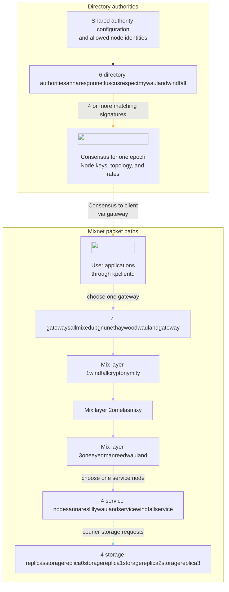

This network uses the [Namenlos configuration](https://github.com/katzenpost/kno/tree/main/data/networks/namenlos/.generated).
Six dirauths require four matching signatures.
Packet routes use one gateway, one mix per layer, and one service node.
Only allowed nodes with enough votes enter the consensus. [Prerequisites](#22-prerequisites) distinguish configured counts from publication minimums.

<!-- Source baseline: Katzenpost v0.0.107, commit 6f6b13d4524ec2da68ca3ba18fefe4a181af8a04.
Namenlos parameters, node names, and fixed topology: kno 7a7a7e66dd3dbcb964409df251a169b3cba2dc12. -->

## History

This protocol continues the [original Katzenpost PKI design](/docs/specs/pki), described in [KATZMIXPKI](/docs/specs/references#KATZMIXPKI).
That design already used configured authorities, node allow-lists, and a majority-signed consensus.
The post-quantum hybrid protocol adds new key schemes, encodings, node roles, and voting phases.

## Conventions

The [glossary](/docs/specs/glossary) defines shared terms.
MUST, MUST NOT, SHOULD, SHOULD NOT, and MAY have the meanings in [RFC 2119](https://www.rfc-editor.org/rfc/rfc2119).
[Reference tables](#field-and-encoding-reference) and [requirements](#requirements) appear in linked appendices.

<a id="the-current-post-quantum-design"></a>

<a id="the-v00107-protocol"></a>

<a id="directory-protocol"></a>

## The post-quantum hybrid protocol

The [network configuration](#network-and-consensus) fixes membership and keys.
In each [voting round](#the-voting-round), dirauths agree on a consensus of [signed directory data](#signed-data-formats).
Participants exchange that data over [authenticated connections](#connections-and-messages) under the [security requirements](#227-security-considerations).

### Network membership and node roles {#network-and-consensus}

Configured authority keys define which directory authorities a participant trusts.
The authorities' shared allow-lists define which other nodes can enter the consensus.

#### Node roles {#24-roles-keys-and-schemes}

The [node roles](#reference-4-1) include gateways, which connect clients to the mixnet. Mixes relay packets through layers, and service nodes host application endpoints. Storage replicas support [Pigeonhole](/docs/specs/pigeonhole).
The topology groups mixes into ordered layers.
Node keys follow the [cryptographic schemes](#directory-key-schemes).


#### Prerequisites {#22-prerequisites}

Clients need a usable consensus to reach mixnet services under the [network prerequisites](#reference-2-1). Authorities can publish that consensus only when the network requirements are met.

All parties in a network MUST use the same [epoch duration](#29-time), [cryptographic schemes](#directory-key-schemes), and [packet geometry](#r-26-2).

`Layers` is the configured number of mix layers.
`MinNodesPerLayer` is the minimum configured mix count per layer.

At startup and reload, an authority MUST require at least `Layers * MinNodesPerLayer` configured mixes, one gateway, and one service node.
A fixed topology MUST also meet `MinNodesPerLayer` in each layer.
At signing, every mix layer MUST be non-empty. At least one gateway and one service node MUST remain ([R-16-6](#r-16-6)).

One authority cannot complete [voting](#217-phase_cert-voting-certificates), which needs at least two contributors.
Let `A` be the number of configured authorities.
Publication requires `floor(A/2)+1` matching signatures ([threshold](#r-26-1)).
Replica requirements depend on the storage service ([Pigeonhole](/docs/specs/pigeonhole)).

Namenlos configures six authorities, seven mixes across three layers, four gateways, four service nodes, and four storage replicas.
Its fixed layers contain two, two, and three mixes.


#### Client software and configuration {#28-client-software-and-configuration}

Applications on one host SHOULD share one local kpclientd daemon through the [thin_client interface](/docs/specs/thinclient#library_daemon).

kpclientd fetches the consensus through a configured gateway.
It MUST verify the consensus before use.
The [client configuration](#reference-8-1) supplies gateway pins and the authority verification keys.
The [Namenlos configurations](https://github.com/katzenpost/kno/tree/main/data/networks/namenlos/.generated/configs) give example values.

#### Mixnet services {#23-services}

A mixnet service provides an application endpoint on a service node. Clients use an accepted consensus to find the mixnet service and select a route to it.

A service node lists its [mixnet services](#reference-3-1) in its descriptor's [Kaetzchen field](#descriptor-field-reference).
Each entry names a capability and a client endpoint.
Clients reach the service through the mixnet without revealing their network addresses to it.
Authorities copy Kaetzchen into the consensus under [R-5-9](#r-5-9). Mixnet services have no separate descriptor.

The [courier service](/docs/specs/pigeonhole) forwards requests to Pigeonhole storage replicas.
Couriers and replicas can fetch the consensus directly from authorities.

### Epochs and timing {#epochs-and-timing}

Epoch boundaries set deadlines for uploads, votes, and publication.
Each consensus names the epoch it describes.

#### Constants and notation {#21-constants-and-notation}

Each consensus covers one fixed-length time period, called an epoch.
The current epoch has a number, denoted `N`. Each epoch has the same duration, denoted `P`.
`T` is the instant that epoch `N` starts. Elapsed time is `t = now - T`.
An authority prepares a document for a voting epoch, denoted `V`.
In a normal round, the voting epoch is the next epoch: `V = N+1`.

The [notation reference](#reference-1-1) gives definitions and [Namenlos](https://github.com/katzenpost/kno/tree/main/data/networks/namenlos/.generated) example values.

#### Time {#29-time}

The network divides time into epochs. Every participant MUST use the same epoch length and starting point.

Epoch 0 starts at `Z = 2017-06-01 00:00:00 UTC`.
Epoch `N` starts at `Z + N*P`. The next epoch starts at `Z + (N+1)*P`.
`P` ranges from 2 minutes to 7 days, with a default of 1200 seconds. [R-9-3](#r-9-3) defines how a
party selects `P`. Namenlos leaves `EpochDuration` unset, which selects the default unless the environment overrides it.

Phase boundaries scale with `P`. [operation defaults](#formats-and-validation) indexes operation defaults and fixed time values.

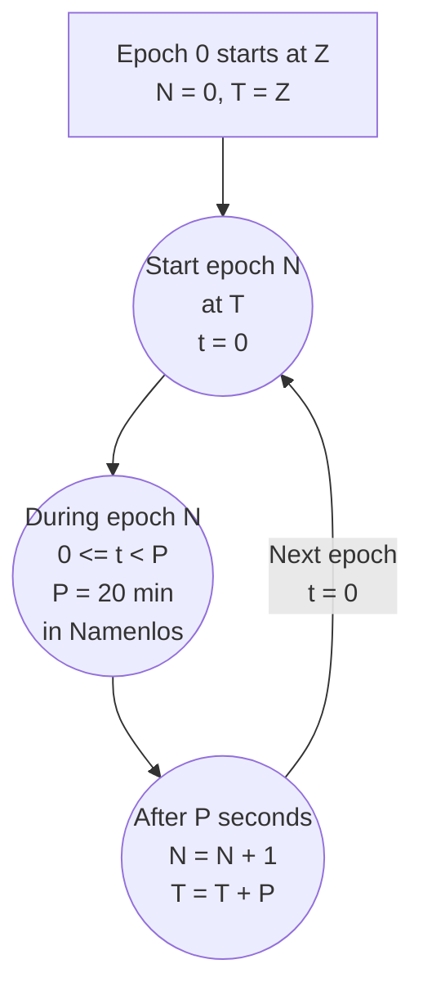

An epoch includes its start and excludes its end. The exact end boundary belongs to the next epoch.
The clock also gives `till`, the time until the next epoch.
At an absolute instant now at or after `Z`, the [epoch clock](https://github.com/katzenpost/katzenpost/blob/v0.0.107/core/epochtime/time.go#L75-L88) is:



```
N       = floor((now - Z) / P)
T       = Z + N * P
t       = now - T
till    = P - t
```



[Requirements R-9-1 through R-9-6](#requirements-9).

### Directory objects and signatures {#signed-data-formats}

Nodes announce their keys in descriptors. Authorities exchange signed proposals and publish a signed consensus.
Producers MUST use canonical [Concise Binary Object Representation (CBOR)](#cbor-encoding-reference).
Receivers MUST apply the [decoding rules](#receiver-decoding).

#### Descriptors {#25-descriptors}

A descriptor announces one node's identity, addresses, and keys. The node signs its upload so authorities can verify who sent it.

Mixes, gateways, and service nodes post a MixDescriptor. Storage replicas post a ReplicaDescriptor.

##### Descriptor fields

A node announces its identity, addresses, keys, and role in the [descriptor fields](#descriptor-field-reference). Its role determines the required fields.

An authority keeps SoftwareVersion and ContactInfo only when [Server].AcceptDescriptorMetadata is true, which defaults to false.
Otherwise, it removes both fields after signature verification, before validation, storage, voting, and comparison.


##### Upload encoding and signatures

Mix servers and storage replicas use different upload structures. Each structure binds the descriptor to the node's signature.

The upload types are [SignedUpload](https://github.com/katzenpost/katzenpost/blob/v0.0.107/core/pki/descriptor_impl.go#L55-L64)
and [SignedReplicaUpload](https://github.com/katzenpost/katzenpost/blob/v0.0.107/core/pki/descriptor_impl.go#L197-L203).
[LoopStats](/docs/specs/mixdecoy#uploading-stats-to-dirauths) contains MixIdentityHash (32 bytes or null), Epoch (uint64), and SegmentRatios (64-byte segment ID to float64).
To verify a signature, the authority decodes the upload, sets Signature to null, and re-encodes it canonically.
The consensus preserves these descriptor encodings.

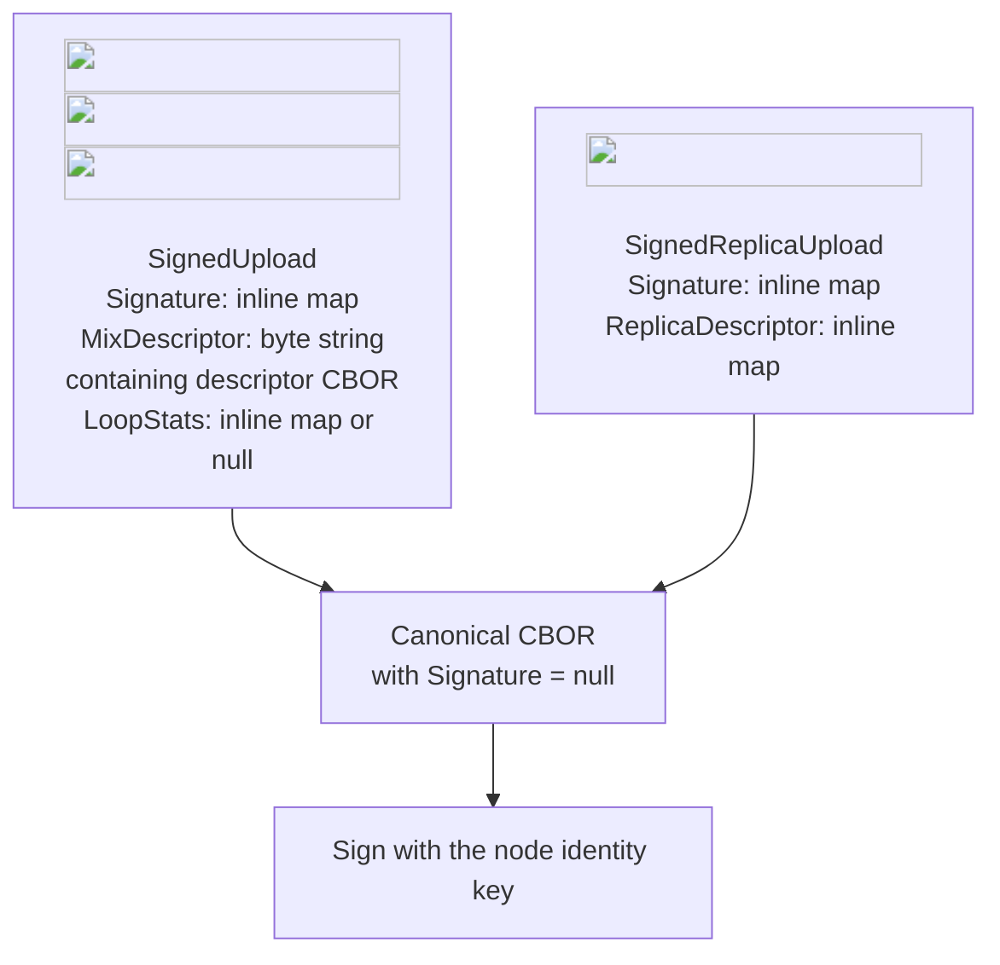

##### Validation stages

Authorities verify an upload before they admit its descriptor. Consumers also parse keys when they use them.

The [upload handler](https://github.com/katzenpost/katzenpost/blob/v0.0.107/authority/voting/server/wire_handler.go#L735-L818)
parses the identity key and verifies the signature and session binding.
[Descriptor validation](https://github.com/katzenpost/katzenpost/blob/v0.0.107/core/pki/descriptor.go#L131-L180)
verifies names, addresses, roles, and the current mix key.
An upload receiver accepts empty future mix-key values, but their indexes MUST remain within NumMixKeys.
Replica uploads require a non-empty envelope-key map with non-empty values. Upload validation imposes no replica-epoch window.
Consumers parse other keys when they use them. Authorities verify retained metadata at upload.

Length and parsing alone do not establish that a public key is non-degenerate.
The [X25519 parser](https://github.com/katzenpost/hpqc/blob/v0.0.93/nike/x25519/ecdh.go#L128-L135)
and [X448 parser](https://github.com/katzenpost/hpqc/blob/v0.0.93/nike/x448/x448.go#L264-L272) require the scheme's public-key length.
Sphinx rejects an all-zero derived shared secret during packet construction and unwrapping
([construction](https://github.com/katzenpost/katzenpost/blob/v0.0.107/core/sphinx/sphinx.go#L152-L172),
[unwrapping](https://github.com/katzenpost/katzenpost/blob/v0.0.107/core/sphinx/sphinx.go#L350-L356)).
CTIDH parsing also rejects the base curve E0 and verifies supersingularity.

[Requirements R-5-1 through R-5-11](#requirements-5).

#### Votes and voting certificates {#directory-voting-objects}

A [vote](#document-construction) is an authority's signed proposal for the next consensus.
It contains node announcements, traffic rates, notices, and a commitment to a random contribution.

A [commitment](#215-phase_vote-phase_reveal-commit-and-reveal) fixes the contribution before its reveal.
A reveal opens that commitment so peers can verify the contribution.

A [voting certificate](#document-construction) carries a tallied document and the matched signed commitment/reveal pairs the sender holds.
Peers use these certificates to reconcile contributions before computing the [shared random value](#218-phase_sig-shared-random-value-and-topology).

#### The consensus document {#26-the-consensus-document}

The consensus describes the network for one epoch. Nodes and clients use it to select peers and apply shared settings.

A consensus lists allowed nodes whose descriptors receive enough votes ([R-16-2](#r-16-2)).
It records the full configured set only for replicas.
A consumer MUST NOT infer other configured node sets from it. Missing nodes can have failed to upload.

##### Traffic rates

Traffic rates control packet frequency and mix delays. Authorities vote on the rates that the consensus publishes.

A [traffic rate](#traffic-rate-reference) measures events per millisecond. Its inverse is the mean waiting time in an exponential distribution.
Rates use float64 values.
[R-16-3](#r-16-3) tallies five rates. [R-16-8](#r-16-8) derives LambdaG.
The [mixing strategy](/docs/specs/mixnet#mixing-strategy) defines how these rates control traffic.
Authority configuration replaces zero with 0.00025 for each voted rate and rejects negative values.
It does not test finiteness ([defaults and validation](https://github.com/katzenpost/katzenpost/blob/v0.0.107/authority/voting/server/config/config.go#L44-L170)).


##### Signed document fields

The consensus stores the network description in one signed body. Votes and voting certificates use the same document structure.

The [Document structure](https://github.com/katzenpost/katzenpost/blob/v0.0.107/core/pki/document.go#L88-L175)
defines the [signed fields](#document-field-reference).
[Document validation](https://github.com/katzenpost/katzenpost/blob/v0.0.107/core/pki/document.go#L552-L710)
verifies them in votes, voting certificates, and the consensus.

Full document validation rejects duplicate identities across Topology, GatewayNodes, and ServiceNodes, but not StorageReplicas.
An empty PriorSharedRandom is valid only when GenesisEpoch equals Epoch.
Consumer validation differs by fetch path ([gateway consensus transfer](#gateway-consensus-transfer)).

The decoder treats null and absent keys as empty.
An encoder MUST preserve the distinctions in the [field reference](#document-field-reference).

Votes supply five rates, descriptors, and notices.
Reconciled commit/reveal pairs supply the shared random value (SRV), which seeds automatic topology assignment.
Epoch is `V`. [R-18-7](#r-18-7) to [R-18-9](#r-18-9) define genesis and history.
LambdaG, geometry hash, scheme, and configured replicas come from local configuration and MUST agree across authorities.
Signatures remain outside the body in its [certificate envelope](#27-certificate-envelopes-and-signing).
Descriptor nesting follows [upload encoding](#upload-encoding-and-signatures). Commit/reveal map values contain serialized certificate envelopes.

[R-6-5](#r-6-5) limits mixing delays. SafetyCap is 27632 milliseconds at Mu = 0.001 and 110525 at Mu = 0.00025.
Debug.DisableServicePreDelay disables the service-node hold. The authority's [Notice] table defaults to empty.

##### Deterministic CBOR

Producers MUST encode equal data as identical bytes. Deterministic CBOR defines the encoding that every participant uses.

Producers MUST encode descriptors, documents, and certificate envelopes with [deterministic CBOR](#cbor-encoding-reference).

[Requirements R-6-1 through R-6-7](#requirements-6).

#### Keys and schemes {#directory-key-schemes}

Identity signatures authenticate directory data. Link and Sphinx keys protect different parts of mixnet communication.

Nodes and authorities have identity signing keys and link [key encapsulation mechanism (KEM)](/docs/specs/wireprotocol#key-encapsulation-mechanism) keys.
Mix servers also have [Sphinx keys](/docs/specs/sphinx#sphinx-packet-creation) per epoch.
Replicas have envelope [non-interactive key exchange (NIKE)](/docs/specs/glossary#nike) keys per [replica epoch](/docs/specs/pigeonhole#epochs).
Sphinx uses [NIKE](/docs/specs/sphinx) or [KEM](/docs/specs/kemsphinx#kemsphinx_introduction) keys.
Every network uses the same replica envelope scheme. Parties MUST configure matching [schemes](#reference-4-2).
[Signature scheme details](#signature-scheme-reference) give component sizes and platform defaults.
The [Namenlos profile](#baseline-crypto-profile) defines the deployed byte formats.

#### Certificate envelopes and signing {#27-certificate-envelopes-and-signing}

A certificate envelope holds data and the signatures that authenticate it. Several authorities can sign the same data.

##### Envelope fields

The envelope separates the payload from its signatures. Authorities can add signatures without changing the payload.

A [certificate envelope](/docs/specs/certificate#document-format) holds a payload and its signatures.
The [implementation](https://github.com/katzenpost/katzenpost/blob/v0.0.107/core/cert/cert.go#L61-L99) defines five fields:

- Version, a uint32 that is 0
- Expiration, an epoch
- KeyType, the scheme name
- Certified, a byte string containing the payload bytes
- Signatures, a map from signer hash to PublicKeySum256 and Payload

Producers MUST use canonical CBOR and the configured signature scheme name.
[Receiver decoding](#receiver-decoding) and [envelope verification](#envelope-validation) define accepted encodings and signature verification.
The decoded envelope Version MUST be zero. KeyType MUST be nonempty and forms part of the signed message.
The document schema has a separate Version field, "v1".

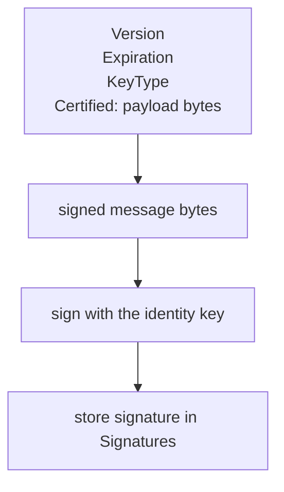

Certified contains document CBOR, a raw 40-byte commit/reveal, or one CBOR cert.Signature for sig commands.
Descriptor uploads use [separate structures](#upload-encoding-and-signatures).

##### Signature input

Every signature covers the same four envelope fields. The signature map itself remains outside that input.

The [signed message](https://github.com/katzenpost/katzenpost/blob/v0.0.107/core/cert/cert.go#L133-L152) concatenates four fields with no separator and no length prefix:

```
signed_message = LE_uint32(Version)
              || LE_uint64(Expiration)
              || KeyType, the UTF-8 bytes of the scheme name
              || Certified
```

[Requirements R-7-1 through R-7-7](#requirements-7).

#### Byte identity {#226-byte-identity}

Authorities can combine signatures only when they build identical consensus bytes. Shared encoding, ordering, and configuration make this possible.

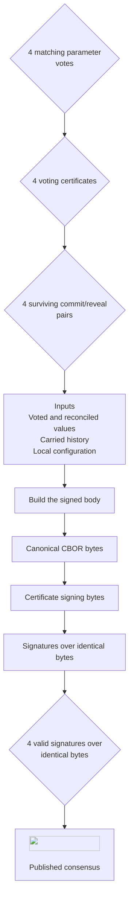

Namenlos has `A = 6`. The general threshold is `floor(A/2)+1`.
[Document inputs](#signed-document-fields), [CBOR](#deterministic-cbor), [signature input](#signature-input),
SRV ordering and wire encoding MUST produce identical bytes. Different configuration or history can prevent signatures from combining.

[Requirements R-26-1 through R-26-8](#requirements-26).

### A successful voting round {#the-voting-round}

Nodes announce their keys for the next epoch.
In a successful round, dirauths agree on one signed consensus.
Clients fetch it through gateways and verify it before use.

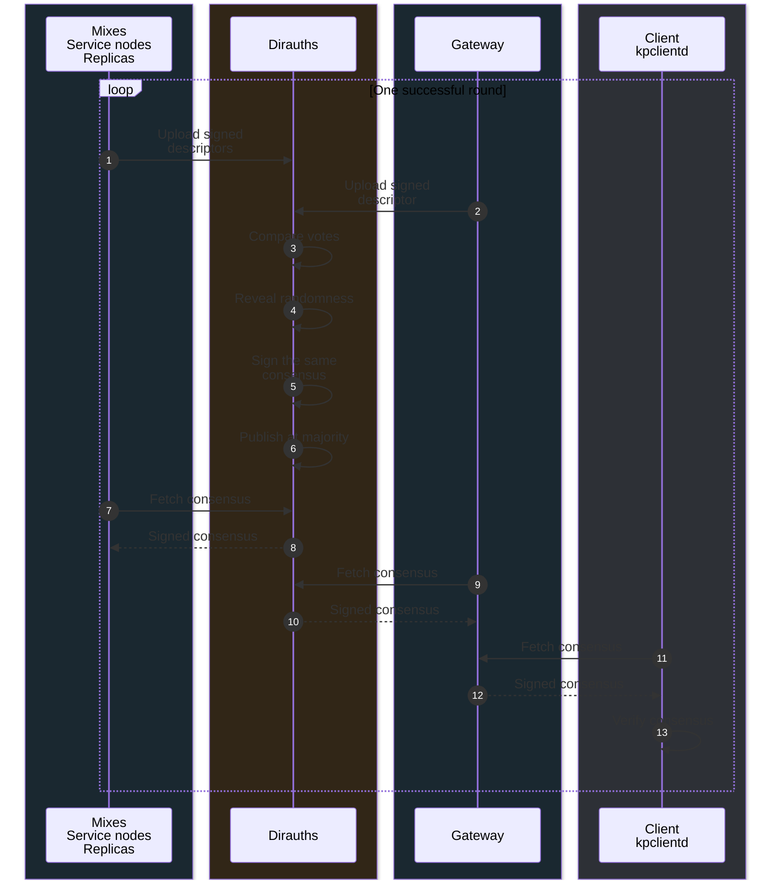

#### Phases {#210-phases}

Each voting round follows a fixed schedule. Different phases collect node announcements, exchange votes, and publish the next consensus.

The [authority state machine](https://github.com/katzenpost/katzenpost/blob/v0.0.107/authority/voting/server/state.go#L255-L454)
starts each phase's sends and computations at its boundary.
The diagram uses `P = 1200 seconds`. Its times are offsets after `T`.
Phase fractions measure elapsed time from `T` as a share of `P`.

[Authority phases](#reference-10-1), [node uploads and fetches](#reference-10-2).

Fetch retries follow [R-10-9](#r-10-9) to [R-10-11](#r-10-11). The descriptor upload rules are in [R-10-3](#r-10-3).

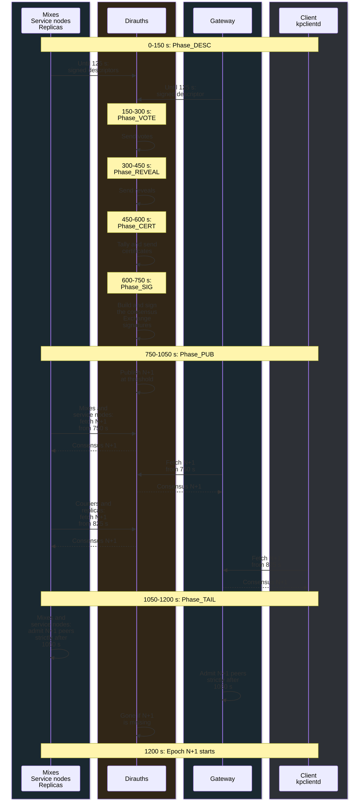

Each send window starts at its phase boundary and ends according to [R-10-1](#r-10-1) and [R-10-8](#r-10-8).

[Requirements R-10-1 through R-10-14](#requirements-10).

#### Phase_DESC. Descriptor upload {#214-phase_desc-descriptor-upload}

Nodes MUST attempt descriptor uploads to [every configured authority](https://github.com/katzenpost/katzenpost/blob/v0.0.107/authority/voting/client/client.go#L764-L782).
Retries MAY omit authorities that already accepted that descriptor.
Nodes MAY fetch a consensus from any configured authority.

Nodes send signed announcements with [post_descriptor or post_replica_descriptor](#directory-command-reference).
After [upload validation](#upload-validation), the authority applies the [descriptor storage rules](#upload-storage).
It compares an existing descriptor before it tests whether it voted or published.

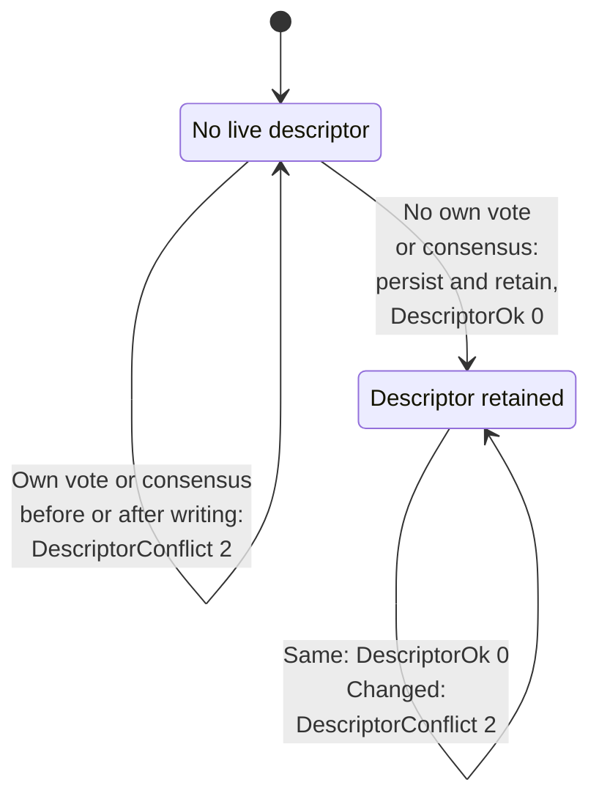

An authority MUST serialize uploads per node identity across epochs. Different identities MAY proceed concurrently.
DescriptorInternalError triggers an uploader retry. A failure to persist the upload is fatal to the authority.
DescriptorInvalid, DescriptorForbidden, and DescriptorConflict are final for that authority, as is a strict QUIC pin mismatch ([R-24-11](#r-24-11)).
[R-14-10](#r-14-10) defines durable storage before acknowledgment.

[Requirements R-14-1 through R-14-10](#requirements-14).

#### Phase_VOTE, Phase_REVEAL. Commit and reveal {#215-phase_vote-phase_reveal-commit-and-reveal}

Authorities exchange random contributions in two steps. Each authority commits to a value before it reveals that value.

With `RN` a 32-byte random value and `H = BLAKE2b-256`, each [commit or reveal](https://github.com/katzenpost/katzenpost/blob/v0.0.107/core/pki/sharedrandom.go#L37-L56) is 40 bytes:



```
RN     = 32 bytes from the random source
REVEAL = BE_uint64(epoch) || H(RN)
COMMIT = BE_uint64(epoch) || H(REVEAL)
```



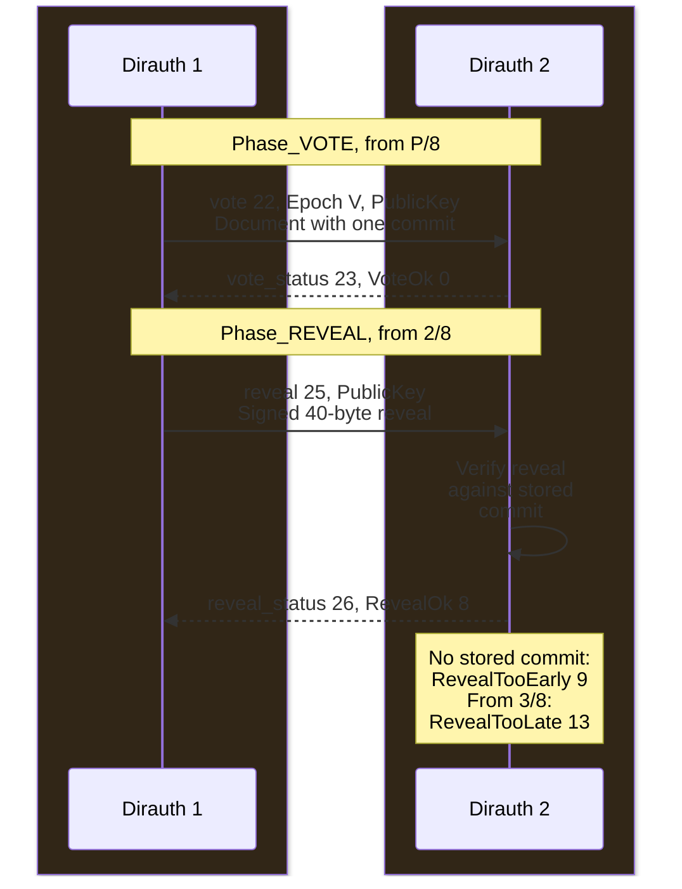

[R-15-8](#r-15-8) prevents an authority from contributing a late commit during the reveal phase.
Without this restriction, it could observe other reveals before deciding whether to contribute its own committed value.

[Requirements R-15-1 through R-15-8](#requirements-15).

#### Phase_CERT, Phase_SIG. Tabulation {#216-phase_cert-phase_sig-tabulation}

Each authority counts votes for node announcements and traffic settings. Only results with enough matching votes enter the consensus.

The [tally](https://github.com/katzenpost/katzenpost/blob/v0.0.107/authority/voting/server/state.go#L1536-L1684)
compares descriptor and parameter bytes. [R-16-3](#r-16-3) keeps signed zeros separate and groups NaNs.
History comes from the prior consensus, not a vote tally. [R-16-6](#r-16-6) separates startup provisioning from per-epoch topology usability.

[Requirements R-16-1 through R-16-8](#requirements-16).

#### Phase_CERT. Voting certificates {#217-phase_cert-voting-certificates}

Authorities exchange certificates that summarize the contributions they received. Other authorities verify this evidence before they compute the shared random value.

A voting certificate contains the tallied document and commit/reveal pairs in a signed [envelope](#27-certificate-envelopes-and-signing).
Authorities send it between the reveal and signature phases.
The [receiver](https://github.com/katzenpost/katzenpost/blob/v0.0.107/authority/voting/server/state.go#L2259-L2387)
verifies voting certificates before it computes the SRV.

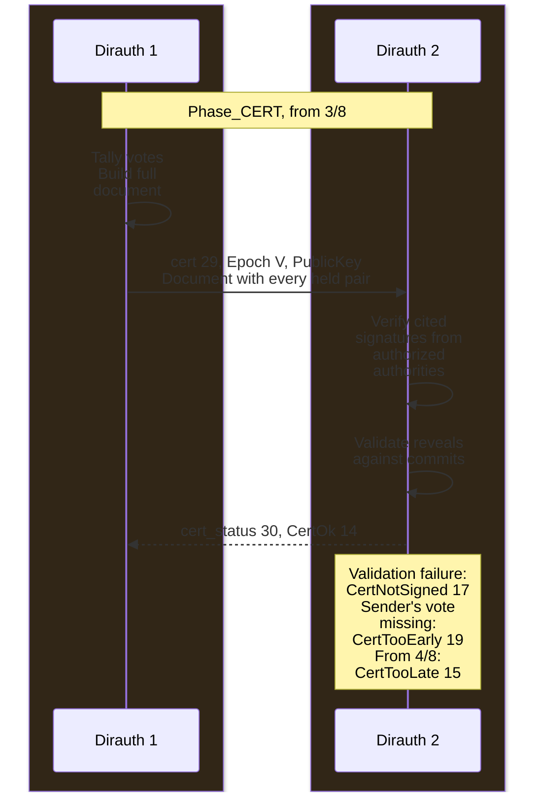

Document validation treats exactly one commit as a vote and rejects a reveal alongside it.
A certificate built from matched commitments and reveals needs at least two pairs to pass validation.
The [zero-commit receiver case](#document-validation) does not inspect reveals. A one-authority network cannot complete this phase.
An authority sends no voting certificate if its tally lacks a usable topology or it has exactly one pair.
It still advances to the next phase.

[Reconciliation](https://github.com/katzenpost/katzenpost/blob/v0.0.107/authority/voting/server/state.go#L991-L1019) compares complete serialized commit and reveal certificate envelopes, after signature verification.
Equal 40-byte payloads do not establish envelope equality. Differences in signatures or other envelope bytes can produce a conflict.
[R-6-1](#r-6-1) permits an additional signature during individual-envelope verification. It does not change the equality comparison during reconciliation.
The SRV calculation uses the extracted 40-byte reveal, not its envelope.

[Requirements R-17-1 through R-17-9](#requirements-17).

#### Phase_SIG. Shared random value and topology {#218-phase_sig-shared-random-value-and-topology}

Authorities combine verified random contributions into one shared value. This value controls automatic mix placement and links the round to the previous round.

The authority needs at least a [threshold of voting certificates](#r-18-4) before [reconciliation](#ordered-reconciliation).
It needs the same threshold of surviving commit/reveal pairs before it computes the SRV.
The epoch in this calculation is the voting epoch `V`.
`H` is BLAKE2b-256 and `PREV` is the previous epoch's SRV or 32 zero bytes.
The authority computes the [shared random value](https://github.com/katzenpost/katzenpost/blob/v0.0.107/authority/voting/server/state.go#L1687-L1739) as follows:

```
SRV = H( "shared-random"
      || BE_uint64(epoch)
      || identity_hash(1) || reveal(1)
      || ...
      || identity_hash(k) || reveal(k)
      || PREV )
```

Each reveal is the 40-byte certified payload of that authority's signed reveal. [R-18-2](#r-18-2)
gives the order of the k pairs.

The [Namenlos authority config](https://github.com/katzenpost/kno/blob/cb7f35159d25374316acd73698f0c5174355c5f9/data/networks/namenlos/.generated/configs/annares-pq-authority.toml#L344-L368)
pins three fixed layers.
With gateways configured, document construction requires a fixed Topology.
Omitting it reaches a nil topology during [LambdaG calculation](https://github.com/katzenpost/katzenpost/blob/v0.0.107/authority/voting/server/server.go#L133-L150).
The [automatic assignment subroutine](#2181-the-topology-draw) defines automatic layer placement.
An empty resulting layer prevents signing.

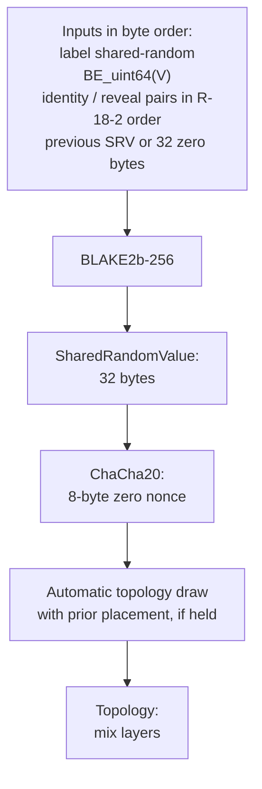

[Requirements R-18-1 through R-18-10](#requirements-18).

The [topology draw](#2181-the-topology-draw) and [layer assignment](#layer-assignment) define the complete automatic placement algorithms.

#### Phase_SIG, Phase_PUB. Signatures and publication {#219-phase_sig-phase_pub-signatures-and-publication}

Each authority signs the consensus it built. Matching signatures let the authorities publish that document for the network.

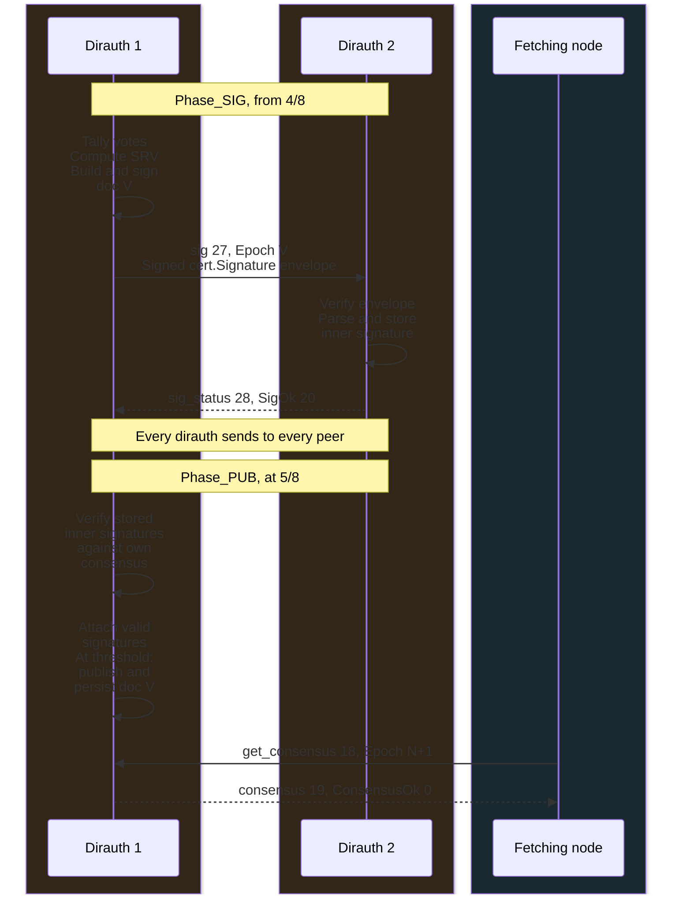

[Requirements R-19-1 through R-19-4](#requirements-19).

### Receiver states, failures, and retention {#receiver-states-and-retention}

Receiver state controls message acceptance. Epoch windows limit how long documents and keys remain usable.

#### The authority state machine {#212-the-authority-state-machine}

After startup or restart, an authority enters bootstrap to select its voting epoch.
Each authority runs the same sequence of voting steps. Timers move the authority from one step to the next.
If processing misses a deadline, the next timer fires immediately. Remaining phases run in sequence.
If an action panics, the authority recovers and retries that state after one second.

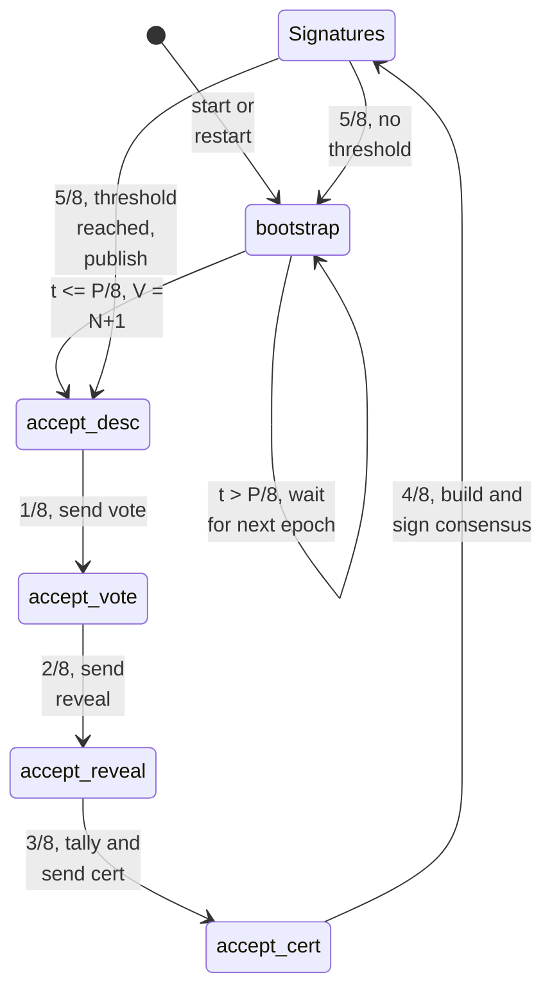

[Requirements R-12-1 through R-12-5](#requirements-12).

#### Acceptance windows and status codes {#213-acceptance-windows-and-status-codes}

An authority accepts messages only for the round it is processing. Response codes tell a sender whether to retry or stop.

An authority can publish consensus `N` during the preceding epoch, `N-1`.
Its scheduled publication time is `T - 3*P/8`, before epoch `N` starts.
After successful publication, it advances `V` to `N+1` and can accept votes and commits for that voting epoch.

Vote, reveal, cert, and sig handlers use `V` and [authority state](#212-the-authority-state-machine) to decide [acceptance](#reference-13-1).
They do not compare elapsed time.
Handlers evaluate phase and duplicate status only for messages at epoch `V`.
Vote, voting certificate, and signature handlers verify the command's Epoch field.
The reveal handler verifies the epoch in the signed payload and ignores the command's Epoch field.

After building its voting certificate, an authority can still accept a valid vote for the consensus tally until it enters the [signature state](#212-the-authority-state-machine).
Its existing voting certificate does not change.
NotFound permits a retry. Gone is final for `N+1` and past epochs.
A courier also retries Gone for its current epoch.

[Requirements R-13-1 through R-13-3](#requirements-13).

#### Clocks and retention {#211-clocks-and-retention}

Authorities manage [clock and retention settings](#reference-11-2) outside this protocol. Operators SHOULD keep clocks within a few seconds of UTC.
The [timing margins](#reference-11-1) depend on delivery time, retries, and successful preceding phases.
They are not clock synchronization targets.

A reveal, detached-signature envelope, or commit for `N+1` passes expiration verification only through the receiver's epoch `N`.
A document, vote, or voting certificate for `N` remains unexpired through epoch `N+4`.
Other validation rules still apply.


The [replica clock](https://github.com/katzenpost/katzenpost/blob/v0.0.107/replica/common/time.go#L14-L33) gives `RE = floor((now - Z) / 604800 seconds)`, independently of `P`.
A client MAY adjust its clock from the gateway handshake.

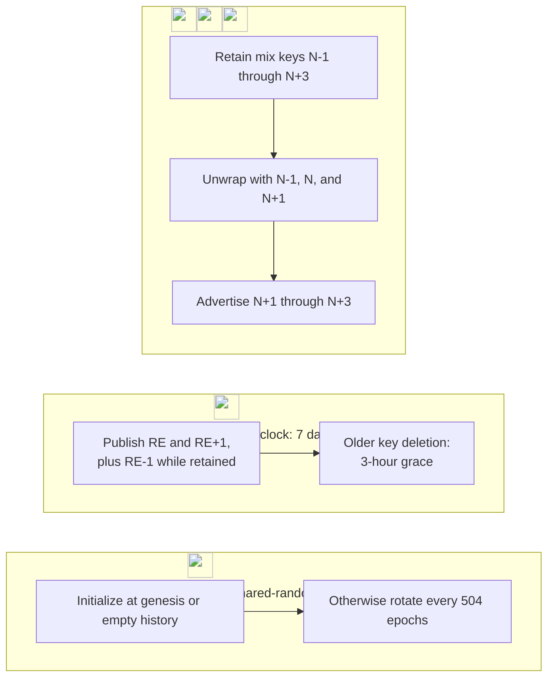

504 epochs equal seven days only at `P = 1200 seconds`. Replica epochs do not scale with `P`.

[Requirements R-11-1 through R-11-6](#requirements-11).

### Connections and messages {#connections-and-messages}

Directory commands travel over encrypted links. Each connection also applies peer authorization and resource limits.

#### Transport layers {#220-transport-layers}

Directory commands carry signed CBOR objects directly over PQ Noise, outside Sphinx packets.
The [direct consensus reply](#direct-consensus-reply) gives the directory encoding and link records.
PQ Noise protects each connection over TCP or QUIC.

[Descriptor map keys and URL schemes](#transport-address-reference) select transports and address protocols.
The mix server's [address conversion](https://github.com/katzenpost/katzenpost/blob/v0.0.107/server/internal/pki/pki.go#L1228-L1284)
places tcp:// IPv4 addresses under tcp4 and tcp:// IPv6 addresses under tcp6.


Mix-server dialing selects map keys tcp4, tcp6, and quic
([transport selectors](https://github.com/katzenpost/katzenpost/blob/v0.0.107/core/pki/document.go#L447-L473)).
A tcp entry alone cannot provide a mix-server destination.
Replicas instead preserve the lowercased URL scheme as the descriptor map key
([replica conversion](https://github.com/katzenpost/katzenpost/blob/v0.0.107/replica/pkiworker.go#L99-L108)).
Their outgoing connections use ClientTransports, which includes tcp
([replica dialing](https://github.com/katzenpost/katzenpost/blob/v0.0.107/replica/outgoing_conn.go#L218-L228)).
Upload validation accepts more URL schemes than mix servers publish ([R-5-6](#r-5-6)).

Authorities use configured address lists, not descriptors. Their listeners accept tcp:// and quic:// URLs only
([listeners](https://github.com/katzenpost/katzenpost/blob/v0.0.107/authority/voting/server/server.go#L273-L312)).
Mixes, gateways, and service nodes MUST advertise a reachable tcp4 or tcp6 entry.
Replicas MUST advertise a reachable tcp entry. Authorities MUST advertise a reachable tcp:// endpoint.
A dialer uses QUIC only with the peer's pinned QUIC key hash ([QUIC transport](#224-quic-transport)).

PQ Noise carries commands over each transport. An authority PKI session carries one
command and one reply unless configuration enables persistent peer connections ([R-22-15](#r-22-15)).
kpclientd uses a persistent gateway session for packets, replies, and consensus retrieval
([connection loop](https://github.com/katzenpost/katzenpost/blob/v0.0.107/client/connection.go#L585-L615)).


An authority MUST accept only commands allowed for the sender's role. It MUST drop others without reply ([R-23-4](#r-23-4)).

#### Wire protocol {#222-wire-protocol}

A command carries one request or response. PQ Noise encrypts each command and its length before it sends them.

Commands travel over the [PQ Noise link](/docs/specs/wireprotocol#core-protocol):
pattern PqXX, ChaChaPoly, BLAKE2b-512, the
configured KEM and a one-byte prologue 0x03. The [handshake profile](/docs/specs/wireprotocol#pq-handshake-profile) defines its four flights. The responder MUST send NoOp as its first transport command.
Each command uses two encrypted Noise transport messages in the
[data-transfer phase](/docs/specs/wireprotocol#data-transfer-phase).
The first encrypts the four-byte big-endian command-ciphertext length. Its tag makes this header 20 bytes.
The second encrypts the command with a separate 16-byte tag. The length includes the second tag.
Each endpoint MUST rekey the affected direction after both encrypted messages
([sender](https://github.com/katzenpost/katzenpost/blob/v0.0.107/core/wire/session.go#L615-L643),
[receiver](https://github.com/katzenpost/katzenpost/blob/v0.0.107/core/wire/session.go#L707-L739)).

Before encryption, a command has a 6-byte header,
`command_id (1) || reserved (1, zero) || BE_uint32(body_length)`, and a body. PublicKey
is the sender's full marshaled identity key. The [command reference](#directory-command-reference) defines each Payload type.

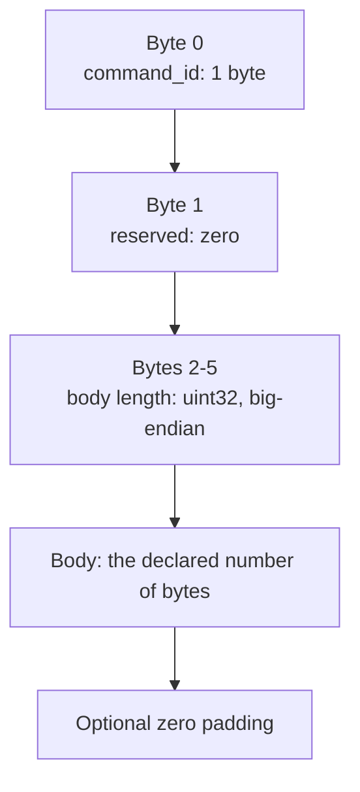

The [wire session](https://github.com/katzenpost/katzenpost/blob/v0.0.107/core/wire/session.go#L811-L816)
selects the Noise primitives. Noise uses [BLAKE2b-512](https://github.com/katzenpost/nyquist/blob/v0.0.13/hash/hash.go#L124-L136).
The directory's `H` is BLAKE2b-256.
The [command encoders](https://github.com/katzenpost/katzenpost/blob/v0.0.107/core/wire/commands/pki_commands.go)
define the bodies and [command constants](https://github.com/katzenpost/katzenpost/blob/v0.0.107/core/wire/commands/constants.go#L61-L65)
define their IDs.

[Direct authority fetchers](#reference-20-1) send empty additional data to identify an unauthenticated client.
kpclientd's gateway handshake carries a generated queue identifier and keeps the session open.

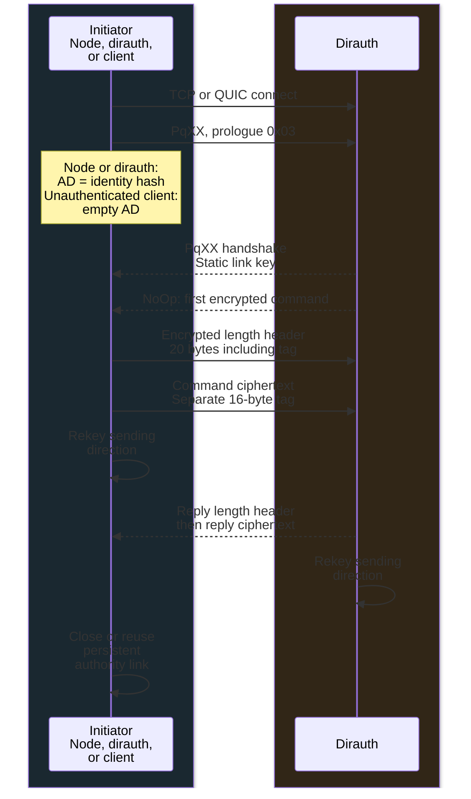


##### Gateway consensus transfer

Clients fetch the consensus through their gateway connection. The gateway compresses the document and sends it in chunks.

kpclientd MUST fetch the consensus through a configured gateway with get_consensus2.
It uses its existing gateway connection. On success, the
gateway gzip-compresses the signed consensus envelope and sends consensus2 chunks
numbered 0 through ChunkTotal-1. The chunk capacity comes from the connection's
configured packet geometry. An error uses one empty chunk, ChunkNum 0 and ChunkTotal 1,
with the consensus status code below
([gateway handler](https://github.com/katzenpost/katzenpost/blob/v0.0.107/server/internal/incoming/incoming_conn.go#L491-L549)).

The client MUST verify [chunk order, totals, and sizes](https://github.com/katzenpost/katzenpost/blob/v0.0.107/core/pki/chunking.go#L18-L132) before it decompresses the envelope.
It MUST verify the [authority signature threshold, requested epoch, and local geometry](https://github.com/katzenpost/katzenpost/blob/v0.0.107/client/connection.go#L689-L735) before using the consensus.
Chunks carry one document. Gateway commands have separate padding and size bounds from [direct authority sessions](#receive-size-ceiling).

The direct authority fetcher also calls IsDocumentWellFormed before accepting a consensus
([fetch validation](https://github.com/katzenpost/katzenpost/blob/v0.0.107/authority/voting/client/client.go#L1611-L1646)).
kpclientd's gateway path uses Deserialize to verify the signature threshold and decode the document
([Deserialize](https://github.com/katzenpost/katzenpost/blob/v0.0.107/authority/voting/client/client.go#L1650-L1657)).
It also verifies epoch and geometry, but does not call IsDocumentWellFormed
([client verification](https://github.com/katzenpost/katzenpost/blob/v0.0.107/client/pki.go#L438-L539)).


A client reports [Gone](#reply-status-code-reference) only when replies from queried authorities make a signing threshold impossible.
With fewer Gone replies, it can retry.

##### Receive size ceiling

A size ceiling bounds the largest directory command a receiver accepts. The default ceiling depends on network size and cryptographic sizes.

[R-22-17](#r-22-17) uses [EstimateConsensusSize](https://github.com/katzenpost/katzenpost/blob/v0.0.107/core/pki/consensus_size.go#L56-L83).
The ceiling bounds the command ciphertext, including its 16-byte tag. The encrypted 20-byte length header is separate.
Let sign and sig be the PKI scheme's public-key and signature sizes. Let link, sphinx
and envelope be the public-key sizes of the wire KEM, Sphinx scheme, and replica NIKE.
Let nodes, replicas, and authorities be their counts.

```
mix      = sign + link + 3 * sphinx + 4096
replica  = sign + link + 3 * envelope + 4096
unsigned = 8192 + nodes * mix + replicas * replica
signed   = unsigned + authorities * (sig + 96)
                   + 2 * authorities * (sig + 96 + 40)
ceiling  = min(500000000, max(262144, 2 * signed))
```

The factor 3 counts per-epoch keys. The 4096 and 8192 allowances cover names, addresses,
service data and framing. The 96 covers the signature key hash and framing. The 40
counts a shared-random value. The second authority term includes commit and reveal
envelopes in a voting certificate. The final factor 2 provides headroom.

An authority uses its configured counts of mixes, gateways, service nodes, replicas, and
authorities. Before its first consensus, a client [uses 64 nodes and 16 replicas](https://github.com/katzenpost/katzenpost/blob/v0.0.107/authority/voting/client/client.go#L145-L153).
A configured MaxConsensusSize above zero replaces the calculated ceiling for that party.

[Requirements R-22-1 through R-22-18](#requirements-22).

#### Authentication and authorization {#223-authentication-and-authorization}

Authorities distinguish configured nodes from unauthenticated clients. Each role has its own permitted commands.

The [authority listener](https://github.com/katzenpost/katzenpost/blob/v0.0.107/authority/voting/server/wire_handler.go)
authorizes peers by role. [Gateway clients](https://github.com/katzenpost/katzenpost/blob/v0.0.107/client/connection.go#L440-L452) use a separate path.
Allow-lists map identity hashes to names, adding ReplicaID for replicas and a pinned link key for authorities.
Lookup order is mix/gateway/service, authority, then replica.
Unauthenticated fetchers, including couriers and replicas, send empty additional data and a fresh random link key.
[R-23-7](#r-23-7) permits unpinned nodes to upload. Their identity signature and session-key binding remain mandatory.

[Requirements R-23-1 through R-23-7](#requirements-23).

#### Authority message delivery {#221-authority-message-delivery}

Authorities send each voting message to every peer. A retry loop handles temporary failures while the voting schedule continues.

<a id="221-vote-delivery"></a>

All four message families use one [retry loop](https://github.com/katzenpost/katzenpost/blob/v0.0.107/authority/voting/server/state.go#L1100-L1182).
Default backoff starts at 10 ms. A 3-second cap applies before 0.2 jitter, so delays can approach 3.6 seconds
([calculation](https://github.com/katzenpost/katzenpost/blob/v0.0.107/core/retry/retry.go#L50-L65)).
Phase sends use the deadline, with an additional retry cap when PeerRetryMaxAttempts is positive.
[Bootstrap](https://github.com/katzenpost/katzenpost/blob/v0.0.107/authority/voting/server/state.go#L3327-L3333) defaults to 20 retries plus the initial attempt.
After a bounded wait, the loop can start an attempt without testing the deadline again.
The state machine advances independently of delivery.
A peer needs the sender's vote and commit before it can accept the reveal.

[Requirements R-21-1 through R-21-4](#requirements-21).

#### QUIC transport {#224-quic-transport}

A node or authority MAY listen on QUIC as well as TCP.
PQ Noise authenticates the peer over one QUIC stream. QUIC also requires a pinned TLS key.
The dialer MUST compare SHA-256 of the certificate's SubjectPublicKeyInfo with QUICKeyHash.
For nodes, the hash comes from the descriptor. Authorities use configured hashes.
Before its first consensus, a client uses its configured gateway hash.

Mixes, service nodes, and replicas rotate TLS keys each epoch. Each key comes from a random Ed25519 seed in DataDir/quic.
Gateways with QUIC listeners and authorities keep one long-term key in DataDir/quic-tls.key.
The authority's -g option writes this key and quic-tls.hash. TCP-only authorities neither read nor create the key file.

The [QUIC configuration](#formats-and-validation) supplies defaults for ALPN, CurvePreferences, AddressValidation, KeepAlivePeriod, KeepAliveJitter, PinMismatch, and CloseLinger.

[Requirements R-24-1 through R-24-15](#requirements-24).

#### Connection bounds and operation {#225-connection-bounds-and-operation}

One listener carries descriptor uploads, voting, and consensus retrieval. The listener applies [connection limits](#connection-limit-reference) and deadlines before and after the handshake.


An authority MUST refuse connections above a nonzero pool cap before the handshake.
Each epoch, it updates the peer pool from consensus and configured authority addresses. A failed refresh keeps the previous set.
A panic in one connection handler MUST NOT stop the authority. Persistent authority connections default to off.

Stored state carries a schema version. An authority MUST refuse to start if that version differs from the expected version.
It MUST also refuse to start unless its configured authority list contains its own identity and link key.

An operator MAY reload the authorized node set. Every authority MUST reload the same set in the same epoch, or their votes disagree.
An authority MUST reject a reload that would fail startup validation ([R-16-6](#r-16-6)) and keep the old set.

#### Mixnet packet paths {#mixnet-packet-paths}

[Sphinx packets](/docs/specs/sphinx#sphinx-packet-creation) protect routing information and payloads through successive hops.
For a client forward path, Namenlos uses a gateway, three mixes, and a service node.
Each relay removes one Sphinx layer and forwards the packet over a separately authenticated [PQ Noise link](/docs/specs/wireprotocol#core-protocol).

```mermaid
flowchart TB
    %% panel: layers
    accTitle: Protocol encapsulation
    accDescr: A client-to-gateway PQ Noise connection carries a send_packet command over TCP/IP or QUIC/UDP/IP. The command contains a Sphinx packet with five concentric protection layers around the data. The outer layer belongs to the gateway, followed by three mixes and the service node. Each receiving hop removes its Sphinx layer. Each forwarded packet uses the next neighbor link's independent encryption. Namenlos uses five hops, 3082-byte packets, and up to 2000 bytes of user payload.
    PACKET@{img: "/docs/specs/dirauth/sphinx-layers.svg", label: "", w: 244, h: 453, constraint: "on"}
    PACKET -->|"gateway decrypts link command"| UNWRAP["<br/>Gateway removes its<br/>Sphinx layer"]
    UNWRAP -->|"four Sphinx layers remain"| FORWARD["<br/>Gateway forwards to Mix 1<br/>over their own PQ Noise link"]
    class PACKET local
    class UNWRAP,FORWARD link
```

The [forward path](https://github.com/katzenpost/katzenpost/blob/v0.0.107/core/sphinx/path/path.go#L146-L199)
selects these five hops from the consensus.
Sphinx protection spans the route. PQ Noise protects only one neighbor connection.
Sphinx packets retain their configured length as each hop unwraps them.
The [Sphinx packet format](/docs/specs/sphinx#the-sphinx-cryptographic-packet-structure) defines the byte layout.

### Security considerations {#227-security-considerations}

Clients trust the configured authority keys. A threshold of authorities can sign a network view that clients accept.

- Any two signing quorums overlap in at least 2*threshold - A authorities.
  With a simple majority, this minimum is two for even A and one for odd A.
  Quorum intersection prevents conflicting signed consensuses only if the overlap exceeds
  the number of dishonest authorities and honest authorities sign once per epoch.
  At A = 3 or A = 5, one dishonest signer can belong to both quorums.
  A simple majority cannot guarantee agreement with two dishonest authorities, regardless of A.
  Crash and omission faults do not create conflicting signed consensuses if honest authorities sign once per epoch.
- Verified conflicting commits or reveals exclude their signer from the SRV calculation only ([R-17-4](#r-17-4)).
  A dishonest authority can still send different descriptor sets to different peers and prevent matching consensus bytes.
- Authorities with different PriorSharedRandom rules can sign different bytes at multiples of 504.
  Only a group with threshold matching signatures can publish its document.
- Nodes can authenticate peers with descriptors from `N`, `N-1`, and `N-2`.
  A superseded link key can remain valid for up to three epochs while the current consensus still lists that node.
  Removing a node from all authority allow-lists prevents its inclusion in later consensuses.
  Nodes reject its older descriptors when they apply a current consensus that omits it
  ([authentication](https://github.com/katzenpost/katzenpost/blob/v0.0.107/server/internal/pki/pki.go#L979-L1062)).
  A key listed only in `N+1` becomes eligible strictly after 7/8 of `N` ([R-11-2](#r-11-2)).
  A peer key that cannot be marshaled MUST fail authentication without stopping the node.
- A consensus records accepted descriptors, not live node availability.
  Clients can select a failed node from a cached document and lose packets sent to it.
  An [absent descriptor](#26-the-consensus-document) can mean a missing upload, insufficient votes, or removal from the allow-lists.
- A mix creates a Sphinx key pair for each epoch and removes expired keys.
  The [key manager](https://github.com/katzenpost/katzenpost/blob/v0.0.107/server/internal/mixkeys/mixkeys.go#L124-L198) maintains this window.
  Forward secrecy depends on erasing expired private keys, including any copies.
  Epoch changes also limit the lifetime of the [replay cache](/docs/specs/packetreplay#epoch-boundaries).
- A node retains peer connections while the peer remains authorized by the applicable documents ([R-11-2](#r-11-2)).
  Authentication and permission to send can change at an epoch boundary.
- Five authorities require three signatures. Six require four. Both configurations
  can publish with two authorities unavailable, but not three.
  Quorum overlap determines agreement when authorities sign conflicting documents.
- Without node link-key pinning ([authentication and authorization](#223-authentication-and-authorization)) anyone could present a node's identity hash, hold
  its per-identity slots and keep it from uploading.
- With fresh authority connections and no retries, each send phase can require A*(A-1) peer handshakes.
  Retries can increase this count. HandshakeTimeoutSec defaults to 3 seconds.
  Persistent authority connections can reduce the count ([connection bounds and operation](#225-connection-bounds-and-operation)).

<a id="appendix-b-formats-and-validation"></a>

## Appendix A. Formats and validation {#formats-and-validation}

Producers MUST encode CBOR objects using [CDDL](/docs/specs/dirauth/dirauth.cddl).
Command and transport-record encodings MUST follow [ABNF](/docs/specs/dirauth/wire.abnf). [Encoding and validation rules](#requirements) also govern canonical bytes, signatures, authorization, and epoch acceptance.

<div class="key-value-table">

| Key | Value | Explanation |
| --- | --- | --- |
| Fields | [Descriptors](#descriptor-fields), [documents](#signed-document-fields), [envelopes](#envelope-fields), CDDL | Field names, types, null, and omission |
| Byte identity | [R-6-3](#r-6-3), [signature input](#signature-input), [R-26-2](#r-26-2) through [R-26-8](#r-26-8), [conformance vectors](#conformance-and-vectors) | Canonical byte identity |
| Key validation | [R-5-1](#r-5-1) through [R-5-4](#r-5-4), [R-14-2](#r-14-2) through [R-14-8](#r-14-8), [R-23-6](#r-23-6) | Key sizes, parsing, and identity/session binding |
| Descriptor fields | [R-5-5](#r-5-5) through [R-5-11](#r-5-11) | Names, roles, addresses, services, and metadata |
| Network configuration | [prerequisites](#22-prerequisites), [R-16-6](#r-16-6), [R-26-1](#r-26-1) | Authority configuration and topology minima |
| Time | [time](#29-time) through [acceptance windows and status codes](#213-acceptance-windows-and-status-codes), [R-18-8](#r-18-8), [R-18-9](#r-18-9) | Clock, phase, expiry, and retention windows |
| Wire protocol | [wire protocol](#222-wire-protocol), ABNF | Receive ceiling, command fields, and status values |
| Retries | [authority message delivery](#221-authority-message-delivery), [R-22-18](#r-22-18) | Retries and operation budgets |
| QUIC | [QUIC transport](#224-quic-transport), option limits below | QUIC pinning, streams, rotation, and options |
| Connections | [connection bounds and operation](#225-connection-bounds-and-operation) | Connection pools, handlers, identity slots, and first-command deadline |

</div>

Configuration defaults and limits come from
[authority configuration](https://github.com/katzenpost/katzenpost/blob/v0.0.107/authority/voting/server/config/config.go#L40-L220)
and [QUIC options](https://github.com/katzenpost/katzenpost/blob/v0.0.107/quic/common/options.go#L20-L164).

<div class="key-value-table">

| Key | Value | Explanation |
| --- | --- | --- |
| Mu, LambdaP, LambdaL, LambdaM, LambdaR | 0.00025 | Zero selects the default. Negative values fail configuration validation. Finiteness is not tested. |
| `Layers` / `MinNodesPerLayer` | 3 / 2 | Values at most zero select the defaults. `Layers` above 3 fail. [R-16-6](#r-16-6) defines provisioning minima. |
| AcceptDescriptorMetadata / Notice | false / empty |  |
| AllowHostnameAddresses | false | Authority URL addresses require IP literals, except onion URLs. Metrics addresses require IP literals too ([policy](https://github.com/katzenpost/katzenpost/blob/v0.0.107/core/utils/addr.go#L60-L132)). |
| PeerRetryBaseDelay / PeerRetryMaxDelay / PeerRetryJitter | 10 ms / 3 s / 0.2 | Zero selects the defaults. Jitter follows the delay cap. |
| QUIC ALPN | h3 | Empty selects the default. Maximum 255 bytes. |
| QUIC KeepAlivePeriod / KeepAliveJitter | 45 s, or 20 s for clients / 0.25 | The period MUST be non-negative. Jitter MUST be at least 0 and less than 1. |
| QUIC CloseLinger / PinMismatch / AddressValidation | 30 s / fallback / always | 0 / empty / empty select the defaults. Negative linger fails. Other modes follow [R-24-11](#r-24-11) and [R-24-14](#r-24-14). |
| QUIC CurvePreferences | TLS defaults | Empty selects the defaults. No duplicate or unknown names. |

</div>

TLS curve names are X25519, X25519MLKEM768, SecP256r1MLKEM768, SecP384r1MLKEM1024, CurveP256, CurveP384, and CurveP521.
These local settings do not replace network-wide scheme agreement.

Let M be the positive decompressed limit. Set C = M + 18 + 5 * (floor(M/16384) + 2).
The [dechunker](https://github.com/katzenpost/katzenpost/blob/v0.0.107/core/pki/chunking.go#L57-L132) requires:

- Sequential chunk numbers starting at zero, with one constant total between 1 and C.
- A non-empty first payload of size S and total at most ceil(C/S).
- Every non-final payload exactly S bytes, and the final payload between 1 and S bytes.
- At most C compressed bytes and M decompressed bytes.

Error responses use a [single empty chunk](#gateway-consensus-transfer) instead. Signature, epoch, and geometry verification follow reassembly.

<a id="appendix-c-existing-tla-models"></a>

## Appendix B. Existing TLA+ models {#formal-models}

Katzenpost includes TLA+ models for authority voting, node state, key retention, and client retransmission.

<div class="key-value-table">

| Key | Value | Explanation |
| --- | --- | --- |
| VotingAuthority | [VotingAuthority.tla](https://github.com/katzenpost/katzenpost/blob/v0.0.107/authority/voting/tla/VotingAuthority.tla), [guide](https://github.com/katzenpost/katzenpost/blob/v0.0.107/authority/voting/tla/README.md) | Voting, quorum agreement, equivocation, and chained epochs. |
| MixNode | [MixNode.tla](https://github.com/katzenpost/katzenpost/blob/v0.0.107/server/tla/MixNode.tla), [guide](https://github.com/katzenpost/katzenpost/blob/v0.0.107/server/tla/README.md) | Packet processing and scheduler state. |
| MixKeys | [MixKeys.tla](https://github.com/katzenpost/katzenpost/blob/v0.0.107/server/tla/MixKeys.tla), [guide](https://github.com/katzenpost/katzenpost/blob/v0.0.107/server/tla/README.md) | Key retention, replay state, and restart. |
| ClientARQ | [ClientARQ.tla](https://github.com/katzenpost/katzenpost/blob/v0.0.107/client/tla/ClientARQ.tla), [guide](https://github.com/katzenpost/katzenpost/blob/v0.0.107/client/tla/README.md) | Retransmission and connection changes. |

</div>

<a id="appendix-d-field-and-encoding-reference"></a>

## Appendix C. Field and encoding reference {#field-and-encoding-reference}

Descriptors and consensus documents carry node identities, network parameters, and cryptographic material. Their encodings determine the signed bytes.

### Directory formation overview {#directory-formation-overview}

Nodes submit descriptors, and authorities reconcile contributions before signing a consensus.

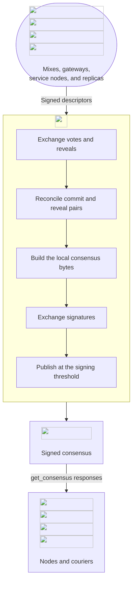

The [network map](#namenlos-network-map) includes all configured node roles.


### Descriptor fields {#descriptor-field-reference}

Mixes, gateways, and service nodes use [MixDescriptor](https://github.com/katzenpost/katzenpost/blob/v0.0.107/core/pki/descriptor.go#L32-L88).
Storage replicas use [ReplicaDescriptor](https://github.com/katzenpost/katzenpost/blob/v0.0.107/core/pki/descriptor.go#L268-L297).

Required fields describe producer output.
[Receiver decoding](#receiver-decoding), [descriptor validation](#descriptor-validation), and [upload validation](#upload-validation) define acceptance of missing fields and alternate encodings.

<div class="key-value-table">

| Key | Value | Explanation |
| --- | --- | --- |
| Name | text | Required in both types. |
| Epoch | uint64 | Required in both types. |
| IdentityKey | byte string | Required in both types. |
| LinkKey | byte string | Required in both types. |
| MixKeys | map from uint64 to byte string | Required in MixDescriptor. Maps epochs to keys. |
| EnvelopeKeys | map from uint64 to byte string | Required in ReplicaDescriptor. Maps replica epochs to keys. |
| Addresses | map from text to a list of text | Required in both types. Maps transports to addresses. Replicas cannot advertise onion addresses. |
| Kaetzchen | map from text to a map from text to any | MixDescriptor, null when unset. Service nodes only ([R-5-9](#r-5-9)). |
| KaetzchenAdvertizedData | map from text to a map from text to any | MixDescriptor, null when unset. |
| IsGatewayNode | boolean | Required in MixDescriptor. |
| IsServiceNode | boolean | Required in MixDescriptor. |
| LoadWeight | uint8 | Required in MixDescriptor. Reserved. |
| AuthenticationType | text | Required in MixDescriptor. Gateways use ["tofu"](https://github.com/katzenpost/katzenpost/blob/v0.0.107/server/internal/pki/pki.go#L729-L735), other nodes use empty text. |
| Version | text | MixDescriptor only. The standard producer emits empty text. Receivers also accept other text, including "v0". ReplicaDescriptor omits this field. |
| ReplicaID | uint8 | Required in ReplicaDescriptor. |
| SoftwareVersion | text | Both types, omitted when empty. Retained only under AcceptDescriptorMetadata ([R-5-11](#r-5-11)). |
| ContactInfo | text | Both types, omitted when empty. Retained only under AcceptDescriptorMetadata ([R-5-11](#r-5-11)). |
| QUICKeyHash | byte string | Both types, omitted when empty. Zero to three 32-byte hashes ([QUIC transport](#224-quic-transport)). |

</div>

### Traffic rates {#traffic-rate-reference}

Consensus traffic rates control packet delays and transmission frequency.

<div class="key-value-table">

| Key | Value | Explanation |
| --- | --- | --- |
| Mu | 0.001 | Per-hop delay rate. |
| LambdaP | 0.001 | Client send rate, with drop decoys when its queue is empty. |
| LambdaL | 0.0005 | Client loop decoy rate. |
| LambdaM | 0.0005 | Mix loop decoy rate. |
| LambdaR | 0.02 | Courier and replica decoy rate. |
| LambdaG | derived ([R-16-8](#r-16-8)) | Gateway loop decoy rate. |

</div>

### Signed document fields {#document-field-reference}

The document body contains the topology, traffic rates, and signed directory contributions.

<div class="key-value-table">

| Key | Value | Explanation |
| --- | --- | --- |
| Epoch | unsigned integer | Required. |
| GenesisEpoch | unsigned integer | Required, nonzero. |
| Mu, LambdaP, LambdaL, LambdaM, LambdaR | float | Required. |
| LambdaG | float | Required. |
| Topology | array of arrays of byte strings | Required. One entry per layer, mixes only. An empty layer is null, valid only in a vote. |
| GatewayNodes, ServiceNodes | array of byte strings | Required, [] when empty. |
| StorageReplicas | array of descriptor maps | Required, [] when empty. |
| ConfiguredReplicaIDs | byte string | Omitted when empty. |
| ConfiguredReplicaIdentityKeys | array of byte strings | Omitted when empty. |
| SharedRandomCommit | map from a 32-byte string to a byte string | Consensus: null. Vote: one commit. Voting certificate: each available commit/reveal pair. |
| SharedRandomReveal | map from a 32-byte string to a byte string | Consensus and vote: null. Voting certificate: each available commit/reveal pair. |
| SharedRandomValue | byte string | Required, 32 bytes. All zero in votes and voting certificates ([shared random value and topology](#218-phase_sig-shared-random-value-and-topology)). |
| PriorSharedRandom | array of byte strings | Required. Two history values, rotated every 504 epochs. [] in a vote without history ([shared random value and topology](#218-phase_sig-shared-random-value-and-topology)). |
| SphinxGeometryHash | byte string | Required. BLAKE2b-256 of canonical Sphinx geometry. |
| Version | text | Required, "v1". |
| PKISignatureScheme | text | Required. |
| MinClientVersion, ClientNotice | text | Omitted when empty. |

</div>

### Transport addresses {#transport-address-reference}

Descriptor address maps select link transports and endpoint URLs.

<div class="key-value-table">

| Key | Value | Explanation |
| --- | --- | --- |
| tcp4 | tcp://, Namenlos: every mix, gateway, and service node | TCP over IPv4 for mixes, gateways, and service nodes |
| tcp6 | tcp://, Namenlos: some mixes, gateways, and service nodes | TCP over IPv6 for mixes, gateways, and service nodes |
| tcp | tcp://, Namenlos: every storage replica | TCP for storage replicas. Also a client transport selector |
| quic | quic://, Namenlos: none | QUIC over UDP, with a pinned TLS key ([QUIC transport](#224-quic-transport)) |
| onion | onion://, Namenlos: one gateway | gateway endpoint for clients through Tor |
| ws | ws://, Namenlos: none | additional client transport selector |

</div>

### Directory commands {#directory-command-reference}

Directory peers exchange descriptors, votes, reveals, certificates, and signatures through numbered wire commands.

<div class="key-value-table">

| Key | Value | Explanation |
| --- | --- | --- |
| get_consensus | ID 18. BE_uint64(Epoch) | Sent by client, mix, gateway, service node, authority. A replica and a courier send it as clients ([authentication and authorization](#223-authentication-and-authorization)) |
| consensus | ID 19. ErrorCode (1) \|\| Payload: consensus certificate envelope on success | Sent by authority, gateway |
| post_descriptor | ID 20. BE_uint64(Epoch) \|\| Payload: SignedUpload CBOR | Sent by mix, gateway, service node |
| post_descriptor_status | ID 21. ErrorCode (1) | Sent by authority |
| post_replica_descriptor | ID 11. BE_uint64(Epoch) \|\| Payload: SignedReplicaUpload CBOR | Sent by replica |
| post_replica_descriptor_status | ID 10. ErrorCode (1) | Sent by authority |
| vote, reveal, cert, sig | ID 22, 25, 29, 27. BE_uint64(Epoch) \|\| PublicKey \|\| Payload: certificate envelope | Sent by authority |
| vote_status, reveal_status, cert_status, sig_status | ID 23, 26, 30, 28. ErrorCode (1) | Sent by authority |
| get_consensus2 | ID 32. BE_uint64(Epoch), upstream padded | Sent by kpclientd to gateway |
| consensus2 | ID 31. ErrorCode (1) \|\| BE_uint32(ChunkNum) \|\| BE_uint32(ChunkTotal) \|\| Payload, downstream padded | Sent by gateway to kpclientd |
| get_vote | ID 24. reserved |  |

</div>

### Connection limits {#connection-limit-reference}

Limits bound message sizes, timeouts, connection pools, and concurrent handlers.

<div class="key-value-table">

| Key | Value | Explanation |
| --- | --- | --- |
| PKI message ceiling when not derived | 2 MiB | Fallback ceiling. |
| receive chunk | 64 KiB | Maximum chunk size. |
| handshake, receive, and send deadlines | 3 seconds, 30 seconds, 30 seconds | Operation deadlines. |
| persistent-connection idle | 2 minutes | Idle timeout. |
| accept pools by source address: client, peer, loopback | 1024 each | 0 means unlimited. |
| per-address cap in the client and peer pools, IPv6 by /64 | 64 | Client and peer pool limit, with IPv6 grouped by /64. |
| concurrent handlers | 64 | A client runs only below half of them, and never blocks. |
| connections per proven identity | 8 | Per-identity connection limit. |
| first-command deadline | 5 seconds | Time to receive the first command. |
| hostname resolution per lookup | 2 seconds | A party never resolves an onion address. |

</div>

### Signature schemes {#signature-scheme-reference}

Ed25519 Sphincs+ concatenates an Ed25519 signature and a SPHINCS+ signature. Ed25519 has a 32-byte
public key and a 64-byte signature. SPHINCS+ runs at the sphincs-shake-256f parameter
set, with a 64-byte public key and a 49856-byte signature
([parameter selection](https://github.com/katzenpost/sphincsplus/blob/v0.0.2/ref/params.h#L3),
[sizes](https://github.com/katzenpost/sphincsplus/blob/v0.0.2/ref/params/params-sphincs-shake-256f.h#L7-L76)).
The [hybrid implementation](https://github.com/katzenpost/hpqc/blob/v0.0.93/sign/hybrid/hybrid.go#L137-L147)
adds the component sizes. A verifier MUST verify both
components ([verification](https://github.com/katzenpost/hpqc/blob/v0.0.93/sign/hybrid/hybrid.go#L65-L79)).
On Windows the authority default is [Ed25519 alone](https://github.com/katzenpost/katzenpost/blob/v0.0.107/authority/voting/server/config/scheme_default_windows.go#L8). A network that mixes
platforms MUST configure the same signature scheme explicitly.


### Deterministic CBOR {#cbor-encoding-reference}

[R-6-3](#r-6-3) applies these encoding requirements to descriptors, documents, and certificate
envelopes:

- Map keys MUST use the [descriptor fields](#descriptor-field-reference), [document fields](#document-field-reference), and [envelope fields](#envelope-fields). They MUST be sorted by encoded
  key length first, then bytewise. This is the canonical order of RFC 7049 section 3.9,
  retained in RFC 8949 section 4.2.6.
- Integers MUST use their shortest form. All lengths MUST be definite.
- Floats MUST use the shortest of float16, float32, and float64 that represents them
  exactly. NaN MUST be 0xf97e00. Infinities MUST use float16.
- Each field MUST be present, omitted, or null as the field tables specify. A nil map
  or list encodes as null. An empty map encodes as {}, and an empty list as []. These
  are distinct byte sequences.

RFC 8949 section 4.2.3 sorts keys bytewise without comparing length first. A library
that supports both orders MUST use the length-first order here.

### Reply status codes {#reply-status-code-reference}

A response status tells the sender whether its command succeeded or why it failed.

<div class="key-value-table">

| Key | Value | Explanation |
| --- | --- | --- |
| consensus | ConsensusOk 0, ConsensusNotFound 1, ConsensusGone 2 | [Response conditions](#213-acceptance-windows-and-status-codes). |
| descriptor | DescriptorOk 0, DescriptorInvalid 1, DescriptorConflict 2, DescriptorForbidden 3, DescriptorInternalError 4 | [Response conditions](#214-phase_desc-descriptor-upload). |
| vote | VoteOk 0, VoteTooEarly 1, VoteTooLate 2, VoteNotAuthorized 3, VoteNotSigned 4, VoteMalformed 5, VoteAlreadyReceived 6, VoteNotFound 7 | [Response conditions](#215-phase_vote-phase_reveal-commit-and-reveal). |
| reveal | RevealOk 8, RevealTooEarly 9, RevealNotAuthorized 10, RevealNotSigned 11, RevealAlreadyReceived 12, RevealTooLate 13 | [Response conditions](#215-phase_vote-phase_reveal-commit-and-reveal). |
| cert | CertOk 14, CertTooLate 15, CertNotAuthorized 16, CertNotSigned 17, CertAlreadyReceived 18, CertTooEarly 19 | [Response conditions](#217-phase_cert-voting-certificates). |
| sig | SigOk 20, SigNotAuthorized 21, SigNotSigned 22, SigTooLate 23, SigTooEarly 24, SigAlreadyReceived 25, SigInvalid 26 | [Response conditions](#219-phase_sig-phase_pub-signatures-and-publication). |

</div>

### Protocol components {#reference-0-1}

The protocol combines network configuration, voting, signed objects, and authenticated transport.

<div class="key-value-table">

| Key | Value | Explanation |
| --- | --- | --- |
| Configuration | [constants and notation](#21-constants-and-notation), [prerequisites](#22-prerequisites) | constants and prerequisites |
| Roles | [services](#23-services), [roles, keys, and schemes](#24-roles-keys-and-schemes) | services, keys, and schemes |
| Formats | [descriptors](#25-descriptors) to [certificate envelopes and signing](#27-certificate-envelopes-and-signing) | descriptors, documents, and envelopes |
| Clients | [client software and configuration](#28-client-software-and-configuration) | applications and kpclientd |
| Time | [time](#29-time) to [clocks and retention](#211-clocks-and-retention) | epochs, phases, and clocks |
| Phases | [the authority state machine](#212-the-authority-state-machine) to [signatures and publication](#219-phase_sig-phase_pub-signatures-and-publication) | the authority state machine |
| Transport | [transport layers](#220-transport-layers) to [connection bounds and operation](#225-connection-bounds-and-operation) | delivery, wire, authentication, and QUIC |
| Properties | [byte identity](#226-byte-identity), [security considerations](#227-security-considerations) | byte identity and security |

</div>

### Constants and notation {#reference-1-1}

Epoch and quorum parameters set the voting schedule and signature threshold.

<div class="key-value-table">

| Key | Value | Explanation |
| --- | --- | --- |
| `A` | 6 | Number of authorities. |
| `N` | runtime | Current epoch number. |
| `T` | `Z` + `N` * `P` | Start time of epoch `N`. |
| threshold | 4 | `floor(A/2)+1`. Matching votes or valid signatures required. |
| dissenters | 2 | `floor(A/2)-1`. Logging only, without effect on the result. |
| `P` | 1200 seconds, default | Epoch duration. `EpochDuration` is unset. |
| epoch 0 | 2017-06-01 00:00:00 UTC | Start of the first epoch. |
| `V` | `N+1` in a healthy round | Authority voting epoch. |
| `t` | 0 to less than `P` | Elapsed time in `N`. A fraction such as 5/8 means `t` = 5P/8. |
| W | 150 seconds | `P`/8. Phase width. |
| buf | 5 seconds | Authority retry-loop deadline margin, when time permits. |
| U | 125 seconds | 5P/48. Descriptor upload cutoff. |
| F | 825 seconds | 11P/16. Client, courier, and storage replica fetch time. |
| `H` | BLAKE2b-256 | Hash function. |
| identity hash | 32 bytes | `H` of the marshaled identity public key. |
| `Layers` | 3 | Number of mix layers. |
| topology mode | fixed: 2, 2, 3 | Mixes in each layer. |
| `MinNodesPerLayer` | 1 | Startup minimum per layer. |
| NumMixKeys | 3 | Sphinx key epochs per descriptor. |
| Mu | 0.001 | Per-hop mixing delay rate. |
| LambdaP | 0.001 | Client send rate. |
| LambdaL | 0.0005 | Client loop rate. |
| LambdaM | 0.0005 | Mix loop rate. |
| LambdaR | 0.02 | Courier and replica decoy rate. |
| PKISignatureScheme | Ed25519 Sphincs+ | Descriptor and directory signatures. |
| WireKEMScheme | KYBER768-X25519 | Link key KEM. |
| SphinxGeometry.NIKEName | x25519 | Sphinx mix key scheme. |
| EnvelopeScheme | CTIDH1024-X25519 | Replica envelope NIKE, fixed for every network. |
| NrHops | 5 | Hops per Sphinx path. |
| UserForwardPayloadLength | 2000 bytes | Maximum user payload. |

</div>

### Prerequisites {#reference-2-1}

A network's configuration supplies trusted authorities, allowed nodes, cryptographic schemes, and transport addresses.

<div class="key-value-table">

| Key | Value | Explanation |
| --- | --- | --- |
| Authorities | 6: annares, gnunet, luscus, respectmy, wauland, windfall | Fixed and known to every party before the first round. |
| threshold | 4 of 6 | Each round needs 4 reachable authorities in agreement, or no consensus. |
| clocks | not specified in these configs | Operators synchronize clocks under the [clock and skew rules](#211-clocks-and-retention). |
| `EpochDuration` | unset, default 1200 seconds | Select `P` under [R-9-3](#r-9-3). Runtime overrides can change it. |
| allow-lists | 7 mixes, 4 gateways, 4 service nodes, 4 replicas | Authorities MUST hold identical lists and reload them in the same epoch ([connection bounds and operation](#225-connection-bounds-and-operation)). |
| PKISignatureScheme | Ed25519 Sphincs+ | Descriptor and directory signatures ([roles, keys, and schemes](#24-roles-keys-and-schemes)). |
| WireKEMScheme | KYBER768-X25519 | PQ Noise link key KEM. |
| SphinxGeometry.NIKEName / KEMName | x25519 / empty | Selects NIKE Sphinx. |
| SphinxGeometry | 5 hops, 3082-byte packets, 2000-byte user payload | All geometry fields MUST agree ([byte identity](#226-byte-identity)). |
| link protocol | PqXX, ChaCha20-Poly1305, BLAKE2b-512, prologue 0x03 | Every party MUST use this PQ Noise protocol and the configured wire KEM ([wire protocol](#222-wire-protocol)). |
| Addresses | IPv4 TCP: all nodes and authorities. IPv6 TCP: some. | Nodes and authorities MUST publish a reachable TCP address. IPv6-only peers need IPv6 ([transport layers](#220-transport-layers)). |
| authority key pins | 6 identity and link key pairs per authority | Each authority MUST hold every authority's identity key and pin its link key, including its own ([connection bounds and operation](#225-connection-bounds-and-operation)). |
| DataDir | annares: /var/lib/katzenpost/authority/annares-pq-authority | Authorities MUST store descriptors and documents durably and stop on storage failure ([R-14-10](#r-14-10)). |

</div>

### Mixnet services {#reference-3-1}

Service nodes advertise mixnet services through the Kaetzchen descriptor field.

<div class="key-value-table">

| Key | Value | Explanation |
| --- | --- | --- |
| echo | capability echo, endpoint +echo, 4 service nodes | Returns the request payload. The ping tool uses it to test a route and measure delay. |
| courier | capability courier, endpoint courier, 3 service nodes | Forwards client read and write requests to [Pigeonhole](/docs/specs/pigeonhole) storage replicas and returns their replies. |

</div>

### Node roles {#reference-4-1}

Descriptors identify node roles and their published keys.

<div class="key-value-table">

| Key | Value | Explanation |
| --- | --- | --- |
| mix | MixDescriptor | Listed in Topology layers. |
| gateway node | MixDescriptor with IsGatewayNode | Listed in GatewayNodes. |
| service node | MixDescriptor with IsServiceNode | Listed in ServiceNodes. |
| storage replica | ReplicaDescriptor | Listed in StorageReplicas. |
| authority | none | Listed in every configuration. |

</div>

### Key schemes {#reference-4-2}

Parties use identity signatures, link KEMs, Sphinx keys, and replica envelope keys for separate tasks.

<div class="key-value-table">

| Key | Value | Explanation |
| --- | --- | --- |
| PKI signature | [Ed25519 Sphincs+](https://github.com/katzenpost/katzenpost/blob/v0.0.107/authority/voting/server/config/scheme_default.go#L11). Sizes: public key 96 bytes, private key 192 bytes, signature 49920 bytes. | signs descriptors, votes, reveals, voting certificates, and the consensus |
| wire KEM | configured, no default. Sizes: by scheme. | the KEM of the PQ Noise link key |
| Sphinx NIKE or KEM | configured, no default. Sizes: by scheme. | the scheme of a mix key |
| replica envelope NIKE | CTIDH1024-X25519, public key 160 bytes | Fixed for every network. |

</div>

### Client software and configuration {#reference-8-1}

The client daemon loads its listeners, gateway pins, and authority keys from client.toml.

<div class="key-value-table">

| Key | Value | Explanation |
| --- | --- | --- |
| thinclient.toml | Dial.Unix.Address = @katzenpost | Selects the daemon's socket through [Dial.Unix] or [Dial.Tcp]. |
| client.toml | Listen.Unix.Address = @katzenpost | Sets kpclientd's listener, pinned gateways, authority keys, cryptographic schemes, and Sphinx geometry. |

</div>

### Authority phases {#reference-10-1}

Authorities collect descriptors and exchange voting material on the epoch schedule.
The times below are fractions of the epoch duration `P`. Each phase includes its start and excludes its end.

<div class="key-value-table">

| Key | Value | Explanation |
| --- | --- | --- |
| Phase_DESC | 0 to before 1/8 | Accept descriptors for `N+1`. |
| Phase_VOTE | 1/8 to before 2/8 | Build and send the vote for `V`. |
| Phase_REVEAL | 2/8 to before 3/8 | Send the reveal. |
| Phase_CERT | 3/8 to before 4/8 | Consume reveals, tally, and send the voting certificate. |
| Phase_SIG | 4/8 to before 5/8 | Verify voting certificates, compute the SRV, tally again, sign, and send the signature. |
| Phase_PUB | 5/8 to before 7/8 | Combine signatures, publish `N+1`, and set `V` = `N+2`. |
| Phase_TAIL | 7/8 to before 1 | Answer Gone for `N+1` if no document is available. |

</div>

### Phases: Mix, gateway, service node {#reference-10-2}

Mixes, gateways, and service nodes upload next-epoch descriptors before they fetch the next consensus.

<div class="key-value-table">

| Key | Value | Explanation |
| --- | --- | --- |
| Mix, gateway, service node | 0 | Rotate keys and upload for `N+1` until U. |
| Storage replica | Until U | Upload the replica descriptor. |
| Mix, gateway, service node | 5/8 | Fetch `N+1`. |
| Replica, courier, client | F | Fetch `N+1`. |
| Mix, gateway, service node | After 7/8 | Admit `N+1` peers. |

</div>

### Clocks and retention {#reference-11-1}

Epoch windows determine key retention, document expiry, and retry timing.

<div class="key-value-table">

| Key | Value | Explanation |
| --- | --- | --- |
| authority behind a peer, for reveal, cert, sig | 145 seconds | W - buf - delivery |
| authority behind a peer, for a vote | 295 seconds, 445 seconds | 2W - buf - delivery to reach the voting certificate, 3W - buf - delivery to reach the consensus |
| authority ahead of a peer | 600 seconds | 4W for a vote. Other messages can receive TooEarly. All four families retry under [authority message delivery](#221-authority-message-delivery) |
| node behind an authority | 25 seconds | `P`/48, from U to `P`/8 |
| node ahead of an authority | 112.5 seconds | U minus `P`/96 |
| mix ahead of every authority, fetching at 5/8 | 300 seconds | 2W with retries |
| client ahead of its gateway | 75 seconds | `P`/16 minus the gateway's fetch latency |

</div>

### Clocks and retention: authority {#reference-11-2}

Authorities retain voting state and limit retries using separate timing settings.

<div class="key-value-table">

| Key | Value | Explanation |
| --- | --- | --- |
| authority | `N-3` to `N` | `N+1` from 5/8 |
| mix, gateway, service node | `N-2` to `N` | `N+1` from 5/8 |
| replica, courier | `N-2` to `N` | `N+1` from F |
| client | `N-1`, `N` | `N+1` from F |

</div>

### Acceptance windows and status codes {#reference-13-1}

Receivers use the request epoch and local state to select a response status.

<div class="key-value-table">

| Key | Value | Explanation |
| --- | --- | --- |
| descriptor | Phase_DESC of `N` receives DescriptorOk | Outside {`N-1`, `N`, `N+1`}: DescriptorInvalid. After vote construction: DescriptorConflict. Byte-identical re-upload: DescriptorOk. |
| vote | 5/8 of `N-1` to 4/8 of `N` receives VoteOk or VoteAlreadyReceived | [Epoch errors](#r-22-2). Accepted duplicate: VoteAlreadyReceived. Closed phase: VoteTooLate. |
| reveal | from the sender's vote to 3/8 receives RevealOk | [Epoch errors](#r-22-2). Accepted duplicate: RevealAlreadyReceived. Closed phase: RevealTooLate. Missing sender commit: RevealTooEarly. |
| cert | from the sender's vote to 4/8 receives CertOk | [Epoch errors](#r-22-2). Accepted duplicate: CertAlreadyReceived. Closed phase: CertTooLate. Missing sender vote: CertTooEarly. |
| sig | 5/8 of `N-1` to 5/8 of `N`: SigOk | [Epoch errors](#r-22-2). |
| GetConsensus(e), e at most `N` | held: ConsensusOk | Missing document: ConsensusGone. |
| GetConsensus(`N+1`) | from 5/8: ConsensusOk | Before 5/8: ConsensusNotFound. Missing after 7/8: ConsensusGone. |
| GetConsensus(e), e at least `N+2` | ConsensusNotFound | No acceptance window. |

</div>

### Commands by role {#reference-20-1}

The authenticated peer role determines which directory commands the receiver accepts.

<div class="key-value-table">

| Key | Value | Explanation |
| --- | --- | --- |
| kpclientd | gateway node | Commands: get_consensus2 |
| gateway node | kpclientd | Commands: consensus2 |
| unauthenticated authority client | authority | Commands: get_consensus |
| mix, gateway node, service node | authority | Commands: get_consensus, post_descriptor |
| storage replica | authority | Commands: post_replica_descriptor, and get_consensus as a client |
| courier | authority | Commands: get_consensus as a client |
| authority | authority | Commands: get_consensus, vote, reveal, cert, sig |

</div>

<a id="appendix-e-requirements"></a>

## Appendix D. Requirements {#requirements}

R-s-n identifies requirement n in group R-s.
For example, R-6-3 is the third requirement in [R-6. The consensus document](#requirements-6).

### R-5. Descriptors {#requirements-5}

Nodes publish signed [descriptors](#25-descriptors) with identity keys, addresses, and role fields.

<div class="key-value-table">

| Key | Value | Explanation |
| --- | --- | --- |
| R-5-1 | node / on build | <span id="r-5-1"></span>A producer MUST include a non-empty IdentityKey, LinkKey, each MixKeys value, and each EnvelopeKeys value required by its descriptor type. A mix upload MUST include a MixKeys value for the command epoch. |
| R-5-2 | node / on build | <span id="r-5-2"></span>Each key field MUST be exactly the public key size of its scheme. |
| R-5-3 | node / on build | <span id="r-5-3"></span>Each key field MUST parse under its scheme. |
| R-5-4 | Sphinx sender or receiver / on key use | <span id="r-5-4"></span>NIKE Sphinx MUST reject an all-zero derived shared secret. X25519 and X448 parsing alone does not reject small-order points. CTIDH parsing rejects the base curve E0, the all-zero encoding, and non-supersingular curves. Upload verification follows the [validation stages](#validation-stages). |
| R-5-5 | node / on build, on upload | <span id="r-5-5"></span>The name MUST contain [1 to 32 bytes](https://github.com/katzenpost/katzenpost/blob/v0.0.107/core/sphinx/constants/constants.go#L22-L23). This is a byte limit, not a character count. |
| R-5-6 | node / on build, authority / on upload | <span id="r-5-6"></span>A descriptor MUST list at least one transport, with no empty address list. Producers MUST use the map keys and URL schemes in [transport layers](#220-transport-layers). Upload validation MUST apply [AddressShape](#descriptor-validation). It accepts tcp, tcp4, tcp6, ws, and quic URLs if the host component permits separation into host and port. It accepts onion URLs in gateway descriptors only. This syntax rule does not require a numeric port or equality between the map key and URL scheme. |
| R-5-7 | mix / on build, authority / on upload | <span id="r-5-7"></span>A producer MUST include a mix key for its descriptor epoch and none outside the NumMixKeys window that starts there. An upload receiver MUST select that window from the command epoch, require a nonempty key for that epoch, and reject keys outside that window. It does not compare the descriptor's Epoch with the command epoch or require nonempty future key values ([descriptor validation](#descriptor-validation)). |
| R-5-8 | node / on build, on upload | <span id="r-5-8"></span>A descriptor MUST NOT set both IsGatewayNode and IsServiceNode. |
| R-5-9 | node / on build, on upload | <span id="r-5-9"></span>Only service nodes MAY carry non-null Kaetzchen. Others MUST NOT supply even an empty map. Each capability MUST have a non-empty name and a parameter map containing endpoint text of 1 to 32 bytes, [RecipientIDLength](https://github.com/katzenpost/katzenpost/blob/v0.0.107/core/pki/descriptor.go#L173-L264). Capabilities MAY share an endpoint. |
| R-5-10 | storage replica / on build, on upload | <span id="r-5-10"></span>A replica MUST publish envelope keys for `RE` and `RE+1`, plus `RE-1` when retained. These are replica epochs, independent of mixnet Epoch ([clocks and retention](#211-clocks-and-retention)). Upload verification requires a non-empty map with non-empty values, but imposes no replica-epoch window ([producer](https://github.com/katzenpost/katzenpost/blob/v0.0.107/replica/pki.go#L416-L445)). |
| R-5-11 | authority / on upload, on restore, on encode | <span id="r-5-11"></span>With AcceptDescriptorMetadata false, an authority MUST remove SoftwareVersion and ContactInfo after signature verification, before validation, in-memory storage, voting, and comparison. The persisted signed upload retains its original bytes. Otherwise, SoftwareVersion MUST contain at most 128 printable ASCII bytes and ContactInfo at most 256, in 0x20..0x7e. Producers MUST omit empty metadata fields when encoding. Invalid retained metadata MUST receive DescriptorInvalid when the ordered [upload procedure](#upload-validation) reach metadata validation. |

</div>

### R-6. The consensus document {#requirements-6}

Nodes and clients use the [consensus](#26-the-consensus-document) to select peers and apply network settings.

<div class="key-value-table">

| Key | Value | Explanation |
| --- | --- | --- |
| R-6-1 | authority / on build, on validation | <span id="r-6-1"></span>Producers MUST use BLAKE2b-256 of the signer's identity public key as each SharedRandomCommit and SharedRandomReveal map key. Each producer envelope MUST carry a valid signature by that identity. Receivers MUST apply the [document-validation algorithm](#document-validation), including its zero-commit and one-commit cases. An additional signature by another identity does not invalidate the required signature ([envelope verification](#envelope-validation)). |
| R-6-2 | authority / Phase_PUB | <span id="r-6-2"></span>A published consensus MUST carry no commits and no reveals. |
| R-6-3 | producer / on encode | <span id="r-6-3"></span>Descriptors, documents, and certificate envelopes MUST use the [deterministic CBOR encoding](#cbor-encoding-reference). [Receiver decoding](#receiver-decoding) defines acceptance and re-encoding. |
| R-6-4 | authority / on build | <span id="r-6-4"></span>Detached signatures MUST NOT be part of the signed body. |
| R-6-5 | mix, gateway, service node / on packet handling | <span id="r-6-5"></span>Before subtracting queue dwell time, forwarding nodes MUST drop packets whose advertised delay exceeds `P` * NumMixKeys. Mixes and gateways MUST drop packets whose [remaining per-hop delay](https://github.com/katzenpost/katzenpost/blob/v0.0.107/server/internal/cryptoworker/crypto_worker.go#L247-L304) exceeds the limit. With service pre-delay enabled, service nodes MUST apply that limit to the advertised last-hop delay ([delay queue](https://github.com/katzenpost/katzenpost/blob/v0.0.107/server/internal/service/predelay.go#L63-L70)). The selected cap MUST be SafetyCap(consensus Mu) when nonzero. Otherwise, it MUST be a positive configured fallback, or the built-in SafetyCap(0.001) of 27632 ms if none is positive. The final limit MUST be min(selected cap, `P` * NumMixKeys) ([selection](https://github.com/katzenpost/katzenpost/blob/v0.0.107/server/internal/maxdelay/maxdelay.go#L32-L46)). Both paths SHOULD warn if fallback or consensus caps differ from the built-in value by more than a factor of 4 ([scheduler](https://github.com/katzenpost/katzenpost/blob/v0.0.107/server/internal/scheduler/scheduler.go#L87-L91), [service](https://github.com/katzenpost/katzenpost/blob/v0.0.107/server/internal/service/service.go#L74-L75)). |
| R-6-6 | consumer / on fetch | <span id="r-6-6"></span>A consumer MUST treat a SphinxGeometryHash mismatch in a threshold-signed consensus as a failed fetch, not a fatal error. |
| R-6-7 | authority, client / at startup, Phase_CERT, Phase_SIG | <span id="r-6-7"></span>MinClientVersion MUST be at most 32 bytes and ClientNotice at most 512, both printable ASCII 0x20..0x7e. An authority MUST propose its configured pair and reject invalid startup values. It MUST tally the pair separately from rates. It MUST publish a pair present in at least threshold well-formed votes. Otherwise it MUST omit the notice without preventing consensus. It MUST log malformed vote pairs and exclude them from this tally only. Clients MUST NOT act on either field. |

</div>

### R-7. Certificate envelopes and signing {#requirements-7}

A [certificate envelope](#27-certificate-envelopes-and-signing) binds a payload to one or more identity signatures.

<div class="key-value-table">

| Key | Value | Explanation |
| --- | --- | --- |
| R-7-1 | any party / on build | <span id="r-7-1"></span>A certificate envelope MUST carry Version, Expiration, KeyType, Certified, and Signatures. |
| R-7-2 | any party / on sign, on verify | <span id="r-7-2"></span>The signed message MUST be the [signature-input concatenation](#signature-input), with little-endian integers and no length prefixes. |
| R-7-3 | any party / on verify | <span id="r-7-3"></span>A verifier MUST accept a signature only while its current epoch is less than Expiration. |
| R-7-4 | authority / on build | <span id="r-7-4"></span>A document's Expiration MUST be Epoch + 5. |
| R-7-5 | any party / on build | <span id="r-7-5"></span>A party MUST verify each signature over the same message before adding it by signer hash to a multi-signed document. |
| R-7-6 | any party / on parse | <span id="r-7-6"></span>A parser MUST reject a certificate envelope whose decoded Version is not 0. An absent or null Version decodes to 0 under the [receiver decoding rules](#receiver-decoding). Producers MUST include Version under [R-7-1](#r-7-1). |
| R-7-7 | producer, document validator / on build, on validation | <span id="r-7-7"></span>A producer MUST set document Version to "v1". Full document validation MUST reject any other value. ParseDocument alone does not enforce this requirement, and kpclientd's gateway path does not repeat it ([gateway consensus transfer](#gateway-consensus-transfer)). |

</div>

### R-9. Time {#requirements-9}

Participants use the same [epoch clock](#29-time) to select current and next-epoch data.

<div class="key-value-table">

| Key | Value | Explanation |
| --- | --- | --- |
| R-9-1 | any party / at startup | <span id="r-9-1"></span>`P` MUST be the `EpochDuration` selected by [R-9-3](#r-9-3). Epoch 0 starts at 2017-06-01 00:00:00 UTC. |
| R-9-2 | any party / at startup | <span id="r-9-2"></span>`P` MUST be a whole number of seconds from 2 minutes to 7 days. A party MUST refuse to start on any other value. |
| R-9-3 | any party / at startup | <span id="r-9-3"></span>A party MUST set `P` once per process, before any epoch arithmetic. It MUST use the configured value. Without one, it MUST use the environment value and log a deprecation warning. Without either, it MUST use the default. A party MUST refuse to start if configuration and environment values differ, or if it receives a second, different value. |
| R-9-4 | any party / always | <span id="r-9-4"></span>All parties in a network MUST use the same `P`. No document or message carries it. |
| R-9-5 | any party / always | <span id="r-9-5"></span>The epoch number `N`, elapsed time `t`, and remaining time till MUST follow the [clock formula](#29-time). The start instant belongs to the epoch. A time before epoch 0 is an error. |
| R-9-6 | authority / always | <span id="r-9-6"></span>The PriorSharedRandom rotation period MUST be 504 epochs at every `P` (one week only at 1200 seconds). |

</div>

### R-10. Phases {#requirements-10}

The [voting phases](#210-phases) schedule uploads, authority exchanges, and consensus publication.

<div class="key-value-table">

| Key | Value | Explanation |
| --- | --- | --- |
| R-10-1 | authority / every send phase | <span id="r-10-1"></span>An authority MUST calculate its retry deadline from the time until the phase boundary, treating negative time as zero. It MUST subtract buf only when more than buf remains. This deadline does not cancel in-progress attempts ([authority message delivery](#221-authority-message-delivery)). |
| R-10-2 | any party / always | <span id="r-10-2"></span>Phase boundaries MUST use the [phase fractions](#210-phases) and the acting party's clock. Each phase includes its start. Bootstrap skips the round only after `P`/8. Gone and `N+1` peer authentication apply strictly after 7/8. The sender upload cutoff U is exclusive. Authorities may accept uploads after U until vote construction ([R-10-5](#r-10-5)). Each timer MUST target its phase boundary. |
| R-10-3 | node / Phase_DESC, before `U` | <span id="r-10-3"></span>A node MUST upload its descriptor for `N+1` at or after the start of `N` and before `U`. A replica MUST retry every second. After an unsuccessful post, a node MUST post again every `P`/96 while the window is open. A DescriptorConflict from an authority that accepted an earlier attempt counts as acceptance. |
| R-10-4 | authority / Phase_VOTE, at `P`/8 | <span id="r-10-4"></span>An authority MUST build its vote for `N+1` at `P`/8 from exactly the descriptors it holds at that instant. |
| R-10-5 | authority / on upload | <span id="r-10-5"></span>After the live validation pass, an authority MUST apply the ordered [upload-storage procedure](#upload-storage). It MUST answer DescriptorConflict to a new descriptor for an epoch whose document or own vote it already holds. It MUST first compare an existing descriptor, returning DescriptorOk for the same canonical descriptor bytes and DescriptorConflict for a change. |
| R-10-6 | authority / on receive | <span id="r-10-6"></span>An authority MUST apply the state and error precedence in [message acceptance](#message-acceptance). New reveals close in accept_cert and accept_signature. New votes and voting certificates close in accept_signature. The sig handler has no state gate. The stored voting epoch controls its epoch comparisons. State-machine transitions normally place these cuts at 3/8, 4/8, and advancement of `V` at 5/8. |
| R-10-7 | authority / at 3/8, 4/8, 5/8 | <span id="r-10-7"></span>An authority MUST tally votes at 3/8 for its voting certificate and again at 4/8 for its consensus. It MUST process collected reveals at 3/8, voting certificates at 4/8, and signatures at 5/8. Each action MUST run at the corresponding state-machine wake. |
| R-10-8 | authority / every send phase | <span id="r-10-8"></span>Each authority MUST start delivery at the corresponding phase wake. Retry-deadline targets are 2/8 for votes, 3/8 for reveals, 4/8 for voting certificates, and 5/8 for signatures. [R-10-1](#r-10-1) applies the buffer. These targets do not guarantee completion before the boundary. |
| R-10-9 | mix, gateway node, service node / Phase_PUB, from 5/8 | <span id="r-10-9"></span>A mix, a gateway, or a service node MUST first request doc `N+1` at 5/8. It MUST retry every `P`/16 until it holds the document or it receives Gone. While doc `N` is missing it MUST fetch every `P`/96 until it posts its descriptor, and every `P`/16 after that. |
| R-10-10 | courier, storage replica / Phase_PUB, from F | <span id="r-10-10"></span>A courier or a replica MUST first request doc `N+1` at F, and MUST retry every `P`/32 until it holds the document or receives Gone. While doc `N` is missing it MUST fetch every `P`/32. |
| R-10-11 | client / Phase_PUB, from F | <span id="r-10-11"></span>A client MUST first request doc `N+1` from its gateway at F. It MUST retry every `P`/16 until it receives the document or Gone. While doc `N` is missing it MUST request it every `P`/16, and MUST use doc `N-1` if available. |
| R-10-12 | mix, gateway, service node, courier, replica, client / every fetch pass | <span id="r-10-12"></span>Mixes, gateways, service nodes, couriers, and replicas MUST use min(3 minutes, `P`/8) for each fetch pass. kpclientd MUST use a separate 30-second timeout per document. Authority bootstrap uses [R-12-2](#r-12-2)'s retry budget. |
| R-10-13 | mix, gateway, service node / epoch boundary | <span id="r-10-13"></span>At the start of epoch `N` these nodes MUST retain mix keys `N-1` through `N+3`. They MUST publish `N+1` through `N+3` in their descriptors. They MUST unwrap with keys `N-1`, `N`, and `N+1`. |
| R-10-14 | client / epoch boundary | <span id="r-10-14"></span>A client MUST wake at the epoch boundary and adopt doc `N+1` there, without refetching a cached document it already verified. |

</div>

### R-11. Clocks and retention {#requirements-11}

Authorities, nodes, and clients apply separate [clock and retention limits](#211-clocks-and-retention).

<div class="key-value-table">

| Key | Value | Explanation |
| --- | --- | --- |
| R-11-1 | authority / every wake | <span id="r-11-1"></span>An authority MUST drop documents older than `N-3` at every state-machine wake. |
| R-11-2 | node / on authentication, after 7/8 | <span id="r-11-2"></span>A node MUST authenticate a peer from documents `N`, `N-1`, and `N-2`, and, strictly after 7/8, from `N+1`. An incoming peer that only `N+1` lists MAY send from that instant. A node MUST evaluate an outgoing link's send permission again at the epoch boundary. |
| R-11-3 | courier, storage replica / on authentication | <span id="r-11-3"></span>A courier or replica MUST authenticate peers from documents `N-1`, `N`, and `N+1`. |
| R-11-4 | client / on clock adjustment | <span id="r-11-4"></span>A client that adjusts its clock MUST record skew = local - responder. It MUST then use local - skew. It MUST NOT apply a skew larger than `P`/8. |
| R-11-5 | authority / on build | <span id="r-11-5"></span>A signature, a commit, and a reveal MUST carry Expiration `V`. A vote, a voting certificate, and a document MUST carry Expiration Epoch + 5. |
| R-11-6 | node, client / always | <span id="r-11-6"></span>A node MUST keep documents for epochs at or above `N-2` and a client at or above `N-1`. |

</div>

### R-12. The authority state machine {#requirements-12}

Each authority advances through [voting states](#212-the-authority-state-machine) on the epoch schedule.

<div class="key-value-table">

| Key | Value | Explanation |
| --- | --- | --- |
| R-12-1 | authority / always | <span id="r-12-1"></span>The authority MUST implement the bootstrap, descriptor, vote, reveal, certificate, and signature acceptance states. The state labels identify the reference transitions. |
| R-12-2 | authority / bootstrap | <span id="r-12-2"></span>For each missing document `N-1` and `N`, an authority MUST start a background fetch with a 2-minute retry budget. The budget does not cancel an in-progress attempt. It MUST decide `V` by [R-12-4](#r-12-4) without waiting for those fetches. |
| R-12-3 | authority / Phase_PUB, at 5/8 | <span id="r-12-3"></span>At 5/8 an authority that holds a threshold-signed document MUST store doc `V`, set `V` = `V` + 1, and wake at `P`/8 of `N+1`. An authority that holds none MUST enter bootstrap, set `V` = `N+2`, and wake at the boundary. |
| R-12-4 | authority / bootstrap | <span id="r-12-4"></span>In bootstrap, at `t` of at most `P`/8, an authority MUST set `V = N+1` and wake at `P`/8. At `t` greater than `P`/8 it MUST stay in bootstrap, set `V` = `N+2`, and wake at the boundary. |
| R-12-5 | authority / on restart | <span id="r-12-5"></span>A restarted authority MUST start in bootstrap and attempt restoration for `N-1`, `N`, and `N+1`. For each persisted document, it MUST run threshold verification, parse the document, compare its epoch with its storage key, and skip failures. It MUST apply [descriptor restoration](#restoration-validation) to persisted signed uploads and use the current AcceptDescriptorMetadata setting. Restoration does not repeat live session binding, QUICKeyHash validation, or the live late-upload cut. A late conflict can reject an upload after persistence, so storage does not prove prior acceptance. |

</div>

### R-13. Acceptance windows and status codes {#requirements-13}

Message [acceptance windows](#213-acceptance-windows-and-status-codes) determine the status returned to a sender.

<div class="key-value-table">

| Key | Value | Explanation |
| --- | --- | --- |
| R-13-1 | authority / on get_consensus | <span id="r-13-1"></span>An authority MUST answer GetConsensus under the [availability table](#reference-13-1): Ok when held, NotFound for `N+1` through 7/8 and for `N+2` on, Gone otherwise. |
| R-13-2 | gateway node / on consensus retrieval | <span id="r-13-2"></span>A gateway MUST answer ConsensusGone for an epoch below `N-1` or an epoch marked as a permanent fetch failure. Permanent failures are an authority's Gone response, a Sphinx geometry mismatch, or failure to build the document cache. For other epochs, it MUST answer ConsensusOk if it has the document, and ConsensusNotFound otherwise. |
| R-13-3 | authority / on every rejection | <span id="r-13-3"></span>An authority MUST log every epoch-gated rejection of a peer message with the local epoch, the elapsed time, and the phase. It MUST log a rejected descriptor upload with that upload's epoch. |

</div>

### R-14. Phase_DESC. Descriptor upload {#requirements-14}

Authorities accept [descriptor uploads](#214-phase_desc-descriptor-upload) from authorized nodes.

<div class="key-value-table">

| Key | Value | Explanation |
| --- | --- | --- |
| R-14-1 | authority / Phase_DESC, on upload | <span id="r-14-1"></span>An authority MUST accept descriptor uploads only for epochs `N-1`, `N`, and `N+1`, and answer DescriptorInvalid otherwise. |
| R-14-2 | authority / Phase_DESC, on upload | <span id="r-14-2"></span>The descriptor's identity hash MUST be pinned for the claimed role and the announced name MUST match the pinned name. |
| R-14-3 | authority / Phase_DESC, on upload | <span id="r-14-3"></span>A replica's ReplicaID MUST match the pinned identifier. |
| R-14-4 | authority / on upload | <span id="r-14-4"></span>SignedUpload and SignedReplicaUpload signature verification MUST use the canonical encoding of the decoded upload with Signature set to null ([upload validation](#upload-validation)). This verification MUST succeed. It does not verify the upload signature's PublicKeySum256. |
| R-14-5 | authority / Phase_DESC, on upload | <span id="r-14-5"></span>The identity hash presented on the link MUST equal the descriptor's identity hash. |
| R-14-6 | authority / Phase_DESC, on upload | <span id="r-14-6"></span>An authority MUST verify the identity key length against the scheme before it parses the key. |
| R-14-7 | authority / on upload | <span id="r-14-7"></span>After live validation succeeds, an authority MUST compare re-uploads for the same command epoch and identity using canonical descriptor bytes after the [metadata policy](#r-5-11). It MUST return DescriptorConflict for a changed descriptor and DescriptorOk for an unchanged descriptor. The comparison excludes the upload signature and LoopStats ([storage order](#upload-storage)). |
| R-14-8 | authority / on upload | <span id="r-14-8"></span>An authority MUST apply the ordered [live upload procedure](#upload-validation) and [storage procedure](#upload-storage). Core descriptor validation and its caller-selected epoch follow [descriptor validation](#descriptor-validation). Key parsing and degeneracy tests at key use follow [R-5-4](#r-5-4). |
| R-14-9 | authority / always | <span id="r-14-9"></span>Every authority MUST use the same AcceptDescriptorMetadata setting in an epoch. With mixed settings, a descriptor containing metadata needs threshold authorities to retain it or threshold authorities to remove it. Otherwise, neither form reaches the identical-bytes threshold of [R-16-2](#r-16-2). |
| R-14-10 | authority / on upload | <span id="r-14-10"></span>For a new upload, an authority MUST persist the original signed upload before it returns DescriptorOk. Persistence MUST also precede insertion into the in-memory upload set. The authority MUST recheck the vote and document cut before that insertion. A cut reached during persistence produces DescriptorConflict. An unchanged existing descriptor returns DescriptorOk without a new write. Storage failure MUST produce DescriptorInternalError and trigger fatal shutdown ([storage algorithm](#upload-storage)). |

</div>

### R-15. Phase_VOTE, Phase_REVEAL. Commit and reveal {#requirements-15}

Authorities [commit to random values](#215-phase_vote-phase_reveal-commit-and-reveal) before revealing them.

<div class="key-value-table">

| Key | Value | Explanation |
| --- | --- | --- |
| R-15-1 | authority / on build, on receive | <span id="r-15-1"></span>Producers MUST use the [commit and reveal formulas](#215-phase_vote-phase_reveal-commit-and-reveal), each with exactly 40 bytes: an 8-byte epoch and a 32-byte digest or value. A reveal receiver MUST reject fewer than 8 certified bytes before reading the epoch. It MUST apply the later 40-byte and commitment-opening requirements in the order specified by [message acceptance](#message-acceptance). |
| R-15-2 | authority / Phase_VOTE, on receive | <span id="r-15-2"></span>A vote MUST carry the sender's commit, or be answered VoteMalformed. |
| R-15-3 | authority / on receive | <span id="r-15-3"></span>When the ordered [reveal procedure](#message-acceptance) reach commitment verification, the reveal MUST open the sender's stored commitment for the same epoch. Failure at that condition MUST produce RevealNotSigned. |
| R-15-4 | authority / Phase_VOTE, Phase_REVEAL, on build | <span id="r-15-4"></span>Commit and reveal MUST each be signed with the sender's identity key. |
| R-15-5 | authority / Phase_VOTE, Phase_REVEAL, on send | <span id="r-15-5"></span>An authority MUST send identical signed commit envelopes and identical signed reveal envelopes to every peer. Conflicting verified envelope bytes exclude the signer from the SRV calculation under [R-17-4](#r-17-4). |
| R-15-6 | authority / on receive | <span id="r-15-6"></span>A receiver MUST store a reveal only if it holds the sender's commitment. If earlier conditions hold and that commitment is missing, it MUST return RevealTooEarly under the ordered [reveal procedure](#message-acceptance). |
| R-15-7 | authority / on receive | <span id="r-15-7"></span>A vote MUST pass [VoteDocument](#document-validation), which omits the usable-topology requirement. It MUST also contain exactly one commitment under the sender's identity hash and no reveals. Failure at these conditions MUST produce VoteMalformed, after the preceding conditions in [message acceptance](#message-acceptance). |
| R-15-8 | authority / on receive | <span id="r-15-8"></span>A receiver MUST store a received vote's commitment only in accept_desc or accept_vote. If it accepts a vote in bootstrap, accept_reveal, or accept_cert, it MUST store the vote without its commitment and log a warning. A later reveal follows [message acceptance](#message-acceptance), including state closure before the commitment-presence test. |

</div>

### R-16. Phase_CERT, Phase_SIG. Tabulation {#requirements-16}

Authorities [tally votes](#216-phase_cert-phase_sig-tabulation) for descriptors and traffic rates.

<div class="key-value-table">

| Key | Value | Explanation |
| --- | --- | --- |
| R-16-1 | authority / Phase_CERT, Phase_SIG | <span id="r-16-1"></span>Tabulation MUST require at least threshold votes for the epoch. |
| R-16-2 | authority / Phase_CERT, Phase_SIG | <span id="r-16-2"></span>An authority MUST include a descriptor only if its allow-list authorizes it and at least threshold votes contain identical serialized bytes. |
| R-16-3 | authority / Phase_CERT, Phase_SIG | <span id="r-16-3"></span>An authority MUST adopt a parameter set only with at least threshold votes. It groups the votes by the canonical CBOR map {Mu, LambdaP, LambdaL, LambdaM, LambdaR}, with keys in canonical order and floats as in [R-6-3](#r-6-3). Two sets group together if and only if each rate is bit-identical to its counterpart, or both of that pair are NaN. |
| R-16-4 | authority / Phase_CERT, Phase_SIG | <span id="r-16-4"></span>dissenters MUST be `floor(A/2)-1`, and it MUST NOT decide any output. An authority logs a parameter set that has fewer than threshold votes and at least dissenters votes. |
| R-16-5 | authority / Phase_CERT, Phase_SIG | <span id="r-16-5"></span>An authority MUST sort included nodes and replicas by identity-key hash. |
| R-16-6 | authority / at startup, on reload, on sign | <span id="r-16-6"></span>`Layers` defaults to 3 and `MinNodesPerLayer` defaults to 2. An authority MUST [reject `Layers` above 3](https://github.com/katzenpost/katzenpost/blob/v0.0.107/authority/voting/server/config/config.go#L43-L44). At startup and reload, the allow-lists MUST contain at least `Layers * MinNodesPerLayer` mixes, one gateway, and one service node. A fixed topology MUST contain at least `MinNodesPerLayer` mixes per layer. At signing, a topology MUST have non-empty layers, a gateway, and a service node. It does not require `MinNodesPerLayer`. |
| R-16-7 | authority / Phase_SIG, on sign | <span id="r-16-7"></span>An authority MUST refuse to sign a document that is not well formed. |
| R-16-8 | authority / on document construction | <span id="r-16-8"></span>Each authority MUST derive LambdaG from its configured topology, gateway count, and rates using [gateway rate arithmetic](#gateway-rate-arithmetic). This value is outside the voted parameter key. With gateways present, the tagged document builder requires a fixed topology. |

</div>

### R-17. Phase_CERT. Voting certificates {#requirements-17}

Authorities verify [voting certificates](#217-phase_cert-voting-certificates) before reconciling random contributions.

<div class="key-value-table">

| Key | Value | Explanation |
| --- | --- | --- |
| R-17-1 | authority / Phase_CERT | <span id="r-17-1"></span>An authority MUST send its voting certificate between the reveal and signature phases. It MUST include only pairs for which it has both the commit and reveal. [R-17-6](#r-17-6) defines when it sends none. |
| R-17-2 | authority / Phase_SIG, on verify | <span id="r-17-2"></span>Each commit and reveal cited in a voting certificate MUST be signed by an authorized authority. |
| R-17-3 | authority / Phase_SIG, on verify | <span id="r-17-3"></span>Each cited reveal MUST open its commit for the matching epoch. |
| R-17-4 | authority / Phase_SIG | <span id="r-17-4"></span>During [ordered reconciliation](#ordered-reconciliation), two encountered verified current-epoch commit or reveal envelopes with different serialized bytes MUST exclude their signer from the SRV calculation ([R-17-8](#r-17-8)). The comparison includes envelope metadata and signatures, not only Certified. The SRV MUST use the pairs that survive [ordered reconciliation](#ordered-reconciliation). |
| R-17-5 | authority / on receive | <span id="r-17-5"></span>A voting-certificate upload MUST pass the ordered [certificate procedure](#message-acceptance). These bind its declared key to the connected peer. They compare its document epoch with `V` and require a nonempty reveal map. They require a stored vote from the sender before full document validation. |
| R-17-6 | authority / Phase_CERT, on send | <span id="r-17-6"></span>A voting certificate MUST contain the tallied document. An authority MUST send it only if that document passes validation, including the usable-topology requirement. Otherwise, it MUST send none. |
| R-17-7 | authority / Phase_SIG, on verify | <span id="r-17-7"></span>An authority MUST follow [ordered reconciliation](#ordered-reconciliation), including its empty accumulators, sorted traversal, exclusions, skips, early exits, and final deletion. |
| R-17-8 | authority / Phase_SIG, on verify | <span id="r-17-8"></span>An encountered entry that fails verification MUST exclude the voting certificate's author and stop that certificate's entry loop. An authority MUST exclude a cited authority only for two verified current-epoch commits or reveals that differ under that authority's own key. |
| R-17-9 | authority / on receive | <span id="r-17-9"></span>A receiver MUST run [FullDocument](#document-validation) at the point specified by [certificate acceptance](#message-acceptance). Failure there MUST reject the whole certificate with CertNotSigned and log the sender, epoch, failed rule, and cited authorities. With two or more commitments, this verifies a matching reveal for every commitment. With zero commitments, the validator does not inspect the reveal map. |

</div>

### R-18. Phase_SIG. Shared random value and topology {#requirements-18}

Authorities derive the [shared random value](#218-phase_sig-shared-random-value-and-topology) and assign mix layers.

<div class="key-value-table">

| Key | Value | Explanation |
| --- | --- | --- |
| R-18-1 | authority / Phase_SIG, at 4/8 | <span id="r-18-1"></span>The SRV MUST use the [shared-random digest](#218-phase_sig-shared-random-value-and-topology). |
| R-18-2 | authority / Phase_SIG, at 4/8 | <span id="r-18-2"></span>An authority MUST sort reveals by descending certified bytes, breaking ties by ascending identity hash. Each pair contributes the identity hash followed by the reveal. |
| R-18-3 | authority / Phase_SIG, at 4/8 | <span id="r-18-3"></span>`PREV` MUST be the previous epoch's SRV if held, else 32 zero bytes. |
| R-18-4 | authority / Phase_SIG, at 4/8 | <span id="r-18-4"></span>An authority MUST hold voting certificates from at least threshold authorities before reconciliation. It MUST compute the SRV only if at least threshold commit/reveal pairs remain after reconciliation. |
| R-18-5 | authority / Phase_SIG, at 4/8 | <span id="r-18-5"></span>Automatic assignment MUST seed its generator with the SRV and follow [layer assignment](#layer-assignment). Fixed assignment MUST preserve configured order and use no random draws. |
| R-18-6 | authority / Phase_SIG, on build | <span id="r-18-6"></span>PriorSharedRandom MUST be restored from the previous consensus and carried unchanged, except for initialization under [R-18-8](#r-18-8) and rotation under [R-18-9](#r-18-9). |
| R-18-7 | authority / Phase_VOTE, at `P`/8 | <span id="r-18-7"></span>At vote construction, an authority MUST copy GenesisEpoch from document `V-1` if available, or use `V` otherwise. An older retained document MUST NOT supply this value. It restores shared-random history from `V-1` when available. GenesisEpoch remains fixed for the round. Later document construction reads the [stored history and prior topology](https://github.com/katzenpost/katzenpost/blob/v0.0.107/authority/voting/server/state.go#L490-L500). |
| R-18-8 | authority / Phase_SIG, on build | <span id="r-18-8"></span>With an empty history or at the genesis epoch, PriorSharedRandom MUST be [srv, srv]. |
| R-18-9 | authority / Phase_SIG, on build | <span id="r-18-9"></span>Initialization under [R-18-8](#r-18-8) MUST take precedence. Otherwise, at `V` mod 504 = 0, an authority MUST set PriorSharedRandom to [srv, previous first element]. It MUST rotate once, using the real SRV. |
| R-18-10 | authority / Phase_SIG, on build | <span id="r-18-10"></span>Topology generation MUST read only those layers of the prior consensus that exist in the configured layer count. |

</div>

### R-19. Phase_SIG, Phase_PUB. Signatures and publication {#requirements-19}

Authorities exchange [consensus signatures](#219-phase_sig-phase_pub-signatures-and-publication) and publish when the threshold is met.

<div class="key-value-table">

| Key | Value | Explanation |
| --- | --- | --- |
| R-19-1 | authority / Phase_SIG, at 4/8 | <span id="r-19-1"></span>Each authority MUST sign its own consensus and send the detached signature to every peer. |
| R-19-2 | authority / on receipt, on publication | <span id="r-19-2"></span>On receipt, an authority MUST follow [ReceiveSig](#message-acceptance). It MUST run verification on the enclosing certificate, then verify for an existing message. For a new message, it MUST decode and store the inner Signature. SigOk acknowledges receipt, not agreement on consensus bytes. At publication, it MUST attach only inner signatures whose verification over its own consensus succeeds ([attachment](https://github.com/katzenpost/katzenpost/blob/v0.0.107/authority/voting/server/state.go#L734-L757)). |
| R-19-3 | authority / Phase_PUB, at 5/8 | <span id="r-19-3"></span>An authority MUST publish and persist a consensus with at least threshold valid signatures. |
| R-19-4 | client / on fetch | <span id="r-19-4"></span>A client MUST apply the same threshold verification when it fetches a consensus. |

</div>

### R-21. Authority message delivery {#requirements-21}

Authorities [deliver voting messages](#221-authority-message-delivery) through peer connections and retry within phase deadlines.

<div class="key-value-table">

| Key | Value | Explanation |
| --- | --- | --- |
| R-21-1 | authority / every send | <span id="r-21-1"></span>Each candidate address MUST use the configured DialTimeoutSec, 30 seconds by default. The retry deadline limits waits between attempts, but does not cancel an in-progress attempt. |
| R-21-2 | authority / on retry | <span id="r-21-2"></span>Votes, reveals, voting certificates, and signatures MUST retry transient errors and their matching TooEarly responses under the shared retry policy. A non-TooEarly response MUST end that send. |
| R-21-3 | authority / every send | <span id="r-21-3"></span>Phase sends MUST use [R-10-1](#r-10-1)'s retry deadline. Bootstrap MUST use [R-12-2](#r-12-2)'s 2-minute retry budget. Both MUST use PeerRetryMaxAttempts when positive, permitting an initial attempt plus that many retries. Without this setting, bootstrap defaults to 20 retries per peer. |
| R-21-4 | authority / on retry | <span id="r-21-4"></span>Each retry MUST preserve the command's serialized payload bytes. Commit and reveal envelopes MUST also be byte-identical across peers, including their metadata and signatures. The sender MUST reuse these bytes rather than sign them again. |

</div>

### R-22. Wire protocol {#requirements-22}

Directory [wire commands](#222-wire-protocol) carry signed protocol objects over PQ Noise.

<div class="key-value-table">

| Key | Value | Explanation |
| --- | --- | --- |
| R-22-1 | any party / always | <span id="r-22-1"></span>Status codes MUST use the [reply status reference](#reply-status-code-reference) for their reply-command family. Different families reuse some numeric values. |
| R-22-2 | authority / on receive | <span id="r-22-2"></span>Epoch comparison MUST follow the ordered [message procedure](#message-acceptance). At that step, an epoch below `V` MUST produce the command's TooLate code. An epoch above `V` MUST produce its TooEarly code. A reveal uses the epoch in its verified signed body. The command Epoch field has no effect on that comparison. |
| R-22-3 | authority / on receive | <span id="r-22-3"></span>Vote, reveal, cert, and sig handlers MUST require the stored voting epoch `V`, with the command-specific state conditions in [message acceptance](#message-acceptance). These handlers do not compare elapsed time with phase deadlines. The sig handler has no state gate. |
| R-22-4 | authority / on receive | <span id="r-22-4"></span>An authority MUST answer NotAuthorized unless a vote, reveal, cert, or sig declares an authorized authority key matching the link-authenticated peer. |
| R-22-5 | authority / on receive | <span id="r-22-5"></span>The first accepted vote, reveal, certificate, or signature from an identity for `V` MUST retain its slot. A duplicate MUST produce AlreadyReceived only when the ordered [message procedure](#message-acceptance) reach that command's duplicate test. Earlier authorization, epoch, state, parsing, or verification can produce another status. |
| R-22-6 | authority / on build, on receive | <span id="r-22-6"></span>At a signature-verification failure, the ordered [message procedure](#message-acceptance) MUST return the command's NotSigned status. For a new sig message, failure to decode the verified body as Signature MUST return SigInvalid. A producer MUST encode that body as canonical CBOR containing PublicKeySum256, a 32-byte value, and Payload, the signature bytes. Canonical order places Payload first. Receiver acceptance follows [CBOR decoding](#receiver-decoding). |
| R-22-7 | authority / Phase_DESC, on upload | <span id="r-22-7"></span>Descriptor uploads MUST be answered with DescriptorInvalid, DescriptorConflict, and DescriptorForbidden as [descriptor uploads](#214-phase_desc-descriptor-upload) and [authentication and authorization](#223-authentication-and-authorization) specify. |
| R-22-8 | any party / on build, on parse | <span id="r-22-8"></span>Every command MUST use the 6-byte header, big-endian integers, and zero padding. |
| R-22-9 | any party / on build, on parse | <span id="r-22-9"></span>Command bodies MUST follow the [command reference](#directory-command-reference), with the full identity public key in vote, reveal, cert, and sig. |
| R-22-10 | any party / on send | <span id="r-22-10"></span>A sender MUST NOT pad a command on a direct authority PKI link. Gateway get_consensus2 and consensus2 commands MUST use the upstream and downstream padding of their connection, respectively. |
| R-22-11 | authority client / after get_consensus | <span id="r-22-11"></span>The initiator MUST end a direct authority consensus-fetch session after get_consensus. This does not close kpclientd's persistent gateway session after get_consensus2. |
| R-22-12 | authority, client / on handshake | <span id="r-22-12"></span>The responder MUST send NoOp as the first encrypted command. The client MUST reject any other command there. |
| R-22-13 | client / on handshake | <span id="r-22-13"></span>A client MUST authenticate an authority with AD[:32] = `H`(identity key) and the pinned static link key. It MUST reject additional data shorter than 32 bytes before it reads that data. |
| R-22-14 | any party / every command | <span id="r-22-14"></span>Each command MUST use the [two encrypted Noise messages](#222-wire-protocol): a 20-byte encrypted length header, then the command ciphertext. The header's four-byte big-endian value MUST include the command's 16-byte tag. The sender MUST rekey its sending direction after both messages. The receiver MUST rekey its receiving direction after authenticating both messages. |
| R-22-15 | any party / every command | <span id="r-22-15"></span>An authority PKI session MUST carry one command and one reply on a fresh connection. Configuration may enable persistent authority peer connections. Client-gateway sessions remain persistent and carry multiple commands. |
| R-22-16 | client / on fetch | <span id="r-22-16"></span>A direct authority fetcher MUST use get_consensus and require a threshold-signed, well-formed document matching the requested epoch. kpclientd MUST use get_consensus2 through its gateway and verify the signature threshold, requested epoch, and local geometry. Its gateway path does not call IsDocumentWellFormed. |
| R-22-17 | any party / on receive | <span id="r-22-17"></span>An authority PKI session MUST bound received commands by the [receive size ceiling](#receive-size-ceiling). It MUST read the body in chunks of at most 64 KiB. |
| R-22-18 | authority / every send | <span id="r-22-18"></span>An authority MUST use configured HandshakeTimeoutSec and ResponseTimeoutSec, which default to 3 and 30 seconds. These [operation budgets](https://github.com/katzenpost/katzenpost/blob/v0.0.107/authority/voting/server/peer_conns.go#L117-L139) do not inherit the phase retry deadline. |

</div>

### R-23. Authentication and authorization {#requirements-23}

Session [authentication and authorization](#223-authentication-and-authorization) bind commands to configured identities and roles.

<div class="key-value-table">

| Key | Value | Explanation |
| --- | --- | --- |
| R-23-1 | authority / always | <span id="r-23-1"></span>Allow-lists MUST be keyed by BLAKE2b-256 of the marshaled identity key ([roles, keys, and schemes](#24-roles-keys-and-schemes)). |
| R-23-2 | authority, node / on handshake | <span id="r-23-2"></span>An authority MUST treat a peer with zero-length additional data as an unauthenticated client. A node MUST present a 32-byte hash that an allow-list holds. An authority MUST also present its pinned link key. |
| R-23-3 | authority / Phase_DESC, on upload | <span id="r-23-3"></span>A descriptor upload MUST come from an authenticated node of the descriptor's kind. |
| R-23-4 | authority / on receive | <span id="r-23-4"></span>Allowed commands MUST follow [commands by role](#reference-20-1). An authority MUST drop unauthorized commands without reply and close unless this is a persistent authority connection. Authorization follows body parsing, so [R-22-17](#r-22-17)'s ceiling applies before dispatch. |
| R-23-5 | authority / on handshake | <span id="r-23-5"></span>The responder MUST read one command from every connection that completes the handshake. It MUST read that command before it applies per-command authorization. It MUST drop a connection that sends no command within the first-command deadline. |
| R-23-6 | authority / Phase_DESC, on upload | <span id="r-23-6"></span>An authority MUST answer DescriptorForbidden unless the descriptor's LinkKey matches the session's link key in a constant-time comparison. |
| R-23-7 | authority / on handshake | <span id="r-23-7"></span>An authority MUST NOT pin a node session unless its link key matches an accepted descriptor for that identity in `N-1`, `N`, or `N+1`. An authority MUST allocate per-identity slots to authorities and pinned nodes only. Unpinned nodes MUST use global and per-address bounds only, permitting first uploads and key rotation. A claimed identity hash alone does not establish pinning. |

</div>

### R-24. QUIC transport {#requirements-24}

Peers authenticate [QUIC endpoints](#224-quic-transport) with pinned keys.

<div class="key-value-table">

| Key | Value | Explanation |
| --- | --- | --- |
| R-24-1 | node, authority / Phase_DESC, on upload | <span id="r-24-1"></span>A descriptor MAY carry QUICKeyHash, a concatenation of zero to three 32-byte hashes. A descriptor omits it when empty, so a TCP-only descriptor does not change. An authority MUST answer DescriptorInvalid to any other length. It verifies the length at upload only, after the link-key verification of [R-23-6](#r-23-6) and before authorization. [R-5-11](#r-5-11) does not remove the field. |
| R-24-2 | node, authority / at startup | <span id="r-24-2"></span>A QUIC listener's TLS key MUST be an Ed25519 key from a random seed kept on disk, and QUICKeyHash MUST be SHA-256 of its SubjectPublicKeyInfo. |
| R-24-3 | any party / on dial | <span id="r-24-3"></span>A dialer MUST NOT dial a QUIC address of a peer for which it holds no QUIC key hash. It MUST abort a QUIC connection whose certificate SubjectPublicKeyInfo hash matches none of the hashes it holds. It MUST compare them in constant time. |
| R-24-4 | authority / at startup, on dial | <span id="r-24-4"></span>An authority entry MAY carry one 32-byte QUICKeyHash, written in hex. A dialer MUST pin it, and MUST NOT dial that authority over QUIC without it. An authority whose own entry carries one MUST refuse to start unless its QUIC key file exists and matches it. |
| R-24-5 | gateway node, authority / on build, at startup | <span id="r-24-5"></span>For common TCP reachability, a gateway MUST advertise a tcp4 or tcp6 map entry with a tcp:// URL. An authority MUST configure tcp:// in its [Server] Addresses and own [[Authorities]] entry. Authority listeners support tcp:// and quic:// only. Gateways MAY advertise onion endpoints for clients. An authority warns about a QUIC gateway descriptor without a TCP or onion alternative. The authority PKI client randomizes addresses, while inter-authority sends use filtered configuration order ([client](https://github.com/katzenpost/katzenpost/blob/v0.0.107/authority/voting/client/client.go#L328-L333), [peer sends](https://github.com/katzenpost/katzenpost/blob/v0.0.107/authority/voting/server/peer_conns.go#L144-L171)). |
| R-24-6 | node, authority / at startup | <span id="r-24-6"></span>A QUIC listener's stateless reset key MUST derive from its identity private key through HKDF-SHA256. The derivation MUST use no salt and the label "katzenpost quic stateless reset". This preserves reset-key continuity across restarts. |
| R-24-7 | any party / every connection | <span id="r-24-7"></span>A QUIC connection MUST carry one stream: a listener MUST allow one incoming stream and a dialer none, and a second stream MUST be refused. |
| R-24-8 | any party / every connection | <span id="r-24-8"></span>A QUIC link MUST select a keepalive period per connection. The default is 45 seconds for nodes and authorities, or 20 seconds for clients, multiplied by 1 +/- 0.25. quic-go limits the period to half the idle timeout. QUIC MaxIdleTimeout defaults to [2 minutes](https://github.com/katzenpost/katzenpost/blob/v0.0.107/quic/common/quic.go#L468-L474). Wire read deadlines can be shorter. The client configures [15 seconds](https://github.com/katzenpost/katzenpost/blob/v0.0.107/client/connection.go#L448-L461). The handshake MUST use the connect deadline. |
| R-24-9 | mix, service node, storage replica / on build | <span id="r-24-9"></span>A mix, a service node, or a replica with a QUIC listener MUST present one QUIC key for each epoch. In the descriptor for epoch e it MUST publish the hashes of the keys it holds for e-1, e, and e+1. |
| R-24-10 | gateway node, node / at startup, on build | <span id="r-24-10"></span>A gateway with a QUIC listener MUST present one long-term QUIC key. It MUST publish that key's single hash in every descriptor. It MUST refuse to start without that key file. A node without a QUIC listener MUST NOT set QUICKeyHash. |
| R-24-11 | any party / on dial | <span id="r-24-11"></span>After a pin mismatch a dialer MUST choose one behaviour for the rest of that epoch. Under fallback, the default, it dials that peer at non-QUIC addresses only. Under strict, it dials that peer over pinned QUIC only. A node under strict MUST count the mismatch as final for its upload to that authority in that epoch. |
| R-24-12 | node / on build | <span id="r-24-12"></span>A node MUST omit QUICKeyHash from its descriptor unless every authority entry in its configuration carries a QUICKeyHash. No authority that drops the field then receives it ([R-26-8](#r-26-8)). |
| R-24-13 | any party / on close | <span id="r-24-13"></span>A QUIC close MUST close the stream's send side and allow data to drain before connection closure. This wait MUST end when the peer closes or CloseLinger expires. CloseLinger defaults to 30 seconds, and 0 selects that default. [Close does not guarantee delivery](https://github.com/katzenpost/katzenpost/blob/v0.0.107/quic/common/quic.go#L217-L272). |
| R-24-14 | any party / at startup, every connection | <span id="r-24-14"></span>All parties in a network MUST offer the same ALPN, which defaults to "h3". A listener MUST answer a new connection with a Retry unless its configuration says otherwise. AddressValidation takes three values. The default is always. Under-load starts at 128 handshakes in flight. The third value is off. |
| R-24-15 | client, any party / on dial | <span id="r-24-15"></span>A party whose links go through a proxy MUST NOT dial QUIC. A client MUST dial QUIC only when its PreferedTransports lists quic. It MUST then pin the QUICKeyHash of the gateway's descriptor, or of its PinnedGateways entry before it holds a consensus. |

</div>

### R-26. Byte identity {#requirements-26}

Authorities require [identical consensus bytes](#226-byte-identity) before combining signatures.

<div class="key-value-table">

| Key | Value | Explanation |
| --- | --- | --- |
| R-26-1 | authority, client / always | <span id="r-26-1"></span>An authority's threshold MUST be `floor(A/2)+1` over the authority identity keys deduplicated by hash, its own key included. A client MUST use `floor(A/2)+1` over its configured authority list without deduplication, so a list that names one authority twice raises its threshold. |
| R-26-2 | any party / on build, on parse | <span id="r-26-2"></span>SphinxGeometryHash MUST be BLAKE2b-256 of canonical Geometry CBOR ([hash](https://github.com/katzenpost/katzenpost/blob/v0.0.107/core/sphinx/geo/geo_impl.go#L45-L53), [structure](https://github.com/katzenpost/katzenpost/blob/v0.0.107/core/sphinx/geo/geo.go#L21-L70)). Its 12 integer fields and text fields NIKEName and KEMName appear in the [conformance vectors](#conformance-and-vectors) and the CDDL schema. Field names are map keys. [R-6-3](#r-6-3)'s length-first order applies. |
| R-26-3 | node / on build | <span id="r-26-3"></span>A SignedUpload MUST be the canonical CBOR of Signature, MixDescriptor, and LoopStats. A SignedReplicaUpload MUST be the canonical CBOR of Signature and ReplicaDescriptor, with no LoopStats. Both MUST be signed with Signature nil. The MixDescriptor value MUST be a byte string that holds the descriptor's own canonical CBOR, and the ReplicaDescriptor value MUST be an inline map. |
| R-26-4 | authority / Phase_SIG, on build | <span id="r-26-4"></span>The automatic topology generator MUST be ChaCha20 keyed by the SRV with an 8-byte zero nonce and initial counter zero. The generated topology is in the signed body ([byte identity](#226-byte-identity)), so a party MUST use the [draw algorithm](#2181-the-topology-draw). |
| R-26-5 | any party / on handshake | <span id="r-26-5"></span>The link handshake MUST be PqXX with the one-byte prologue 0x03. |
| R-26-6 | any party / every frame | <span id="r-26-6"></span>A session MUST serialize nonce use and message operations separately in each direction. Concurrent operations on one direction can reuse a nonce. |
| R-26-7 | authority / on build | <span id="r-26-7"></span>ConfiguredReplicaIDs and ConfiguredReplicaIdentityKeys MUST carry the full configured replica set sorted by identity key. ConfiguredReplicaIDs is one byte string of the identifiers in that order, not an array of integers, because its Go type is a [byte slice](https://github.com/katzenpost/katzenpost/blob/v0.0.107/core/pki/document.go#L150). [the consensus document](#26-the-consensus-document) gives the encoding. |
| R-26-8 | authority, operator / always | <span id="r-26-8"></span>A new descriptor or document field MUST be omitted when empty. It MUST remain empty unless an authority configuration option enables it. That option MUST be false or empty by default. Operators MUST wait until every authority can decode the field before enabling it. Otherwise, an older authority can discard the unknown field and sign different bytes. This applies to retained descriptor metadata and notices. AcceptDescriptorMetadata defaults to false, and the [Notice] table defaults to empty. |

</div>

## Appendix E. Cryptographic configuration {#baseline-crypto-profile}

Namenlos uses hybrid identity signatures and post-quantum link keys.

<div class="key-value-table">

| Key | Value | Explanation |
| --- | --- | --- |
| PKISignatureScheme | `Ed25519 Sphincs+` | The [identity signature profile](/docs/specs/certificate#identity-signature-profile) defines signatures, raw keys, PEM files, and identity hashes. |
| WireKEMScheme | `KYBER768-X25519` | The [wire profile](/docs/specs/wireprotocol#wire-kem-profile) defines the KEM and keys. The [handshake profile](/docs/specs/wireprotocol#pq-handshake-profile) defines the four flights. |
| SphinxGeometry.NIKEName | `x25519` | Sphinx uses [32-byte X25519 public keys](https://www.rfc-editor.org/rfc/rfc7748#section-5). |
| Replica envelope NIKE | `CTIDH1024-X25519` | This fixed scheme uses the [160-byte hybrid NIKE encoding](/docs/specs/pigeonhole#d58e288). |

</div>

## Appendix F. Receiver and construction algorithms {#receiver-compatibility}

Receivers parse signed inputs, authorize senders, verify epochs, and construct the consensus.
A receiver can accept an input that violates a producer requirement.

Receivers MUST evaluate the applicable algorithm's conditions in order and return its first failure.
A later condition does not change an earlier status.
Decoded maps have no iteration order unless an operation sorts them.

### Go reference implementation {#go-reference-implementation}

The [Katzenpost reference implementation](https://github.com/katzenpost/katzenpost/tree/v0.0.107) uses the Go programming language.
Internal data types and library calls can differ between languages.
Compatible implementations MUST produce the same accepted values, canonical bytes, and consensus fields.

The Go CBOR library determines conversion and normalization behavior for received objects.
The conversion of binary64 values to int64 can depend on the Go runtime and target architecture.
The [receiver decoding rules](#receiver-decoding) retain those distinctions.

Go's math.Log computes the natural logarithm for the gateway rate.
Other mathematics libraries can round the result differently.
A different LambdaG encoding changes the signed consensus bytes.
Compatible results require the [binary64 evaluation order and logarithm constants](#gateway-rate-arithmetic).

### CBOR decoding {#receiver-decoding}

The reference uses `github.com/fxamacker/cbor/v2` v2.9.1 with `DecOptions{}` for these objects ([pinned dependency](https://github.com/katzenpost/katzenpost/blob/v0.0.107/go.mod)). Encoding with `CanonicalEncOptions` does not configure the decoder. Each `Unmarshal` call first verifies the structure and limits of one complete CBOR item. It rejects trailing bytes, then decodes that item into the destination type. If either step returns an error, the caller rejects the result, including any fields set before the error ([decoder](https://github.com/fxamacker/cbor/blob/v2.9.1/decode.go#L1243)).

<div class="key-value-table">

| Key | Value | Explanation |
|-----|-------|-------------|
| Nesting limit | 32 | The structural checker starts at depth zero. Each array or map adds one. In a consecutive run of tags, each tag after the first adds one. The first tag does not add a level. The checker examines the content at that depth. |
| Array limit | 131072 elements | This applies to each definite-length or indefinite-length array, including arrays in skipped fields. |
| Map limit | 131072 pairs | This applies to each definite-length or indefinite-length map, before the decoder collapses duplicate keys. |
| Byte and text string limits | No separate decoder option | The available input and the wire message ceiling limit their encoded size. The decoder permits indefinite-length strings. |
| Canonical form | Not required by the decoder | The decoder accepts non-minimal integer and length encodings, non-canonical map order, and supported wider floating-point encodings. This does not permit malformed CBOR. |
| Indefinite lengths | Allowed | Arrays, maps, byte strings, and text strings can use the indefinite-length form. |
| Tags | Allowed | When decoded, tag 0 requires text, tag 1 requires an integer or float, and tags 2 and 3 require bytes. The decoder removes self-described CBOR tags. Other tags around ordinary typed fields decode through to their content after pointer allocation. Untyped values retain unrecognized tags. Only structural validation applies to tags in skipped values. |
| Unknown struct fields | Ignored | The decoder skips unmatched text keys, unmatched integer keys that fit `int64`, and their values. It rejects byte strings, arrays, maps, and other unsupported types as struct field names. |
| Struct field matching | Exact name, then case-insensitive fallback | Matching uses the field name or its CBOR tag. For example, the document history field uses `PriorSharedRandom`. |
| Duplicate struct fields | Retain the first matched field | The decoder skips later keys that match the same destination field, including differently capitalized keys. A malformed value in the first occurrence still causes a decoding error. |
| Duplicate map entries | Retain the last decoded entry | This applies after conversion of the key to its destination type. The decoder does not return a duplicate-key error. A type error in an earlier entry still causes a decoding error. |
| Absent fields | Unchanged destination value | These receivers decode into new objects, so absent fields have their zero value: zero, false, an empty string, or a nil pointer, map, or slice. The later algorithms enforce field presence. |
| `null` and `undefined` | Nil, or no change | When untagged, they set pointers, maps, slices, and interface values to nil. For scalar values, fixed arrays, and ordinary structs, they leave the destination unchanged without a type error. A new scalar or struct therefore remains zero-valued. |
| Tagged pointers | Allocate before removing tags | The decoder [allocates and dereferences pointers before it removes tags](https://github.com/fxamacker/cbor/blob/v2.9.1/decode.go#L1407-L1464). An otherwise accepted tag around null or undefined leaves a new ordinary struct pointer allocated, with zero-valued fields. |
| Scalar map temporaries | Retain the preceding decoded value | Each map uses separate key and value temporaries. Booleans, integers, floats, and strings reuse their temporary across entries. Each temporary starts at zero. A null or undefined scalar therefore retains the preceding decoded key or value. Other destination types reset between entries. |
| Empty containers | Distinct from nil containers | An empty map or array decodes as an allocated empty map or slice. This distinction affects conditions such as `Kaetzchen == nil` and subsequent canonical encoding. |
| Text | UTF-8 when decoded | Decoded text strings, including field names, MUST contain valid UTF-8. The decoder verifies the CBOR structure of values in unknown or duplicate struct fields, but skips their text decoding. The default decoder does not convert byte strings to string fields. |
| Unsigned integer fields | A supported numeric value that fits the destination | Unsigned integers, unsigned bignums that fit `uint64`, and unassigned simple values 0 through 19 or 32 through 255 convert to the destination integer. Negative integers and floats fail. A `uint8` field therefore receives only 0 through 255, apart from the null behavior above. |
| Floating-point fields | CBOR integers, floats, and supported numeric conversions | Unsigned integers through `uint64`, negative integers through `int64`, corresponding bignums within those ranges, and the simple values above convert to the destination float. The decoder permits NaN and positive or negative infinity. |
| Byte slices | Byte strings or arrays of byte values | Arrays decode element by element using the `uint8` conversion above. Tags 2 and 3 around bytes can also decode their contained bytes into a byte slice or fixed byte array. |
| Fixed byte arrays | Copy, truncate, or zero-fill | A byte string or array can decode into `[32]byte`. The decoder discards extra elements and zero-fills a short value. It does not require an encoded length of 32 for a hash field or hash map key. |
| Arbitrary parameter scalars | Default interface decoding | Booleans remain booleans. Positive integers become `uint64`. Negative integers become `int64`, or `big.Int` if necessary. Floats become `float64`. Bytes become byte slices. |
| Arbitrary parameter containers | Default interface decoding | Arrays become interface slices. Maps become maps with interface keys and values. Byte-string map keys use the comparable `cbor.ByteString` type. Unhashable map keys fail. |
| Arbitrary parameter tags and simple values | Default interface decoding | Tags 0 and 1 decode as time values. Tags 2 and 3 decode as bignums. Unrecognized tags decode as `cbor.Tag`. Unassigned simple values decode as `cbor.SimpleValue`. |

</div>

These settings follow the [decoder options](https://github.com/fxamacker/cbor/blob/v2.9.1/decode.go#L752), [struct field rules](https://github.com/fxamacker/cbor/blob/v2.9.1/decode_map_utils.go#L17), [map decoding](https://github.com/fxamacker/cbor/blob/v2.9.1/decode.go#L2478), [byte conversion](https://github.com/fxamacker/cbor/blob/v2.9.1/decode.go#L3163), and [structural conditions](https://github.com/fxamacker/cbor/blob/v2.9.1/valid.go#L87). The limits apply again when the receiver decodes an embedded byte string as another CBOR object. They do not impose a combined nesting limit across separate decodes of an envelope, its certified payload, and an embedded descriptor.

The producer encodes a `MixDescriptor` as a byte string containing its CBOR map. The receiver invokes `MixDescriptor.UnmarshalBinary` on that byte string. The default decoder also accepts a direct CBOR map for this destination type. A `ReplicaDescriptor` has no `UnmarshalBinary` method and uses a direct map. Its `Unmarshal` method does not give it the byte-string conversion used for a mix descriptor. [Descriptor methods](https://github.com/katzenpost/katzenpost/blob/v0.0.107/core/pki/descriptor.go#L102), [replica methods](https://github.com/katzenpost/katzenpost/blob/v0.0.107/core/pki/descriptor.go#L299).

#### Canonical encoding after decoding {#receiver-reencoding}

Upload verification and descriptor tallying encode decoded values again. Arbitrary mixnet service parameters therefore use these conversions before canonical encoding.

<div class="key-value-table">

| Key | Value | Explanation |
|-----|-------|-------------|
| Time tags 0 and 1 | Untagged whole Unix seconds | Tag 0 parses RFC 3339 text. Tag 1 converts numeric seconds. Both produce a time value. Encoding discards its fractional seconds. |
| Fractional numeric time | Truncate, then normalize | Split the binary64 value into whole seconds truncated toward zero and a signed fractional remainder. Multiply the fraction by 1000000000. Truncate that product toward zero for nanoseconds. Normalize negative nanoseconds into the preceding second. Encode the resulting whole seconds. |
| Time bounds | Signed 64-bit integer seconds | Integer input outside this range fails. For finite floats, compare whole seconds against binary64 -2^63 and +2^63. Values outside those bounds fail. Conversion at exactly +2^63 depends on the Go implementation. Go 1.26.10 on Linux/amd64 converts it to -2^63. |
| Zero and nonfinite times | CBOR null | The zero time is 0001-01-01T00:00:00Z. Tag 1 NaN and either infinity decode to that zero time. |
| Bignums | Shortest integer or bignum | Tags 2 and 3 decode to integers. Encode them without a tag when major type 0 or 1 can represent them. Otherwise, encode the shortest bignum magnitude. |
| Unrecognized tags | Tag number and encoded content | Preserve the tag number and recursively encode the decoded content. |
| Simple values | Original simple value, or null | Preserve unassigned simple values. Undefined decodes to nil and encodes as null. |

</div>

The [time decoder](https://github.com/fxamacker/cbor/blob/v2.9.1/decode.go#L1734), [time encoder](https://github.com/fxamacker/cbor/blob/v2.9.1/encode.go#L1633), and [encoding defaults](https://github.com/fxamacker/cbor/blob/v2.9.1/encode.go#L631) define these conversions. The [map decoder](https://github.com/fxamacker/cbor/blob/v2.9.1/decode.go#L2487) defines scalar reuse. These byte examples use hexadecimal CBOR. The [receiver tests](https://github.com/katzenpost/website/blob/main/tools/specs/fixture-state_test.go) verify them against the pinned decoder.

<div class="key-value-table">

| Key | Value | Explanation |
|-----|-------|-------------|
| `c1f93e00` | `01` | Time 1.5 becomes integer 1. |
| `c1f9b800` | `20` | Time -0.5 becomes integer -1. |
| `c1fbbddb7cdfd9d7bdbb` | `00` | Time -0.0000000001 truncates to zero nanoseconds. |
| `c074303030312d30312d30315430303a30303a30305a` | `f6` | The zero time becomes null. |
| `c1f97e00`, `c1f97c00`, `c1f9fc00` | `f6` | NaN and either infinity become null. |
| `c24101` | `01` | Bignum 1 becomes integer 1. |
| `d903e8f7` | `d903e8f6` | An unknown tag retains its number. Its undefined content becomes null. |
| LoopStats: `d903e8f6`, `d9d9f7f6`, `d903e8f7`, `d9d9f7f7` | `a36545706f6368006d5365676d656e74526174696f73f66f4d69784964656e7469747948617368f6` | Tagged null or undefined allocates a zero-valued LoopStats. Upload verification uses this map instead of null. Bare `f6` or `f7` leaves the pointer nil and encodes as `f6`. |
| `a2054161f64162` or `a2054161f74162` | `a1054162` | A map with unsigned integer keys reuses key 5 for null or undefined. The last entry replaces its bytes. |
| `a26161f93c006162f6` | `a26161f93c006162f93c00` | A map with text keys and floating-point values reuses value 1 for null. |

</div>

### Certificate parsing and signature verification {#envelope-validation}

Certificate operations verify the signed payload and its expiration. `H(key)` is the hash of the serialized identity public key. `N` is the current local epoch number at verification.

```text
Envelope(raw):
    Decode raw into a new Certificate, using receiver-decoding.
    Require Version == 0.
    Require N < Expiration.
    Require KeyType to be nonempty.
    Require Certified to be nonempty.
    Replace a nil Signatures map with an empty map.
    Return the decoded certificate.

VerifyEnvelope(key, raw):
    c = Envelope(raw).
    For each signature value s in c.Signatures, in unspecified map order:
        If s.PublicKeySum256 == H(key):
            Require len(s.Payload) == key.scheme.SignatureSize.
            Require key.scheme.Verify(key,
                LE32(c.Version) || LE64(c.Expiration) ||
                UTF8(c.KeyType) || c.Certified, s.Payload).
            Return c.Certified.
    Fail because no signature value identifies key.

ParseDocument(raw):
    c = Envelope(raw).
    Require at least one entry in c.Signatures.
    Create a new Document, with an empty detached-signature map.
    For each signature value s in c.Signatures:
        Set document.Signatures[s.PublicKeySum256] = s.
    Decode c.Certified into the document body, using receiver-decoding.
    Return the document.
```

`ParseDocument` does not run outer signature verification or document validation. In the reference, it calls `GetCertified` and `GetSignatures` separately. Each call decodes the envelope and repeats its validity tests before body decoding ([envelope validation](https://github.com/katzenpost/katzenpost/blob/v0.0.107/core/cert/cert.go#L154)). The body excludes the detached `Signatures` field ([document parsing](https://github.com/katzenpost/katzenpost/blob/v0.0.107/core/pki/document.go#L731)).

Envelope verification does not compare the envelope map key with the inner signature's `PublicKeySum256`. It searches signature values. It also does not compare `KeyType` with the verifier's configured scheme name. It requires a nonempty `KeyType` and includes that string in the signed message ([signature search](https://github.com/katzenpost/katzenpost/blob/v0.0.107/core/cert/cert.go#L356)).

If different map entries contain signatures with the same inner identity hash, the first matching value visited controls verification. Conflicting entries can therefore give an order-dependent result. Producers use matching outer and inner identity hashes and one signature per identity.

Threshold verification calls `VerifyEnvelope` for each configured verifier and counts distinct hashes of successful verifier keys. Unknown or invalid signatures do not invalidate an otherwise sufficient threshold. A threshold greater than the number of supplied verifier entries fails before verification. Duplicate configured keys cannot provide more than one successful identity. [Threshold verification](https://github.com/katzenpost/katzenpost/blob/v0.0.107/core/cert/cert.go#L407).

### Descriptor validation {#descriptor-validation}

A dirauth applies `MixShape(d, e)` to mix descriptors and `ReplicaShape(d, e)` to replica descriptors. The caller supplies `e`. MixShape uses it for the key window. Neither algorithm uses the descriptor's Epoch.

```text
MixShape(d, e):
    Require d != nil.
    Require 1 <= byte_length(d.Name) <= 32.
    Require d.LinkKey and d.IdentityKey to be nonempty.
    Require d.MixKeys[e] to be nonempty.
    For each key epoch k in d.MixKeys:
        Require e <= k < e + 3.
    Require d.Addresses to be nonempty.
    For each address list in d.Addresses:
        Require the list to be nonempty.
        Check each URL with AddressShape(URL, d.IsGatewayNode, true).
    Require that IsGatewayNode and IsServiceNode are not both true.
    If IsServiceNode is false:
        Require Kaetzchen == nil.
    Otherwise, for each capability and parameter map in Kaetzchen:
        Require a nonempty capability name and a non-nil parameter map.
        Require parameter "endpoint" to exist and to be a string.
        Require 1 <= byte_length(endpoint) <= 32.

ReplicaShape(d, e):
    Require d != nil.
    Require 1 <= byte_length(d.Name) <= 32.
    Require d.LinkKey and d.IdentityKey to be nonempty.
    Require d.EnvelopeKeys to be nonempty.
    Require each EnvelopeKeys value to be nonempty.
    Require d.Addresses to be nonempty.
    For each address list in d.Addresses:
        Require the list to be nonempty.
        Check each URL with AddressShape(URL, false, false).

AddressShape(URL, isGateway, allowOnion):
    Parse the URL with the reference URL syntax.
    If its scheme is tcp, tcp4, tcp6, ws, or quic:
        Require its host component to split into host and port.
    Else if its scheme is onion:
        Require allowOnion and isGateway.
    Else:
        Fail.
```

The URL syntax is that of Go `net/url.Parse`, and host-port splitting is that of `net.SplitHostPort`. This is a syntax rule. It does not require a nonempty host, a numeric nonempty port, a particular address family, or equality between the address-map key and the URL scheme. The onion branch omits host-port validation. Additional URL components are not rejected by this validator. [Address validation](https://github.com/katzenpost/katzenpost/blob/v0.0.107/core/pki/descriptor.go#L207).

`MixShape` permits missing or empty future key values when their epoch lies in the permitted window. It does not require a consecutive set of three keys. It does not verify `d.Epoch`, `d.Version`, key lengths, or key decoding. A service can have nil or empty `Kaetzchen`, and multiple capabilities can use the same endpoint. Other capability parameters and `KaetzchenAdvertizedData` have no additional shape validation here. `ReplicaShape` does not use its epoch argument, does not verify envelope-key epochs, and does not verify `ReplicaID` against configuration. A replica descriptor has no `Version` field. [Mix validation](https://github.com/katzenpost/katzenpost/blob/v0.0.107/core/pki/descriptor.go#L131), [replica validation](https://github.com/katzenpost/katzenpost/blob/v0.0.107/core/pki/descriptor.go#L268).

### Live descriptor uploads {#upload-validation}

Upload validation starts after the wire session and command parser accept the command. `peerID` is the session's authenticated identity hash, `peerLinkKey` is its authenticated link public key, and `e` is the command epoch. The handler uses the same sequence for mix and replica uploads.

<div class="key-value-table">

| Key | Value | Explanation |
|-----|-------|-------------|
| 1. Command epoch | `DescriptorInvalid` on failure | Require `e` to be the current local epoch minus one, the current epoch, or the current epoch plus one. |
| 2. Decode upload | `DescriptorInvalid` on failure | Decode `SignedUpload` or `SignedReplicaUpload`, and require its descriptor pointer to be non-nil. |
| 3. Session identity | `DescriptorForbidden` on failure | Require `H(descriptor.IdentityKey) == peerID`. |
| 4. Identity-key length | `DescriptorInvalid` on failure | Require the public-key size of the configured PKI signature scheme. This precedes key decoding. |
| 5. Decode identity key | `DescriptorForbidden` on failure | Decode the identity key with the configured PKI signature scheme. |
| 6. Upload signature | `DescriptorForbidden` on failure | Run signature verification on the decoded upload as specified below. |
| 7. Session link key | `DescriptorForbidden` on failure | Require byte equality between the descriptor's link key and `peerLinkKey`. |
| 8. QUIC hash length | `DescriptorInvalid` on failure | Require the byte length of `QUICKeyHash` to be 0, 32, 64, or 96. |
| 9. Current authorization | `DescriptorForbidden` on failure | Verify identity, role, and pinned name. For a replica, also verify the pinned `ReplicaID`. |
| 10. Metadata policy and shape | `DescriptorInvalid` on failure | Apply the metadata policy, then run `MixShape(d, e)` or `ReplicaShape(d, e)`, and the metadata conditions below. |
| 11. Store | Status from storage | Return `DescriptorOk`, `DescriptorConflict`, or `DescriptorInternalError` according to the storage algorithm below. |

</div>

For step 6, require a non-nil signature with the configured scheme's exact signature size. Make a new upload object with `Signature = nil`. Retain the decoded descriptor and, for a mix upload, the decoded `LoopStats`. Encode this new object canonically. Run signature verification on `Signature.Payload` over those bytes with the decoded descriptor identity key ([upload signature operations](https://github.com/katzenpost/katzenpost/blob/v0.0.107/core/pki/descriptor_impl.go#L90)).

This operation does not verify the upload signature's `PublicKeySum256` or include it in the preimage. The decoder already discarded unknown fields. The receiver therefore verifies the canonical encoding of the decoded object, rather than the received upload bytes.

For step 9, a mix descriptor with only `IsGatewayNode` set uses the gateway authorization map. A descriptor with only `IsServiceNode` set uses the service map. A descriptor with neither flag set uses the mix map. Both flags set cause rejection. The selected map MUST contain the identity hash and the exact descriptor name. A replica MUST have an identity hash, name, and `ReplicaID` that match one current storage-replica entry. [Authorization](https://github.com/katzenpost/katzenpost/blob/v0.0.107/authority/voting/server/state.go#L2019).

For step 10, if `AcceptDescriptorMetadata` is false, clear `ContactInfo` and `SoftwareVersion` before validation and storage. Otherwise, retain them. Require `SoftwareVersion` to contain at most 128 bytes and `ContactInfo` to contain at most 256 bytes. Each retained byte MUST be in the inclusive range `0x20` through `0x7e`. Empty strings are valid ([printable-string validation](https://github.com/katzenpost/katzenpost/blob/v0.0.107/core/pki/client_notice.go#L12)).

The implementation evaluates the core shape validation, the software-version validation, and the contact-information validation, and joins their errors. Any error gives the same wire status. The signature verification always occurs before metadata removal ([metadata policy](https://github.com/katzenpost/katzenpost/blob/v0.0.107/authority/voting/server/state.go#L3161)).

The handler does not compare `descriptor.Epoch` with `e`. For a mix, `e` selects the required mix key and its permitted window. For a replica, shape validation leaves both descriptor and envelope-key epochs unchecked. Storage uses `e` in both cases.

The command handlers do not require `QUICKeyHash` to match a QUIC session key ([replica upload order](https://github.com/katzenpost/katzenpost/blob/v0.0.107/authority/voting/server/wire_handler.go#L548)). They also do not require a gateway to advertise a TCP or onion address. A QUIC-only gateway can produce a warning after acceptance ([mix upload order](https://github.com/katzenpost/katzenpost/blob/v0.0.107/authority/voting/server/wire_handler.go#L690)).

### Upload storage and replay {#upload-storage}

Storage serializes upload decisions for an identity hash. After metadata policy, the receiver compares the incoming descriptor with any descriptor stored for `(command epoch, identity hash)`. Comparison uses canonical descriptor bytes, and excludes the upload signature and `LoopStats`.

```text
StoreUpload(e, identity, rawUpload, decodedDescriptor):
    If a descriptor already exists at (e, identity):
        Canonically encode both descriptors.
        If either encoding fails: return DescriptorInternalError.
        If the encodings differ: return DescriptorConflict.
        Return DescriptorOk.
    If a document for e exists, or this authority's own vote for e exists:
        Return DescriptorConflict.

    Persist the original rawUpload at (e, identity).
    If persistence fails:
        Report a fatal persistence error, and return DescriptorInternalError.

    Recheck state while committing the in-memory descriptor:
        If a descriptor now exists at (e, identity): return DescriptorOk.
        If a document or this authority's own vote now exists for e:
            Return DescriptorConflict.
        Store decodedDescriptor, and notify the state worker.
    Return DescriptorOk.
```

An unchanged upload can therefore succeed after the authority votes or publishes, because comparison precedes the late-upload condition. The nominal upload deadline causes a warning. It is not itself a rejection condition. Persistence can succeed before a later finality comparison produces `DescriptorConflict`, so a conflict response does not prove the absence of a write. The live descriptor has the applied metadata policy, while the stored signed upload preserves its original bytes ([storage and vote cut](https://github.com/katzenpost/katzenpost/blob/v0.0.107/authority/voting/server/state.go#L2706)).

### Document validation {#document-validation}

The shared base validator operates on a parsed body and a set of verifier keys. It does not authenticate the document envelope. `VerifyEnvelope` includes the current-epoch expiration condition for each embedded commitment or reveal.

```text
BaseDocument(d, verifiers):
    Require d.Version == "v1".
    Require d.GenesisEpoch != 0.
    If PriorSharedRandom is empty:
        Require d.GenesisEpoch == d.Epoch.
    Build verifierByHash from verifiers.

    For each (identity, signedCommit) in SharedRandomCommit:
        Require verifierByHash[identity] to exist.
        commit = VerifyEnvelope(verifierByHash[identity], signedCommit).
        Require len(commit) == 40.
        Require BE64(commit[0:8]) == d.Epoch.
        If SharedRandomCommit has exactly one entry:
            Require SharedRandomReveal to have zero entries.
        Otherwise:
            Require reveal count == commitment count.
            Require SharedRandomReveal[identity] to exist.
            reveal = VerifyEnvelope(verifierByHash[identity], that entry).
            Require len(reveal) == 40.
            Require BE64(reveal[0:8]) == BE64(commit[0:8]).
            Require H(reveal) == commit[8:40].

    seen = empty identity-hash set.
    For each descriptor in Topology, in layer and list order:
        Run MixShape(descriptor, d.Epoch).
        Require H(descriptor.IdentityKey) not in seen, then add it.
    For each descriptor in GatewayNodes:
        Run MixShape(descriptor, d.Epoch).
        Require descriptor.IsGatewayNode.
        Require H(descriptor.IdentityKey) not in seen, then add it.
    For each descriptor in ServiceNodes:
        Run MixShape(descriptor, d.Epoch).
        Require descriptor.IsServiceNode.
        Require H(descriptor.IdentityKey) not in seen, then add it.
    For each descriptor in StorageReplicas:
        Run ReplicaShape(descriptor, d.Epoch).

VoteDocument(d, verifiers):
    Run BaseDocument(d, verifiers).

FullDocument(d, verifiers):
    Run BaseDocument(d, verifiers).
    Require Topology to contain at least one layer.
    Require every layer to contain at least one descriptor.
    Require GatewayNodes to contain at least one descriptor.
    Require ServiceNodes to contain at least one descriptor.
```

If `SharedRandomCommit` is empty, the commitment loop does not run. The base validator then neither rejects nonempty `SharedRandomReveal` nor runs verification on it. The one-commit case rejects every nonempty reveal map. The two-or-more-commit case requires the same identity set and a valid matching reveal for each commitment ([commitment opening](https://github.com/katzenpost/katzenpost/blob/v0.0.107/core/pki/sharedrandom.go#L64)). The vote handler adds its own exact count and sender conditions below ([document validators](https://github.com/katzenpost/katzenpost/blob/v0.0.107/core/pki/document.go#L550)).

The base validator does not require role flags to be clear for entries in `Topology`. It does require the appropriate flag for entries in the gateway and service lists, and the core descriptor validation rejects contradictory flags. It rejects repeated identity hashes across those three collections. It does not verify replica identity uniqueness, replica-ID uniqueness, or identity overlap with replicas. It does not consult the receiver's node authorization tables.

This document validator omits descriptor metadata and QUIC hash lengths. It does not parse descriptor keys, compare descriptor epochs, or require a configured topology size. It also omits delay and rate ranges, floating-point finiteness, `SharedRandomValue` length, and geometry-hash length or equality. It does not constrain the body PKI scheme name, notice text, or the length and contents of nonempty `PriorSharedRandom`. Such producer rules or conditions in a later consumer are distinct from this validator ([complete base-validation body](https://github.com/katzenpost/katzenpost/blob/v0.0.107/core/pki/document.go#L584)).

### Authority message acceptance {#message-acceptance}

Authority message validation starts after wire command decoding and authority-role dispatch. Command decoding verifies the minimum command length. It takes the declared key from the fixed-size public-key field, then decodes it with the configured signature scheme. A decoding failure does not reach these handlers ([command decoding](https://github.com/katzenpost/katzenpost/blob/v0.0.107/core/wire/commands/pki_commands.go#L402)).

The session role controls command dispatch ([role dispatch](https://github.com/katzenpost/katzenpost/blob/v0.0.107/authority/voting/server/wire_handler.go#L456)):

- A client session can request consensus.
- A mix, gateway, or service session can request consensus or post a mix descriptor.
- A replica session can only post a replica descriptor.
- An authority session can request consensus or send Vote, Reveal, Cert, or Sig.

An unsupported command for the session role receives no command status.

`V` is the receiver's current `votingEpoch`, and `S` is its current state. Message authorization first compares `H(command.PublicKey)` with the session identity hash, then verifies membership in the configured authority authorization map. Either failure returns that command's `NotAuthorized` status. Message validation and storage are atomic with respect to the state machine.

```text
ReceiveVote(command):
    Check authorization; otherwise return VoteNotAuthorized.
    If command.Epoch < V: return VoteTooLate.
    If command.Epoch > V: return VoteTooEarly.
    Ensure the vote and commitment maps for V exist.
    If this sender already has a vote for V: return VoteAlreadyReceived.
    If S == accept_signature: return VoteTooLate.
    VerifyEnvelope(command.PublicKey, command.Payload);
        on failure, return VoteNotSigned.
    d = ParseDocument(command.Payload);
        on failure, return VoteNotSigned.
    If d.Epoch != V: return VoteMalformed.
    Run VoteDocument(d, verifiers);
        on failure, return VoteMalformed.
    Require exactly one commitment and zero reveals;
        otherwise return VoteMalformed.
    Require the commitment map to contain this sender's identity;
        otherwise return VoteMalformed.
    Store d as this sender's vote for V.
    If S == accept_desc or S == accept_vote:
        Store the sender's commitment for V.
    Return VoteOk.

ReceiveReveal(command):
    Check authorization; otherwise return RevealNotAuthorized.
    reveal = VerifyEnvelope(command.PublicKey, command.Payload);
        on failure, return RevealNotSigned.
    If len(reveal) < 8: return RevealNotSigned.
    e = BE64(reveal[0:8]).
    If e < V: return RevealTooLate.
    If e > V: return RevealTooEarly.
    If S == accept_cert or S == accept_signature:
        If this sender already has a reveal for V:
            Return RevealAlreadyReceived.
        Return RevealTooLate.
    If no commitment exists for this sender at V: return RevealTooEarly.
    commit = VerifyEnvelope(command.PublicKey, the stored commitment);
        on failure, return RevealNotSigned.
    Require len(commit) == 40 and len(reveal) == 40,
        equal eight-byte epoch prefixes, and H(reveal) == commit[8:40];
        otherwise return RevealNotSigned.
    If this sender already has a reveal for V: return RevealAlreadyReceived.
    Store command.Payload as this sender's signed reveal for V.
    Return RevealOk.

ReceiveCert(command):
    Check authorization; otherwise return CertNotAuthorized.
    If command.Epoch < V: return CertTooLate.
    If command.Epoch > V: return CertTooEarly.
    If S == accept_signature:
        If this sender already has a certificate for V:
            Return CertAlreadyReceived.
        Return CertTooLate.
    VerifyEnvelope(command.PublicKey, command.Payload);
        on failure, return CertNotSigned.
    d = ParseDocument(command.Payload);
        on failure, return CertNotSigned.
    If d.Epoch != V: return CertNotSigned.
    If d.SharedRandomReveal is empty: return CertNotSigned.
    If this sender has no stored vote for V: return CertTooEarly.
    Run FullDocument(d, verifiers);
        on failure, return CertNotSigned.
    If this sender already has a certificate for V: return CertAlreadyReceived.
    Store d as this sender's certificate for V.
    Return CertOk.

ReceiveSig(command):
    Check authorization; otherwise return SigNotAuthorized.
    If command.Epoch < V: return SigTooLate.
    If command.Epoch > V: return SigTooEarly.
    body = VerifyEnvelope(command.PublicKey, command.Payload);
        on failure, return SigNotSigned.
    If this sender already has a signature for V: return SigAlreadyReceived.
    Decode body into a new Signature, using receiver-decoding;
        on failure, return SigInvalid.
    Store that Signature under this sender's identity for V.
    Return SigOk.
```

The reveal handler does not use `command.Epoch` for its epoch decision. It uses the signed body's epoch prefix. It verifies the full 40-byte length only after the epoch, state, and stored-commitment conditions ([vote and reveal handlers](https://github.com/katzenpost/katzenpost/blob/v0.0.107/authority/voting/server/state.go#L2389)).

The signature handler has no state gate. It verifies the outer envelope signature before the duplicate test, but it does not decode a duplicate's inner signature. For a new signature, it omits inner-signature verification, sender-hash comparison, and payload-length conditions at receipt. A valid outer envelope whose certified body is CBOR null can therefore decode to a zero-valued inner `Signature` and receive `SigOk`. Publication verifies whether collected signatures authenticate the locally constructed consensus ([signature handler](https://github.com/katzenpost/katzenpost/blob/v0.0.107/authority/voting/server/state.go#L2636)).

There is no general rule that limits a command to the state named after that command. For a matching epoch, the receiver can store a new valid vote in `bootstrap`, `accept_desc`, `accept_vote`, `accept_reveal`, or `accept_cert`. It stores the commitment only in `accept_desc` and `accept_vote`. It can store a valid certificate before `accept_cert` if its sender's vote already exists ([certificate handler](https://github.com/katzenpost/katzenpost/blob/v0.0.107/authority/voting/server/state.go#L2259)). It can store a reveal before `accept_reveal` if its commitment exists.

The explicit closed-state conditions still apply. Bootstrap does not reject all messages.

When `t <= P/8`, the [bootstrap transition](https://github.com/katzenpost/katzenpost/blob/v0.0.107/authority/voting/server/state.go#L259) sets `V` to `N+1`. When `t > P/8`, it sets `V` to `N+2` and remains in bootstrap until the next epoch. Successful publication increments `V`. Failed publication sets it to `N+2` and returns to bootstrap ([publication transition](https://github.com/katzenpost/katzenpost/blob/v0.0.107/authority/voting/server/state.go#L415)). Epoch comparisons use this stored `V`, rather than a fresh calculation from the nominal phase deadline.

### Consensus reception and restoration {#consensus-reception}

Network retrieval, client deserialization, and restoration apply different validation sequences.

<div class="key-value-table">

| Key | Value | Explanation |
|-----|-------|-------------|
| Network fetch | Threshold, parse, full validation, epoch | The standalone client and authority background fetch first require a successful Consensus response. They run threshold verification, parse the document, run `FullDocument`, and then require the requested epoch, in that order. |
| Client `Deserialize` | Threshold, then parse | This operation does not run `FullDocument` or compare against a requested epoch. |
| Persisted consensus | Threshold, parse, storage epoch | Restoration verifies the threshold, parses the document, and compares its epoch with the database epoch key. It does not run `FullDocument`. |

</div>

The network fetch operations do not compare the geometry hash in this sequence. An application that verifies its local geometry does so separately. [Client fetch and deserialize](https://github.com/katzenpost/katzenpost/blob/v0.0.107/authority/voting/client/client.go#L1625), [authority fetch](https://github.com/katzenpost/katzenpost/blob/v0.0.107/authority/voting/server/state.go#L3342), [consensus restoration](https://github.com/katzenpost/katzenpost/blob/v0.0.107/authority/voting/server/state.go#L3053).

### Descriptor restoration and node reload {#restoration-validation}

At startup, the reference restores descriptor and document records for the current local epoch minus one, the current epoch, and the current epoch plus one. It creates fresh in-memory vote, commitment, reveal, certificate, and signature maps. It does not restore these round messages. It then starts in bootstrap ([state initialization](https://github.com/katzenpost/katzenpost/blob/v0.0.107/authority/voting/server/state.go#L3277)).

For each descriptor record, the database bucket supplies the upload epoch `e`, and the record key supplies the expected identity hash. The restoration sequence is:

```text
RestoreUpload(rawUpload, e, storedIdentity):
    Decode the corresponding signed upload.
    Require a non-nil descriptor.
    Require the configured identity public-key length, and decode the key.
    Verify the signed upload over its canonical unsigned form.
    Apply the current AcceptDescriptorMetadata policy.
    Run MixShape(descriptor, e) or ReplicaShape(descriptor, e),
        and validate retained SoftwareVersion and ContactInfo.
    Require H(descriptor.IdentityKey) == storedIdentity.
    Require current identity, role, name, and, for replicas, ReplicaID authorization.
    Insert the descriptor under (e, storedIdentity).
```

A failed descriptor validation discards that record and allows restoration to continue. A database record key whose identity-hash length is not 32 bytes causes a panic before these descriptor validations ([restoration loop](https://github.com/katzenpost/katzenpost/blob/v0.0.107/authority/voting/server/state.go#L3014)). Restoration does not recheck `QUICKeyHash`, bind the descriptor to a live session link key, or apply the live late-upload cut. The receiver runs signature verification before metadata removal. Thus, a different `AcceptDescriptorMetadata` setting can change the restored in-memory metadata without a change to the stored upload ([restored-upload validation](https://github.com/katzenpost/katzenpost/blob/v0.0.107/authority/voting/server/state.go#L3111)).

A node reload verifies the new node counts using the running layer and minimum-node settings ([node-count validation](https://github.com/katzenpost/katzenpost/blob/v0.0.107/authority/voting/server/server.go#L229)). It loads all proposed node identity keys. It then replaces the mix, gateway, service, replica, and reverse-key tables as one operation. Any failure retains the current tables ([node reload](https://github.com/katzenpost/katzenpost/blob/v0.0.107/authority/voting/server/state.go#L2132)).

Reload does not change the startup-only Server, Authorities, Logging, Parameters, Debug, Topology, or SphinxGeometry settings. It also does not remove accepted descriptors or existing round messages. New uploads use the new authorization tables. Descriptor selection from the vote tally verifies current authorization again. Thus an accepted descriptor can remain in memory after a reload but fail later selection ([tally authorization](https://github.com/katzenpost/katzenpost/blob/v0.0.107/authority/voting/server/state.go#L1627)).


### Document construction {#document-construction}

Votes, voting certificates, and consensuses share the document body format.
Their inputs differ as follows. `V` is the stored voting epoch.

<div class="key-value-table">

| Key | Value | Explanation |
| --- | --- | --- |
| Vote | Local descriptors, configured rates and notice, zero[32] SRV | Copy GenesisEpoch and prior-random history from document `V-1` if present. Otherwise set GenesisEpoch to `V` and retain stored history. Include this authority's signed commitment only. Leave reveals null. |
| Voting certificate | Tallied descriptors, rates and notice, zero[32] SRV | Include only locally held commitments with a matching held reveal. Both maps are present, including when empty. Sign, then run FullDocument before storing or sending it. |
| Consensus | Tallied descriptors, rates and notice, computed SRV | First require the certificate threshold, reconcile pairs, and require the surviving-pair threshold. Compute SRV and update history. Build, run FullDocument and the configured topology test, then sign. Leave commit and reveal maps null. |

</div>

The builder sets Version to "v1", Epoch to `V`, and GenesisEpoch to the stored genesis epoch.
It copies the supplied five voted rates. LambdaG comes from local configuration under [gateway rate arithmetic](#gateway-rate-arithmetic).
It copies the configured PKISignatureScheme and geometry hash, the supplied notice, and stored prior-random history.
Configured replica IDs and keys include the full authorized set in [R-26-7](#r-26-7) order.
Empty optional fields follow the [field reference](#document-field-reference).

Split mix descriptors by flags: gateway first, then service node, then ordinary mix.
Place ordinary mixes by the configured fixed topology order.
Gateway and service lists retain the supplied descriptor order. Replica descriptors retain their supplied order.
The vote uses locally collected descriptors. Tallying sorts the included descriptors and replicas for certificate and consensus construction.
Voting documents therefore need not share one descriptor order across different authors.

Before building the consensus, initialize history to `[SRV, SRV]` when history is empty or `V` equals GenesisEpoch.
Otherwise, at `V` modulo 504 equal to zero, set history to `[SRV, old_history[0]]`.
Other rounds preserve history. This update precedes tallying and final document validation.
It changes stored state even if a later construction condition fails.

The [tagged constructors](https://github.com/katzenpost/katzenpost/blob/v0.0.107/authority/voting/server/state.go#L480-L731) and
[common builder](https://github.com/katzenpost/katzenpost/blob/v0.0.107/authority/voting/server/state.go#L798-L895) implement these steps.
The [behavior vectors](/docs/specs/dirauth/behavior-vectors.json) include four genesis and carried-history cases across ordinary and 504-boundary epochs.

### Ordered reconciliation {#ordered-reconciliation}

Reconciliation processes accepted voting certificates. It compares signed envelope bytes, not only their certified payloads.
Certificate authors and cited identities use ascending 32-byte identity-hash order.

Start with empty commit and reveal maps. Do not seed them from separately received votes or reveals.
For each entry, verify these conditions in order:

1. The cited identity is an authorized authority.
2. Its commit envelope passes [certificate verification](#envelope-validation).
3. A reveal envelope exists under the same identity.
4. That reveal envelope passes certificate verification under that identity's key.
5. Both certified payloads have 40 bytes and start with `BE_uint64(V)`.
6. The commit's last 32 bytes equal `H` of the entire reveal payload.

A failed condition excludes the certificate author and stops its entry loop.
A verified pair enters reconciliation.

```
bad = empty set
commits = empty map
reveals = empty map

for author in sorted(certificate authors):
    if author in bad:
        continue
    certificate = certificates[author]
    for signer in sorted(certificate.commit identities):
        if signer in bad:
            continue
        if the ordered pair checks fail:
            bad.add(author)
            break
        commit = certificate.commits[signer]
        reveal = certificate.reveals[signer]
        if signer not in commits:
            commits[signer] = commit
        else if commits[signer] != commit:
            bad.add(signer)
        if signer not in reveals:
            reveals[signer] = reveal
        else if reveals[signer] != reveal:
            bad.add(signer)

for signer in bad:
    delete commits[signer]
    delete reveals[signer]
```

The reveal comparison still runs when the commit comparison excludes its signer.
An exclusion does not remove earlier entries attributed to other identities.
A certificate author excluded during its own entry loop does not automatically stop that loop.
Only a failed pair condition stops it. At each certificate's turn, skip its author if already excluded.

The resulting maps supply the [surviving-pair threshold and SRV](#218-phase_sig-shared-random-value-and-topology).
The [behavior vectors](/docs/specs/dirauth/behavior-vectors.json) distinguish skips, early exits, and retained entries.
The [tagged reconciliation](https://github.com/katzenpost/katzenpost/blob/v0.0.107/authority/voting/server/state.go#L919-L1021) implements this order.

### The topology draw {#2181-the-topology-draw}

The shared random value seeds one deterministic generator. Every authority MUST consume that generator in the same order.

The generator uses original ChaCha20 with a 256-bit SRV key, an eight-byte zero nonce, and initial 64-bit block counter zero.
It reads consecutive keystream bytes without reset. It MUST stop before the counter wraps.
Every draw from the [topology generator](#r-26-4) MUST use this integer algorithm.

- One draw, called Int63, reads 8 bytes of keystream and clears the top bit of the last
  byte. It then reads those 8 bytes as a little-endian unsigned 64-bit integer.
- Int31 is Int63 shifted right by 32 and read as a signed 32-bit integer.
- Intn(n), for n of at least 1 and at most 2^31-1, is as follows. When n is a power of
  two, it is Int31 masked with n-1. In every other case the party draws Int31 again while
  the value is above 2^31-1-(2^31 mod n), and then takes the value modulo n. A larger n
  is outside this definition. n is the size of the input list, which may include all mixes.
- The permutation of n items MUST iterate i from 0 to n-1 inclusive. At each step it
  draws j = Intn(i+1), then sets m[i] to m[j], then sets m[j] to i.

The iteration at i = 0 MUST NOT be skipped. It assigns m[0] = 0 and consumes one draw.
Skipping it changes all later draws.

### Layer assignment {#layer-assignment}

The assignment algorithm places accepted mixes into layers. A fixed topology takes precedence over automatic placement.

[R-18-5](#r-18-5) uses the following [assignment algorithms](https://github.com/katzenpost/katzenpost/blob/v0.0.107/authority/voting/server/state.go#L1742-L1895).
Sort input mix descriptors by identity-key hash ([R-16-5](#r-16-5)).
The prior consensus is the document for `V-1`. An older retained document does not select this algorithm.
Layer indexes start at zero. Each append preserves the layer's order.

With no prior consensus and no configured fixed topology, an authority MUST:

1. Start a fresh generator keyed by the SRV and draw Perm(number of input mixes).
2. Read mixes in that permutation order. Append each to successive layers, wrapping
   from the last layer back to layer zero.

With a prior consensus and no configured fixed topology, an authority MUST:

1. Start one fresh generator keyed by the SRV. Create `Layers` empty output lists and a
   pending set containing every input mix, keyed by identity hash.
2. Set target = floor(number of input mixes / `Layers`). Set priorLayers to the smaller
   of the prior layer count and `Layers`.
3. Visit prior layers 0 through priorLayers-1 in order. For each layer, draw Perm of
   its full prior list, including absent nodes. Visit entries in that order.
   If the output layer contains target nodes, stop visiting entries in that layer.
   Otherwise, append a prior entry's current descriptor if its identity remains pending.
   Remove each appended identity from the pending set.
4. Sort the remaining descriptors by identity hash. Draw Perm of this pending list
   with the same generator. Keep one cursor into that permutation for the next steps.
5. Visit output layers 0 through priorLayers-1. Fill each to target by appending the
   next pending descriptor and advancing the cursor.
6. Starting at layer zero, append each remaining pending descriptor to successive
   layers, wrapping to layer zero after the last layer. Preserve descriptors already
   appended in steps 3 and 5.

An empty permutation consumes no draws.
Draw each prior-layer permutation in full, even when target is zero or the algorithm uses few entries.
Then draw the pending permutation from the same generator.

With a configured fixed topology, an authority MUST visit configured layers and their
identity lists in configuration order. It appends the current descriptor for each
included identity and skips identities with no included descriptor. It uses no random
draws for this assignment. This case takes precedence over prior-consensus placement.

### Gateway rate arithmetic {#gateway-rate-arithmetic}

LambdaG uses the configured largest layer size n and configured gateway count g.
It does not use the number of surviving descriptors.
If g is zero or n is at most one, add configured LambdaP and LambdaL.
Otherwise, evaluate `(((n * n) * Log(n)) * Mu) / g` from left to right.
Convert n and g to binary64 first. Mu, LambdaP, and LambdaL are binary64 configuration values.

Round every arithmetic operation to binary64 with nearest-even rounding. Do not fuse multiply-add operations.
Parentheses fix evaluation order. The logarithm constants are binary64 bit patterns.

<div class="key-value-table">

| Key | Value | Explanation |
| --- | --- | --- |
| SQRT_HALF | 3fe6a09e667f3bcd | Reduction boundary, sqrt(2)/2. |
| LN2_HI | 3fe62e42fee00000 | High part of ln(2). |
| LN2_LO | 3dea39ef35793c76 | Low part of ln(2). |
| C1 | 3fe5555555555593 | Polynomial coefficient. |
| C2 | 3fd999999997fa04 | Polynomial coefficient. |
| C3 | 3fd2492494229359 | Polynomial coefficient. |
| C4 | 3fcc71c51d8e78af | Polynomial coefficient. |
| C5 | 3fc7466496cb03de | Polynomial coefficient. |
| C6 | 3fc39a09d078c69f | Polynomial coefficient. |
| C7 | 3fc2f112df3e5244 | Polynomial coefficient. |

</div>

For positive integer n of at least two, define Log as follows.
Decompose its binary64 value exactly as `fraction * 2^exponent`, with `0.5 <= fraction < 1`.

```
if fraction < SQRT_HALF:
    fraction = fraction * 2
    exponent = exponent - 1
f = fraction - 1
k = binary64(exponent)
s = f / (2 + f)
z = s * s
w = z * z
a = z * (C1 + w * (C3 + w * (C5 + w * C7)))
b = w * (C2 + w * (C4 + w * C6))
r = a + b
q = (0.5 * f) * f
Log(n) = (k * LN2_HI) - ((q - ((s * (q + r)) + (k * LN2_LO))) - f)
```

The [Go logarithm](https://github.com/golang/go/blob/go1.26.10/src/math/log.go#L89-L144) uses this reduction and polynomial.
For n = 3, Log(n) has bits 3ff193ea7aad030a.
The [arithmetic vectors](/docs/specs/dirauth/arithmetic-vectors.json) give 48 fallback and rate cases from the reference formula.
The [tagged rate calculation](https://github.com/katzenpost/katzenpost/blob/v0.0.107/authority/voting/server/server.go#L133-L150) uses these configured inputs.

## Appendix G. References {#references}

Network operation depends on the packet, transport, client, storage, and certificate protocols.

<div class="key-value-table">

| Key | Value | Explanation |
| --- | --- | --- |
| KATZMIXNET | [Mix network design](/docs/specs/mixnet) | Routing, mixing, and cover traffic. |
| KATZKEMSPHINX | [KEM Sphinx](/docs/specs/kemsphinx) | Packet headers using a KEM. |
| KATZTHINCLIENT | [Thin client](/docs/specs/thinclient) | The local library and daemon interface. |
| KATZDECOY | [Mix decoy statistics](/docs/specs/mixdecoy) | The design behind LoopStats. |
| KATZREPLAY | [Replay detection](/docs/specs/packetreplay) | Epoch keys and replay caches. |
| KATZGLOSSARY | [Glossary](/docs/specs/glossary) | Terms shared across the specifications. |
| KATZPKI | [Original PKI specification](/docs/specs/pki), [KATZMIXPKI citation](/docs/specs/references#KATZMIXPKI) | The original design, which this protocol continues. |
| KATZWIRE | Katzenpost Wire Protocol Specification. [/docs/specs/wireprotocol](/docs/specs/wireprotocol) | The PQ Noise link this protocol runs over. |
| KATZSPHINX | Sphinx Packet Format Specification. [/docs/specs/sphinx](/docs/specs/sphinx) | The packet format the Sphinx keys and the geometry of [byte identity](#226-byte-identity) belong to. |
| KATZPIGEON | Pigeonhole Specification. [/docs/specs/pigeonhole](/docs/specs/pigeonhole) | The storage system the courier service and the storage replicas serve. |
| KATZCERT | Certificate Format Specification. [/docs/specs/certificate](/docs/specs/certificate) | The [certificate envelope](#27-certificate-envelopes-and-signing). |
| RFC2119 | Bradner, S. Key words for use in RFCs to Indicate Requirement Levels. [RFC 2119](https://www.rfc-editor.org/rfc/rfc2119), March 1997. |  |
| RFC7049 | Bormann, C., Hoffman, P. Concise Binary Object Representation (CBOR). [RFC 7049](https://www.rfc-editor.org/rfc/rfc7049), October 2013. | Section 3.9 gives the canonical map key order this protocol uses. |
| RFC8949 | Bormann, C., Hoffman, P. Concise Binary Object Representation (CBOR). [RFC 8949](https://www.rfc-editor.org/rfc/rfc8949), December 2020. |  |
| RFC9000 | Iyengar, J., Thomson, M. QUIC, a UDP-Based Multiplexed and Secure Transport. [RFC 9000](https://www.rfc-editor.org/rfc/rfc9000), May 2021. |  |
| RFC5869 | Krawczyk, H., Eronen, P. HMAC-based Extract-and-Expand Key Derivation Function (HKDF). [RFC 5869](https://www.rfc-editor.org/rfc/rfc5869), May 2010. |  |
| PQNOISE | Angel, Y., Dowling, B., Hulsing, A., Schwabe, P., Weber, F. Post Quantum Noise. | The [PqXX pattern](#222-wire-protocol). |
| SPHINCSPLUS | Bernstein, P., Hulsing, A., Kolbl, S., Niederhagen, R., Rijneveld, J., Schwabe, P. SPHINCS+. | The signature half of Ed25519 Sphincs+. |
| TORSRV | Tor Shared Random Subsystem Specification. | The commit-and-reveal design of [shared random value and topology](#218-phase_sig-shared-random-value-and-topology) follows it. |
| BLAKE2 | Aumasson, J., Neves, S., Wilcox-O'Hearn, Z., Winnerlein, C. BLAKE2. [RFC 7693](https://www.rfc-editor.org/rfc/rfc7693) | `H` in [constants and notation](#21-constants-and-notation). |

</div>

<a id="appendix-a-conformance-and-vectors"></a>

## Appendix H. Conformance and vectors {#conformance-and-vectors}

Conformance testing MUST cover:

1. A named test passes for every protocol requirement.
2. The implementation reproduces the [conformance vectors](/docs/specs/dirauth/conformance.json) byte for byte.
3. A mixed network with the reference implementation produces matching, threshold-signed consensuses under successful-round conditions.
   This test includes an epoch divisible by 504.

The [signed-document fixture](/docs/specs/dirauth/conformance.json) contains canonical bytes, signature inputs, and public test keys.
The verifier accepts two Ed25519 signatures from three authorities and rejects all four mutation controls.
The fixture tests document consistency at a fixed future epoch.
The [behavior vectors](/docs/specs/dirauth/behavior-vectors.json) cover individual construction and reconciliation decisions.
These fixtures do not establish a completed mixed-authority round or current-epoch acceptance.

```
epoch   245448 (245448 mod 504 == 0; 2026-10-01 00:00 UTC)
RN      0102030405060708090a0b0c0d0e0f101112131415161718191a1b1c1d1e1f20
REVEAL  000000000003bec8441edc56cebc8e285d02267aa650819f15add7b06ef9b41b2690128dce655924
COMMIT  000000000003bec8e95138c6f44dfe875fa3daa92364a1ece9b315f25a7c7777f6f2064745a254c0

KEY_A   aaaaaaaaaaaaaaaaaaaaaaaaaaaaaaaaaaaaaaaaaaaaaaaaaaaaaaaaaaaaaaaa
REV_A   000000000003bec8f15f1ea681af55bcdc2aff6ae09ca8ca122c84c4770d9571293f73e5d1e032f3
KEY_B   bbbbbbbbbbbbbbbbbbbbbbbbbbbbbbbbbbbbbbbbbbbbbbbbbbbbbbbbbbbbbbbb
REV_B   000000000003bec8afa49d096346b9834fdc42890e35cae35b3ff4546094e747aa5468fe7a961334
PREV    (absent: 32 zero bytes)
order   A then B (descending by reveal bytes)
SRV     702b1bb93f15155761dc058d56edd07d2a5127478566f520366fb4b490a5e8ae
```

BODY contains the Certified bytes of a document's envelope, encoded under [R-6-3](#r-6-3).
This encoding fixture has one empty layer, no nodes, no commits, no reveals, and short byte strings.
It is not a well-formed document.

```
Epoch 245448, GenesisEpoch 245439, Mu 0.001, LambdaP 0.5, LambdaL 0.0005,
LambdaM 0.0005, LambdaG 0.25, LambdaR 0.02, Topology [nil], GatewayNodes [],
ServiceNodes [], StorageReplicas [], SharedRandomValue 00000000,
PriorSharedRandom [01, 02], SphinxGeometryHash aa, Version "v1",
PKISignatureScheme "Ed25519", every other field empty or nil

BODY
b3624d75fb3f50624dd2f1a9fc6545706f63681a0003bec8674c616d62646147
f93400674c616d6264614cfb3f40624dd2f1a9fc674c616d6264614dfb3f4062
4dd2f1a9fc674c616d62646150f93800674c616d62646152fb3f947ae147ae14
7b6756657273696f6e62763168546f706f6c6f677981f66c476174657761794e
6f646573806c47656e6573697345706f63681a0003bebf6c536572766963654e
6f646573806f53746f726167655265706c6963617380715072696f7253686172
656452616e646f6d82410141027153686172656452616e646f6d56616c756544
0000000072504b495369676e6174757265536368656d65674564323535313972
53686172656452616e646f6d436f6d6d6974f67253686172656452616e646f6d
52657665616cf672537068696e7847656f6d657472794861736841aa
```

PARAMKEY groups the example network's five voted rates under [R-16-3](#r-16-3).

```
Mu 0.001, LambdaP 0.001, LambdaL 0.0005, LambdaM 0.0005, LambdaR 0.02

PARAMKEY (81 bytes)
a5624d75fb3f50624dd2f1a9fc674c616d6264614cfb3f40624dd2f1a9fc674c
616d6264614dfb3f40624dd2f1a9fc674c616d62646150fb3f50624dd2f1a9fc
674c616d62646152fb3f947ae147ae147b
```

GEOMETRY_CBOR and SPHINXGEOMETRYHASH encode the example network's Sphinx geometry ([R-26-2](#r-26-2)).
The list gives the 14 fields in struct order. CBOR uses the length-first key order of [R-6-3](#r-6-3).

```
NrHops 5, PacketLength 3082, HeaderLength 476, RoutingInfoLength 410,
PerHopRoutingInfoLength 82, SURBLength 572, SphinxPlaintextHeaderLength 2,
PayloadTagLength 32, ForwardPayloadLength 2574, UserForwardPayloadLength 2000,
NextNodeHopLength 65, SPRPKeyMaterialLength 64, NIKEName "x25519", KEMName ""

GEOMETRY_CBOR (273 bytes)
ae664e72486f707305674b454d4e616d6560684e494b454e616d656678323535
31396a535552424c656e67746819023c6c4865616465724c656e6774681901dc
6c5061636b65744c656e677468190c0a705061796c6f61645461674c656e6774
681820714e6578744e6f6465486f704c656e677468184171526f7574696e6749
6e666f4c656e67746819019a74466f72776172645061796c6f61644c656e6774
68190a0e75535052504b65794d6174657269616c4c656e677468184077506572
486f70526f7574696e67496e666f4c656e6774681852781855736572466f7277
6172645061796c6f61644c656e6774681907d0781b537068696e78506c61696e
746578744865616465724c656e67746802

SPHINXGEOMETRYHASH (32 bytes)
ed57ca3bc2165a0483e0d16d97511e15f318ed5cedfc3e7388c85ee8a2c0fb47
```

The [message ceiling](#r-22-17) is 264512 bytes for these synthetic inputs.
The synthetic key sizes differ from the Namenlos keys.

```
sign 32, sig 64, link 1216, sphinx 32, envelope 1024
nodes 16, replicas 4, authorities 6

mix      = 32 + 1216 + 3 * 32 + 4096            = 5440
replica  = 32 + 1216 + 3 * 1024 + 4096          = 8416
unsigned = 8192 + 16 * 5440 + 4 * 8416          = 128896
signed   = 128896 + 6 * (64 + 96)
                  + 2 * 6 * (64 + 96 + 40)      = 132256
ceiling  = 2 * 132256 = 264512, above the 262144 floor
```

CERT_CBOR holds REVEAL in an envelope with an artificial expiration and a short signature.
It tests encoding only. Signature verification fails.

```
Version 0, Expiration 245453, KeyType "Ed25519", Certified = REVEAL above,
one signature keyed by 32 bytes of 0xaa, with Payload 01020304

CERT_CBOR (204 bytes)
a5674b65795479706567456432353531396756657273696f6e00694365727469
666965645828000000000003bec8441edc56cebc8e285d02267aa650819f15ad
d7b06ef9b41b2690128dce6559246a45787069726174696f6e1a0003becd6a53
69676e617475726573a15820aaaaaaaaaaaaaaaaaaaaaaaaaaaaaaaaaaaaaaaa
aaaaaaaaaaaaaaaaaaaaaaaaa2675061796c6f616444010203046f5075626c69
634b657953756d3235365820aaaaaaaaaaaaaaaaaaaaaaaaaaaaaaaaaaaaaaaa
aaaaaaaaaaaaaaaaaaaaaaaa
```

SIGNEDUPLOAD_CBOR uses the [upload encoding](#upload-encoding-and-signatures).
Its MixDescriptor byte string starts with 0x58cb, which encodes a length of 203 bytes.
The contents are the descriptor's own canonical CBOR. Signature and LoopStats are inline maps.

```
Signature {PublicKeySum256 32 bytes of 0xbb, Payload 0506}
MixDescriptor {Name "mix1", Epoch 245448, IdentityKey bb, LinkKey cc,
  MixKeys {245448: dd}, Addresses {"tcp": ["tcp://127.0.0.1:1"]},
  every other field empty, nil, or false}
LoopStats {MixIdentityHash 32 bytes of 0xbb, Epoch 245448,
  SegmentRatios {01 then 63 zero bytes: 0.5}}

SIGNEDUPLOAD_CBOR (448 bytes)
a3694c6f6f705374617473a36545706f63681a0003bec86d5365676d656e7452
6174696f73a15840010000000000000000000000000000000000000000000000
0000000000000000000000000000000000000000000000000000000000000000
0000000000000000f938006f4d69784964656e74697479486173685820bbbbbb
bbbbbbbbbbbbbbbbbbbbbbbbbbbbbbbbbbbbbbbbbbbbbbbbbbbbbbbbbb695369
676e6174757265a2675061796c6f61644205066f5075626c69634b657953756d
3235365820bbbbbbbbbbbbbbbbbbbbbbbbbbbbbbbbbbbbbbbbbbbbbbbbbbbbbb
bbbbbbbbbb6d4d697844657363726970746f7258cbad644e616d65646d697831
6545706f63681a0003bec8674c696e6b4b657941cc674d69784b657973a11a00
03bec841dd6756657273696f6e6069416464726573736573a163746370817174
63703a2f2f3132372e302e302e313a31694b6165747a6368656ef66a4c6f6164
576569676874006b4964656e746974794b657941bb6d4973476174657761794e
6f6465f46d4973536572766963654e6f6465f47241757468656e746963617469
6f6e5479706560774b6165747a6368656e416476657274697a656444617461f6
```

Automatic topology assignment starts with this SRV, no prior consensus, six mixes, and `Layers` 3.
The authority permutes all six mixes and assigns them to successive layers, under the [layer assignment algorithm](#layer-assignment).
The mix numbers 0 through 5 represent ascending identity-key hash order ([R-16-5](#r-16-5)).

```
SRV     702b1bb93f15155761dc058d56edd07d2a5127478566f520366fb4b490a5e8ae
Perm(6) = [1 5 2 4 3 0]

layer 0 = mix 1, mix 4
layer 1 = mix 5, mix 3
layer 2 = mix 2, mix 0
```

### Direct consensus reply {#direct-consensus-reply}

A successful direct fetch from the Namenlos dirauth annares returns a consensus command.
Let B be the byte length of its certificate envelope.

```mermaid
flowchart TB
    %% panel: layers
    accTitle: Direct consensus reply encoding
    accDescr: The Namenlos dirauth annares sends a successful consensus reply to a fetching node. Canonical document CBOR is the Certified field of a certificate envelope with hybrid signatures. That envelope is the payload after the success status in command 19. PQ Noise separately encrypts a four-byte length and the complete command. TCP segments carry the resulting stream over IPv4 datagrams. Segments and datagrams need not align with command boundaries. Numbered layers use different shapes, colors, and outline patterns.
    DOC["<img src='/docs/specs/dirauth/icons/authority.svg' alt='' width='32' height='32'/><img src='/docs/specs/dirauth/icons/directory.svg' alt='' width='32' height='32'/><br/>1. Consensus CBOR<br/>annares dirauth<br/>Version: v1, Epoch: N<br/>Mu: 0.001, LambdaP: 0.001<br/>Topology: 2, 2, 3 mixes<br/>SphinxGeometryHash:<br/>hash of 5-hop geometry<br/>with 3082-byte packets"]
    CERT[["<img src='/docs/specs/dirauth/icons/signature.svg' alt='' width='32' height='32'/><br/>2. Certificate envelope<br/>Canonical CBOR: B bytes<br/>Certified: consensus CBOR<br/>Version: 0, Expiration: N+5<br/>KeyType: Ed25519 Sphincs+<br/>Signatures: at least 4 of 6"]]
    COMMAND["<img src='/docs/specs/dirauth/icons/data.svg' alt='' width='32' height='32'/><br/>3. Directory command<br/>ID: 19 = 0x13, reserved: 0<br/>Body length: BE32(B+1)<br/>Status: 0 = ConsensusOk<br/>Payload: certificate envelope<br/>Total: B+7 bytes"]
    RECORDS("<img src='/docs/specs/dirauth/icons/connection.svg' alt='' width='32' height='32'/><br/>4. PQ Noise records<br/>Handshake: PqXX<br/>Handshake prologue: 0x03<br/>KEM: KYBER768-X25519<br/>ChaCha20-Poly1305<br/>Hash: BLAKE2b-512<br/>Length record: 20 bytes<br/>BE32(B+23), encrypted<br/>plus a 16-byte tag<br/>Command record: B+23 bytes<br/>B+7 encrypted command bytes<br/>plus a 16-byte tag<br/>Advance nonce twice<br/>then rekey")
    TCP(["5. TCP segments<br/>Source port: 65534<br/>Destination: ephemeral port<br/>Header: 20 to 60 bytes<br/>Payload: stream slice<br/>Reply: B+43 stream bytes"])
    IP["6. IPv4 datagrams<br/>Source: 192.87.90.45<br/>Destination: fetching node<br/>Version: 4, protocol: 6 = TCP<br/>Header: 20 to 60 bytes<br/>Payload before fragmentation:<br/>one TCP segment"]
    RECEIVER["<img src='/docs/specs/dirauth/icons/mix.svg' alt='' width='32' height='32'/><img src='/docs/specs/dirauth/icons/gateway.svg' alt='' width='32' height='32'/><img src='/docs/specs/dirauth/icons/service.svg' alt='' width='32' height='32'/><img src='/docs/specs/dirauth/icons/replica.svg' alt='' width='32' height='32'/><br/>Fetching node<br/>Reassemble and decrypt<br/>Verify consensus signatures<br/>and acceptance conditions"]
    DOC -->|"Certified byte string"| CERT
    CERT -->|"status byte, then payload"| COMMAND
    COMMAND -->|"encrypt complete command"| RECORDS
    RECORDS -->|"concatenate records<br/>and split stream into segments"| TCP
    TCP -->|"encapsulate segment"| IP
    IP -->|"receiver processes layers<br/>in reverse"| RECEIVER
    classDef documentLayer fill:#48351f,stroke:#f3bd66,color:#ffffff
    classDef certificateLayer fill:#153d35,stroke:#73d6b8,color:#ffffff,stroke-dasharray:6 3
    classDef commandLayer fill:#34383d,stroke:#c3cbd5,color:#ffffff
    classDef noiseLayer fill:#1c3c4c,stroke:#7acee9,color:#ffffff,stroke-dasharray:2 3
    classDef tcpLayer fill:#342b4c,stroke:#c3abff,color:#ffffff,stroke-dasharray:8 3
    classDef ipLayer fill:#492d38,stroke:#eab2ce,color:#ffffff,stroke-dasharray:8 3 2 3
    class DOC documentLayer
    class CERT certificateLayer
    class COMMAND commandLayer
    class RECORDS noiseLayer
    class TCP tcpLayer
    class IP ipLayer
    class RECEIVER local
```

The [Namenlos authority configuration](https://github.com/katzenpost/kno/blob/97d6bb18ca18b016f586fc5d2ec7264125bd0932/data/networks/namenlos/.generated/configs/annares-pq-authority.toml#L1-L5)
sets the address and cryptographic schemes.
The [consensus command encoder](https://github.com/katzenpost/katzenpost/blob/v0.0.107/core/wire/commands/pki_commands.go#L275-L284)
adds the status and command header.
The [session encoder](https://github.com/katzenpost/katzenpost/blob/v0.0.107/core/wire/session.go#L615-L643)
adds the two encrypted records after the [PQ Noise handshake](/docs/specs/wireprotocol#pq-handshake-profile).
[TCP segments](https://www.rfc-editor.org/rfc/rfc9293.html#section-3.1)
carry slices of the encrypted stream inside [IPv4 datagrams](https://www.rfc-editor.org/rfc/rfc791.html#page-11).
Their boundaries need not align with directory commands. IPv4 datagrams can fragment in transit.
Directory commands travel directly between peers, outside [Sphinx packets](/docs/specs/sphinx).
The [gateway consensus commands](#directory-command-reference) use different framing.

[^implementation]: Reference implementation: [Katzenpost v0.0.107](https://github.com/katzenpost/katzenpost/tree/v0.0.107).

[^namenlos]: Namenlos started in 2022, as recorded in the [37C3 talk description](https://nlnet.nl/events/20231227/index.html).
